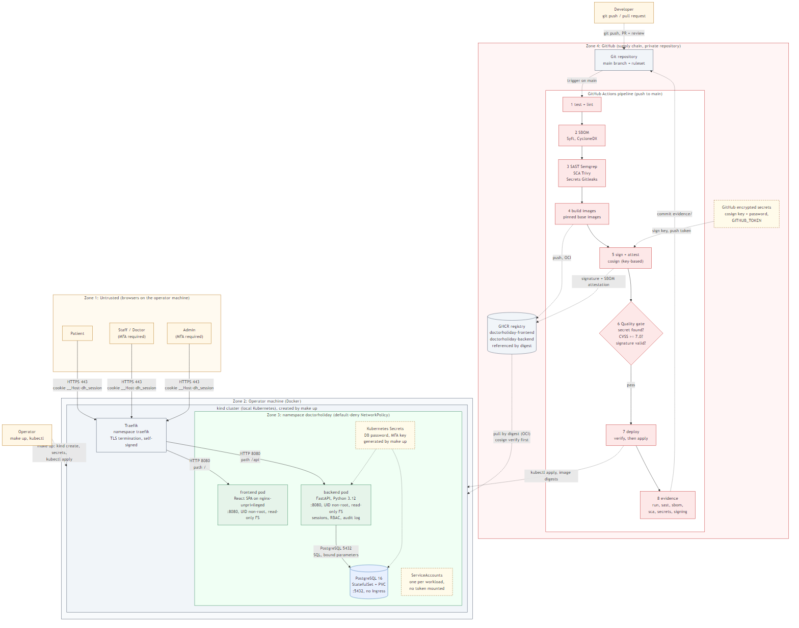

# Doctor Holiday 🩺🏖️

**Doctor Holiday** ist eine kleine, aber vollständige Webanwendung (bestehend aus Frontend und Backend), die als Terminbuchungssystem für eine Arztpraxis dient. Dieses Repository wurde im Rahmen der Prüfungsleistung „Security by Design“ (STG-TINF24F) entwickelt.

Der Schwerpunkt dieses Projekts liegt nicht primär auf der reinen Funktionalität, sondern auf **Security by Design** und einer vollständig nachvollziehbaren, reproduzierbaren Lieferkette (Supply Chain). Vom ersten Commit bis zum Deployment auf einem lokalen Kubernetes-Cluster sind verschiedene Sicherheitsmechanismen tief in den Entwicklungsprozess integriert.

### 🛡️ Core Security Features & DevSecOps

* **Threat Modeling:** Umfassende Bedrohungsanalyse mittels Systemmodellierung (DFD), STRIDE und Attack-Trees zur Identifikation und Mitigation potenzieller Schwachstellen.
* **Sichere CI/CD-Pipeline:** Automatisierte Workflows bei Änderungen am Main-Branch. Die Pipeline umfasst die Erstellung von Software Bill of Materials (SBOMs), Static Application Security Testing (SAST), Software Composition Analysis (SCA) und automatisiertes Secret-Scanning.
* **Image Signing & Quality Gates:** Container-Images werden signiert und verifiziert. Strenge Quality Gates verhindern den Build bei kritischen Findings (CVSS $\ge7.0$) oder fehlenden Signaturen.
* **Kubernetes Security:** Umsetzung des Least-Privilege-Prinzips im Cluster durch dedizierte Namespaces, minimale Service Accounts, restriktive Network Policies und gehärtete Security Contexts (z. B. `runAsNonRoot: true`, `readOnlyRootFilesystem: true`).
* **Secure Coding:** Fokus auf saubere Fehlerbehandlung, strenge Eingabevalidierung und eine sichere Authentifizierung ohne hartcodierte Secrets.

## Inhalt

1. [Überblick](#überblick)
2. [Voraussetzungen](#voraussetzungen)
3. [Schnellstart: `make up`](#schnellstart-make-up)
4. [Makefile-Ziele](#makefile-ziele)
5. [Tests und Scanner lokal ausführen](#tests-und-scanner-lokal-ausführen)
6. [Pipeline, Images und Evidence](#pipeline-images-und-evidence)
7. [Offline-Weg und Fehlerbehebung](#offline-weg-und-fehlerbehebung)
8. [Repository-Struktur](#repository-struktur)
9. [Dokumentation](#dokumentation)

## Überblick



| Komponente | Technik |
| :--- | :--- |
| Frontend | React 18, TypeScript, Vite, ausgeliefert von `nginx-unprivileged` (Port 8080) |
| Backend | Python 3.12, FastAPI, SQLAlchemy 2 (synchron), Argon2id, TOTP; Paketverwaltung mit `uv` |
| Datenbank | PostgreSQL 16, getrennte Rollen für Schema-Besitzer und Anwendung |
| Authentifizierung | serverseitige Sessions im Cookie `__Host-dh_session` (`HttpOnly; Secure; SameSite=Strict`), kein JWT im Browser |
| Cluster | lokaler [kind](https://kind.sigs.k8s.io/)-Cluster, Calico (erzwingt NetworkPolicies), Traefik als Ingress mit TLS |
| Pipeline | GitHub Actions, GHCR, Syft, Semgrep, Trivy, Gitleaks, cosign |

Die Entscheidungen dahinter stehen in den [ADRs](docs/architecture/adr/); Abweichungen von der Aufgabenstellung in [docs/report/deviations.md](docs/report/deviations.md).

## Voraussetzungen

Getestet auf Linux und macOS. **Unter Windows WSL2 (Ubuntu) mit der WSL-Integration von Docker Desktop verwenden**, die Befehle laufen dann im WSL-Terminal.

| Werkzeug | Version | Installation |
| :--- | :--- | :--- |
| Docker (Daemon läuft) | mit BuildKit (aktuelle Docker Engine / Docker Desktop) | <https://docs.docker.com/engine/install/> |
| kind | `v0.33.0` (festgelegt in `infrastructure/kind/versions.env`) | <https://kind.sigs.k8s.io/docs/user/quick-start/#installation> |
| kubectl | höchstens eine Minor-Version Abstand zu Kubernetes 1.35 | <https://kubernetes.io/docs/tasks/tools/> |
| make, bash, openssl, curl, git | übliche Versionen | Paketverwaltung des Systems |
| cosign | 2.x, nur zum manuellen Prüfen der Signaturen (folgt mit [#35](https://github.com/jankrus/doctorholiday/issues/35)) | <https://docs.sigstore.dev/cosign/system_config/installation/> |
| gh | optional, nur für `make evidence` | <https://cli.github.com/> |

Frei sein müssen die Ports **80 und 443** auf `127.0.0.1` (der kind-Knoten bindet sie nur an localhost). `make check-tools` prüft, ob alles vorhanden ist.

Der Cluster braucht für Calico, Traefik, PostgreSQL und die Anwendung einige GB Arbeitsspeicher; Docker Desktop entsprechend ausstatten.

## Schnellstart: `make up`

```sh
git clone https://github.com/jankrus/doctorholiday.git
cd doctorholiday
make up
```

`make up` ist idempotent und führt der Reihe nach aus: prüft die Werkzeuge, erstellt den kind-Cluster, installiert Calico und Traefik (Manifeste per Prüfsumme bzw. Digest festgelegt), legt den Namespace `doctorholiday` mit Pod Security `restricted` an, erzeugt die Secrets zur Laufzeit (nichts davon liegt im Repository), baut die Images aus dem Checkout und lädt sie in den Cluster, wendet die Manifeste an, führt die Datenbank-Migrationen aus und wartet, bis alles bereit ist. Am Ende steht:

```
Ready
  https://doctorholiday.localhost  (self-signed certificate: accept the browser warning or use curl -k)
```

Der erste Lauf dauert einige Minuten (Image-Downloads, Docker-Builds); ein zweiter Lauf verändert nichts.

1. **<https://doctorholiday.localhost> öffnen** (`*.localhost` löst überall auf `127.0.0.1` auf, ein Eintrag in der hosts-Datei ist nicht nötig). Das Zertifikat ist selbstsigniert, die Browserwarnung muss einmal bestätigt werden (Abweichung D-06).
2. **Direkt danach ein Konto registrieren und anmelden.** Der erste erfolgreiche Login auf einem frischen System macht dieses Konto zum `ADMIN` (Prüfungsvorgabe §4, [#15](https://github.com/jankrus/doctorholiday/issues/15)); jede Registrierung legt ein `PATIENT`-Konto an, alle späteren Logins behalten ihre Rolle.
3. Prüfen, dass die Netzwerkrichtlinien greifen: `make verify` (drei Verbindungen müssen blockiert, vier erlaubt sein).
4. Aufräumen: `make down` löscht den Cluster samt Daten.

> **Restrisiko:** Wer nach dem Deployment als Erstes einen Login schafft, wird Admin. Deshalb ist der eigene Login der Schritt direkt nach `make up`; die Begründung steht in [roles-and-permissions.md](docs/architecture/roles-and-permissions.md#bootstrapping-the-first-admin).

`STAFF`- und `DOCTOR`-Testkonten gibt es, bis Einladungen (FR-02) umgesetzt sind, nur über die lokalen Seed-Daten (`make -C backend seed`, siehe [backend/README.md](backend/README.md#seed-data)). Die Seed-Daten tragen ihren eigenen Admin ein, dann wird kein weiterer Login befördert.

Lokale Entwicklung ohne Cluster (Datenbank, Backend und Frontend aus dem Quellcode), manuelle Testszenarien und Fehlerbehebung: [docs/development/local-testing.md](docs/development/local-testing.md). Details zum Cluster: [infrastructure/k8s/README.md](infrastructure/k8s/README.md).

## Makefile-Ziele

`make help` listet alle Ziele. Die wichtigsten:

| Ziel | Wirkung |
| :--- | :--- |
| `make up` | Cluster, Ingress, Secrets, Images, Manifeste, Warten; endet mit `Ready` |
| `make down` | löscht den kind-Cluster und alles darin |
| `make verify` | beweist, dass die NetworkPolicies durchgesetzt werden (3 blockiert, 4 erlaubt) |
| `make status`, `make logs` | Zustand und aktuelle Logs der Anwendung |
| `make cluster`, `cni`, `ingress`, `namespace`, `secrets`, `db-config`, `images`, `deploy`, `wait` | die Einzelschritte von `make up` |
| `make test`, `make lint` | Tests und Linter von Backend und Frontend |
| `make sast-sql` | Semgrep-Regeln des Projekts gegen den Backend-Code |
| `make check-pinning`, `make lint-actions` | prüft, dass Actions per Commit-SHA und Images per Digest festgelegt sind; actionlint und zizmor für die Workflows |
| `make db-up`, `db-down`, `db-reset`, `test-db` | lokale Datenbank für die Entwicklung |
| `make evidence RUN_ID=<id>` | lädt die Berichte eines Pipeline-Laufs nach `evidence/` (braucht `gh`) |
| `make evidence-sync` | kopiert den Branch `evidence` nach `evidence/` für die Abgabe |
| `make package` | baut `team-<nr>.zip` (folgt mit [#51](https://github.com/jankrus/doctorholiday/issues/51)) |

## Tests und Scanner lokal ausführen

```sh
make test          # Backend (pytest gegen PostgreSQL, braucht Docker) und Frontend (Vitest)
make lint          # ruff, ESLint, Prettier
```

Backend und Frontend einzeln: [backend/README.md](backend/README.md) und [frontend/README.md](frontend/README.md).

Die Scanner der Pipeline laufen als per Digest festgelegte Container-Images und sind ohne Installation auf dem Laptop reproduzierbar; die Berichte landen in `reports/<art>/` (nicht im Git):

```sh
scripts/scan.sh sbom      # CycloneDX-SBOM je Komponente (Syft), validiert
scripts/scan.sh sast      # Semgrep
scripts/scan.sh sca       # Trivy über die Lockfiles
scripts/scan.sh secrets   # Gitleaks über die gesamte Historie
```

## Pipeline, Images und Evidence

Jede Änderung an `main` startet [`.github/workflows/ci-cd.yml`](.github/workflows/ci-cd.yml) (Beschreibung: [.github/workflows/README.md](.github/workflows/README.md)): Tests, SBOM, SAST, SCA und Secret-Scan; danach Build und Push nach GHCR, Signatur, Quality Gate, Deployment und Evidence. Pull Requests führen nur Tests, SBOM und Scans aus, nie Build, Signatur oder Deployment.

* **Images:** `ghcr.io/jankrus/doctorholiday-frontend` und `ghcr.io/jankrus/doctorholiday-backend`, Tags `<VERSION>` und `<VERSION>-<Kurz-SHA>` (Version aus `VERSION.txt`), nie `latest`. Die Pipeline arbeitet mit dem Digest; `digest.txt` und `image-ref.txt` liegen in der Evidence. `make up` baut die Images dagegen lokal aus dem Checkout (`IMAGE_SOURCE=local`), damit es ohne Registry-Zugang läuft.
* **Signaturen prüfen** (folgt mit [#35](https://github.com/jankrus/doctorholiday/issues/35) und [#36](https://github.com/jankrus/doctorholiday/issues/36)): `cosign verify --key cosign.pub ghcr.io/jankrus/doctorholiday-backend@sha256:<digest>`, der öffentliche Schlüssel wird mit dem Signaturschritt ins Repository gelegt.
* **Evidence:** `evidence/<image>/{run,sast,sbom,sca,secrets,signing}/<Laufnummer>-<Kurz-SHA>-<Datei>`, je Image ein Verzeichnis, alle Läufe nebeneinander. Die Pipeline schreibt sie in den Branch **`evidence`**, weil `main` per Ruleset nur über geprüfte Pull Requests änderbar ist (Abweichung D-09); vor der Abgabe kopiert `make evidence-sync` sie nach `main`. Siehe [evidence/README.md](evidence/README.md).

## Offline-Weg und Fehlerbehebung

**Ohne GHCR:** `make up` zieht keine Anwendungs-Images aus einer Registry, es baut sie aus dem Checkout und lädt sie mit `kind load` in den Cluster. Nötig bleiben die Downloads der Basis-Images, des kind-Knoten-Images und der Calico-/Traefik-Manifeste. Ein vollständiger Offline-Weg aus dem `.tar` der Abgabe (alle Images vorab geladen) kommt mit dem Paket aus [#51](https://github.com/jankrus/doctorholiday/issues/51).

| Problem | Lösung |
| :--- | :--- |
| `missing tool: …` | das Werkzeug installieren, siehe [Voraussetzungen](#voraussetzungen) |
| `Docker is installed but its daemon is not running` | Docker (Desktop) starten, bei Windows die WSL-Integration aktivieren |
| Port 80 oder 443 belegt (`address already in use` beim Erstellen des Clusters) | den anderen Dienst beenden (Webserver, anderer Cluster) und `make down && make up` |
| `https://doctorholiday.localhost did not answer in time` | `make status` und `make logs` ansehen; meist startet ein Pod noch (Calico oder Traefik); `make up` erneut ausführen |
| Calico wird nicht bereit | Docker mehr Arbeitsspeicher geben, `make down && make up` |
| Pods bleiben `Pending` oder `ImagePullBackOff` | `make images` erneut ausführen; die Images tragen den Tag `dev` und werden nie gezogen |
| Browser meldet ein ungültiges Zertifikat | erwartet (selbstsigniert, D-06); Warnung bestätigen oder `curl -k` verwenden |
| Login als Erstes verpasst | `make down && make up` setzt alles zurück, danach wird der nächste Login Admin |

## Repository-Struktur

| Pfad | Inhalt |
| :--- | :--- |
| `frontend/` | React-SPA und ihr `Dockerfile` |
| `backend/` | FastAPI-API, Migrationen, `openapi.yaml` (API-Vertrag), `Dockerfile` |
| `infrastructure/k8s/` | Kubernetes-Manifeste (Kustomize) |
| `infrastructure/kind/` | kind-Konfiguration, Traefik-Installation, festgelegte Versionen |
| `infrastructure/postgres/` | Rollen-Initialisierung und Migrationslauf der Datenbank |
| `.github/workflows/` | Pipeline-Konfiguration |
| `scripts/` | Hilfsskripte (Scans, Image-Build, Cluster, Evidence) |
| `evidence/` | Berichte der Pipeline-Läufe je Image |
| `docs/` | Architektur, Bedrohungsmodell, Bericht, Entwicklung, Präsentation |
| `VERSION.txt` | SemVer, wird als Image-Tag verwendet |
| `Makefile` | Blaupause des Projekts, `make up` liefert einen gesunden Cluster |

## Dokumentation

* Architektur und Anforderungen: [docs/architecture/](docs/architecture/) (Sicherheitsanforderungen SR-01 bis SR-11 in [security-requirements.md](docs/architecture/security-requirements.md))
* Bedrohungsmodell (DFD, STRIDE, Angriffsbaum): [docs/threat-model/](docs/threat-model/)
* Abweichungen von der Aufgabenstellung: [docs/report/deviations.md](docs/report/deviations.md)
* Konventionen und Regeln für Mitwirkende: [AGENTS.md](AGENTS.md)

### Project planning Kanban Board

[https://github.com/users/jankrus/projects/1/](https://github.com/users/jankrus/projects/1/)
