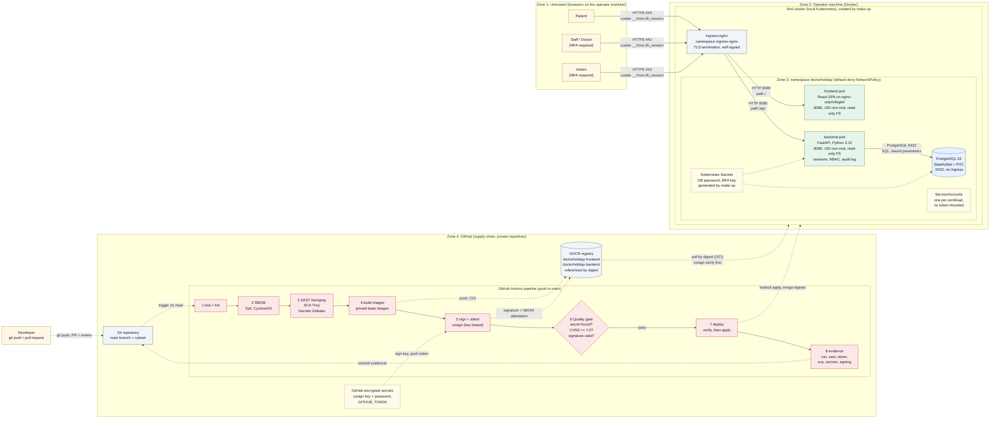

# Architecture

System landscape of Doctor Holiday, from the users through every runtime component to the CI/CD pipeline, and a description of each element in the diagram.

- **Issue:** [#6 – Create the architecture diagram of the full system landscape](https://github.com/jankrus/doctorholiday/issues/6)
- **Grading:** Anforderungen & Architektur → *Architektur(-diagramm)* (5 points) and *Konsistenz Architektur/Umsetzung* (5 points); exam brief §1, §5a, §5b.
- **Builds on:** [ADR-001](adr/ADR-001-tech-stack.md) (stack), [roles-and-permissions.md](roles-and-permissions.md), [requirements.md](requirements.md), [security-requirements.md](security-requirements.md).
- **Feeds:** the system model and DFD ([#7](https://github.com/jankrus/doctorholiday/issues/7)): the zones below are its trust boundaries.
- **Diagram source:** [`architecture.mmd`](architecture.mmd) (Mermaid). The diagram below is a copy of it; if you change one, change the other. GitHub renders both.

> **Status of the diagram.** It shows the target architecture. Elements are marked *implemented*, *in review* or *planned* in the [component catalogue](#component-catalogue). Re-check the diagram against the manifests and the workflow when [#38](https://github.com/jankrus/doctorholiday/issues/38) and [#43](https://github.com/jankrus/doctorholiday/issues/43) are done (consistency criterion).

## Goal

Doctor Holiday is a booking system for **one** medical practice (patients, staff, doctors, admin). The architecture serves the exam focus: security by design and a reproducible supply chain from `git push` to a local Kubernetes cluster. Appointment data is health data (GDPR Art. 9), so the design minimises what is stored, separates components by network policy and keeps every secret out of the repository.

## Tech stack

| Layer | Technology | Decision |
| --- | --- | --- |
| Frontend | React 18, TypeScript, Vite 8, Radix Themes, React Router 7, served by `nginxinc/nginx-unprivileged` | [ADR-001](adr/ADR-001-tech-stack.md), [ADR-004](adr/ADR-004-frontend-libraries.md) |
| Backend | Python 3.12, FastAPI, Pydantic 2, SQLAlchemy 2 (synchronous, psycopg 3), Argon2id, TOTP (`pyotp`) | ADR-001, [ADR-003](adr/ADR-003-synchronous-data-access.md) |
| Python tooling | `uv` with `uv.lock` | [ADR-002](adr/ADR-002-python-package-manager.md) |
| Database | PostgreSQL 16 | ADR-001, [database.md](database.md) |
| Session | Server-side session, cookie `__Host-dh_session` (`HttpOnly; Secure; SameSite=Strict`) | ADR-001 |
| Container images | distroless or Chainguard (backend), `nginx-unprivileged:alpine` (frontend), `postgres:16-alpine`, all pinned by digest | ADR-001 §3.2 |
| Pipeline | GitHub Actions, Syft, Semgrep, Trivy, Gitleaks, cosign, GHCR | ADR-001 §3.3 |
| Runtime | local `kind` cluster with `ingress-nginx` and an enforcing CNI (Calico), driven by the Makefile | ADR-001, [#40](https://github.com/jankrus/doctorholiday/issues/40), [#41](https://github.com/jankrus/doctorholiday/issues/41) |

## Diagram

Legend: solid arrows are runtime data flow, dashed arrows are supply chain or control flow; dashed boxes hold secrets or identities.

## Trust zones

The zones are the trust boundaries of the threat model; every arrow that crosses a zone border is analysed in the STRIDE table ([#8](https://github.com/jankrus/doctorholiday/issues/8)).

| Zone | Contains | Trust level |
| --- | --- | --- |
| Zone 1: untrusted | Browsers of patients, staff, doctors and admins | None. Every request is validated and authorised server-side. |
| Zone 2: operator machine | Docker, the kind cluster, ingress-nginx | Controlled by the operator; ingress is reachable only from this machine (ports 80/443 mapped to localhost). |
| Zone 3: namespace `doctorholiday` | Frontend, backend, PostgreSQL, Secrets, ServiceAccounts | Trusted workloads, separated by a default-deny NetworkPolicy. The database is reachable only from the backend. |
| Zone 4: GitHub | Repository, Actions runners, secrets, GHCR | Trusted for building, but a supply-chain target: protected by review, pinned actions, signing and the quality gate. |

## Data flows

| # | From → to | Protocol, port | Data | Crosses zone | Protection |
| --- | --- | --- | --- | --- | --- |
| F1 | Browser → ingress-nginx | HTTPS 443 | Credentials, session cookie, booking data | 1 → 2 | TLS (self-signed), HSTS, `Secure` cookie |
| F2 | ingress-nginx → frontend | HTTP 8080 | Static SPA files | 2 → 3 | NetworkPolicy allows only the ingress namespace |
| F3 | ingress-nginx → backend | HTTP 8080, path `/api` | JSON API requests | 2 → 3 | NetworkPolicy, validation, authentication, RBAC |
| F4 | backend → PostgreSQL | PostgreSQL 5432 | SQL with bound parameters | inside 3 | NetworkPolicy (only backend), DB user without superuser rights, password from a Secret |
| F5 | Developer → repository | HTTPS (git) | Source code | 1 → 4 | Pull request, review, secret push protection |
| F6 | Repository → pipeline | GitHub internal | Source, `VERSION.txt` | inside 4 | Trigger on `main` only, least-privilege `permissions` |
| F7 | Pipeline → GHCR | HTTPS (OCI) | Images, signatures, SBOM attestations | inside 4 | `GITHUB_TOKEN` with `packages: write` on the push job only |
| F8 | GHCR → kind cluster | HTTPS (OCI) | Images pulled by digest | 4 → 2 | Digest pinning, `cosign verify` before loading, `imagePullSecret` (private repository) |
| F9 | Pipeline deploy job → cluster | Kubernetes API | Manifests with image digests | 4 → 2 | Quality gate must pass, signature verified again in the job |
| F10 | Pipeline → repository | HTTPS (git) | Evidence reports under `evidence/` | inside 4 | `contents: write` on the evidence job only, `paths-ignore` avoids loops |

## Component catalogue

Each element of the diagram: purpose, technology, ports, credentials it holds and its security controls. Status: *implemented* = merged to `main`, *in review* = open pull request, *planned* = issue open.

### Actors

**Patient.** Self-registered user; books, reschedules and cancels own appointments. Uses a browser. Holds a password (and optionally a TOTP device). Controls: Argon2id password policy, rate limiting, optional MFA, object-level authorisation ([SR-01](security-requirements.md#sr-01-strong-authentication-and-session-management), [SR-02](security-requirements.md#sr-02-authorisation-with-default-deny-and-object-level-checks)).

**Staff / Doctor.** Invited by an admin. Staff manage working hours and absences of all doctors and book on behalf of patients; doctors manage only their own schedule. Both MUST use MFA ([SR-09](security-requirements.md#sr-09-multi-factor-authentication-with-totp)).

**Admin.** The first user who logs in becomes admin; manages accounts, settings and audit log. MUST use MFA. Access to appointment data only through a time-limited grant (TBAC). Residual risk of the first-login rule: [roles-and-permissions.md](roles-and-permissions.md#bootstrapping-the-first-admin).

**Developer.** Pushes branches and opens pull requests; never pushes to `main` directly (AGENTS.md). Holds GitHub credentials; no deployment credentials.

### Runtime

**ingress-nginx** (*planned*, [#40](https://github.com/jankrus/doctorholiday/issues/40)). Entry point of the cluster, installed from a pinned upstream manifest in its own namespace. Terminates TLS (self-signed certificate generated at `make up`, never committed) for host `doctorholiday.localhost`, routes `/` to the frontend and `/api` to the backend, redirects HTTP to HTTPS. Ports 80 and 443 are mapped to localhost only. Holds the TLS private key as a Secret. Also provides the client IP that the backend uses for rate limits and audit ([#75](https://github.com/jankrus/doctorholiday/issues/75)).

**Frontend pod** (*app implemented*, container *planned* in [#28](https://github.com/jankrus/doctorholiday/issues/28)/[#38](https://github.com/jankrus/doctorholiday/issues/38)). React single-page application built by Vite, served as static files by `nginx-unprivileged` on port 8080. Talks only to the same origin (`/api`), so no CORS and no cross-site cookies. Holds no secrets: the build reads no `VITE_*` variables. Controls: CSP and safe rendering ([#27](https://github.com/jankrus/doctorholiday/issues/27)), ESLint bans `dangerouslySetInnerHTML` and `eval`, route guards are UX only (the backend authorises), error texts come from a fixed local map. Container: non-root UID, read-only root filesystem, `emptyDir` only for the nginx cache and `/tmp`.

**Backend pod** (*implemented in part*: skeleton, health probes, config and logging are merged; auth and database layer are *in review* in [#69](https://github.com/jankrus/doctorholiday/pull/69) and [#73](https://github.com/jankrus/doctorholiday/pull/73); container *planned*). FastAPI REST API on port 8080, contract in [`backend/openapi.yaml`](../../backend/openapi.yaml). Responsibilities: authentication and sessions, RBAC and object-level checks, availability and appointment logic, admin functions, audit log. Holds `DATABASE_URL` (contains the DB password), `MFA_ENCRYPTION_KEY` and, until [#59](https://github.com/jankrus/doctorholiday/issues/59) decides, `SESSION_SECRET`, all from Kubernetes Secrets via `secretKeyRef`. Controls: Pydantic validation with `extra="forbid"`, parameterised SQL, generic error responses with request ID, structured logs without secrets, no API docs at runtime, fail-fast configuration. Container: distroless or Chainguard image without shell, numeric non-root UID, read-only root filesystem, writes only to `/tmp`.

**PostgreSQL** (*planned*, [#39](https://github.com/jankrus/doctorholiday/issues/39); schema in [#12](https://github.com/jankrus/doctorholiday/issues/12), *in review*). `postgres:16-alpine` as StatefulSet with a PersistentVolumeClaim (kind `standard` storage class). Port 5432 on a ClusterIP service, no Ingress. Holds all application data, including password hashes and the encrypted TOTP secrets in a separate `credentials` table. Application user without superuser rights; credentials from a Kubernetes Secret created by `make up`. Controls: constraints as last line of defence (exclusion constraint against double booking, check constraints), NetworkPolicy allows only the backend, same container hardening as the app pods where the image allows it (otherwise documented in [deviations.md](../report/deviations.md)).

**Kubernetes Secrets** (*planned*, [#30](https://github.com/jankrus/doctorholiday/issues/30)). DB password, `MFA_ENCRYPTION_KEY` in the format `config.py` validates, TLS key. Generated at deploy time (`openssl rand`), never in git, mounted only into the containers that need them. The inventory goes to `docs/architecture/secrets.md` (to be written in #30).

**ServiceAccounts** (*planned*, [#37](https://github.com/jankrus/doctorholiday/issues/37)). One minimal ServiceAccount per workload with no Role bindings and `automountServiceAccountToken: false`, because none of the pods calls the Kubernetes API.

**NetworkPolicies** (*planned*, [#41](https://github.com/jankrus/doctorholiday/issues/41)). `default-deny-all` for ingress and egress in the namespace, then explicit allows: ingress namespace → frontend and backend on 8080, backend → PostgreSQL on 5432, all pods → DNS. The backend gets no internet egress. kind needs an enforcing CNI (Calico) for this to take effect.

**kind cluster and Makefile** (*planned*, [#40](https://github.com/jankrus/doctorholiday/issues/40), [#42](https://github.com/jankrus/doctorholiday/issues/42)). `make up` creates the cluster from `infrastructure/kind/kind-config.yaml`, installs CNI and ingress, creates namespace and secrets, verifies and loads the images, applies the manifests with `kubectl apply -k infrastructure/k8s`, waits for healthy pods and prints `Ready`. It is the reproducible blueprint required by the exam brief.

### Supply chain

**Git repository** (*implemented*). `jankrus/doctorholiday`, private. Ruleset `protect-main`: pull request with review, no force push, no deletion (not technically enforced on the Free tier for private repositories, see [repository_configuration.md](../report/repository_configuration.md)). Secret scanning with push protection and Dependabot alerts are enabled. Required status checks are added once the pipeline exists.

**Pipeline** (*planned*, [#31](https://github.com/jankrus/doctorholiday/issues/31)–[#36](https://github.com/jankrus/doctorholiday/issues/36), [#43](https://github.com/jankrus/doctorholiday/issues/43), [#44](https://github.com/jankrus/doctorholiday/issues/44)). One workflow `.github/workflows/ci-cd.yml`, triggered by pushes to `main`, top-level `permissions` minimal, every action pinned by commit SHA. Jobs run in this order and each failure stops the following jobs:

| Step | Tool | What it does | Output |
| --- | --- | --- | --- |
| 1 test + lint | pytest, ruff, vitest, ESLint | Unit tests and linters of both components | Run log |
| 2 SBOM | Syft | CycloneDX SBOM per image | `evidence/<image>/sbom/` |
| 3 scans | Semgrep (SAST), Trivy (SCA, image), Gitleaks (secrets) | Findings in source, dependencies and history | `sast/`, `sca/`, `secrets/` |
| 4 build | Docker Buildx | Multi-stage images, base images pinned by digest, provenance | Image digests |
| 5 sign | cosign (key-based) | Signs each digest and attaches the SBOM attestation | `signing/` |
| 6 quality gate | script in `scripts/` | Fails on any secret, any finding with CVSS ≥ 7.0 (HIGH/CRITICAL) and any missing or invalid signature | Gate report (JSON) |
| 7 deploy | `make` targets, `cosign verify`, kubectl | Creates a kind cluster, verifies again, applies the manifests, runs smoke tests | Deploy log |
| 8 evidence | git commit-back | Stores all reports of the run in `evidence/<image>/…` | Commit on `main` |

**GitHub encrypted secrets** (*planned*). `COSIGN_PRIVATE_KEY` and `COSIGN_PASSWORD`; registry access uses the short-lived `GITHUB_TOKEN`, no personal access token. Readable only by the sign job. The matching public key `cosign.pub` is committed.

**GHCR** (*planned*, [#34](https://github.com/jankrus/doctorholiday/issues/34)). Container registry between pipeline and cluster, as the exam brief requires. Packages `doctorholiday-frontend` and `doctorholiday-backend`; images are tagged `<VERSION>` and `<VERSION>-<shortsha>` but referenced and deployed only by digest. The repository is private, so the cluster needs an `imagePullSecret` with read access. Holds the signatures next to the images.

## Consistency with the implementation

| Diagram element | In the repository | Status |
| --- | --- | --- |
| Backend API | `backend/` (health, config, logging); auth and DB in PR #69 / #73 | In part |
| Frontend SPA | `frontend/` (skeleton, auth UI) | App implemented, container planned |
| PostgreSQL | migrations in PR #69 | In review |
| Dockerfiles | none yet ([#28](https://github.com/jankrus/doctorholiday/issues/28)) | Planned |
| Kubernetes manifests, NetworkPolicies, ServiceAccounts | `infrastructure/k8s/` contains only a README | Planned |
| kind config, ingress, `make up` | `infrastructure/kind/` README; the Makefile target is a `TODO` | Planned |
| Pipeline | `.github/workflows/` contains only a README | Planned |
| Evidence | `evidence/<image>/…` folders with READMEs | Planned |

Update this table and the diagram whenever one of these rows changes.

## Open points

- The exported `architecture.svg` and `architecture.png` are missing. Render them from `architecture.mmd` (for example with the pinned `@mermaid-js/mermaid-cli`) and commit them next to it.
- Whether the deploy job runs on GitHub Actions against an ephemeral kind cluster (option A in [#43](https://github.com/jankrus/doctorholiday/issues/43)) or only locally through `make up` is decided in #43; the diagram shows the pipeline path.
- GHCR package visibility is private; `imagePullSecret` handling is part of [#34](https://github.com/jankrus/doctorholiday/issues/34) and [#42](https://github.com/jankrus/doctorholiday/issues/42).
