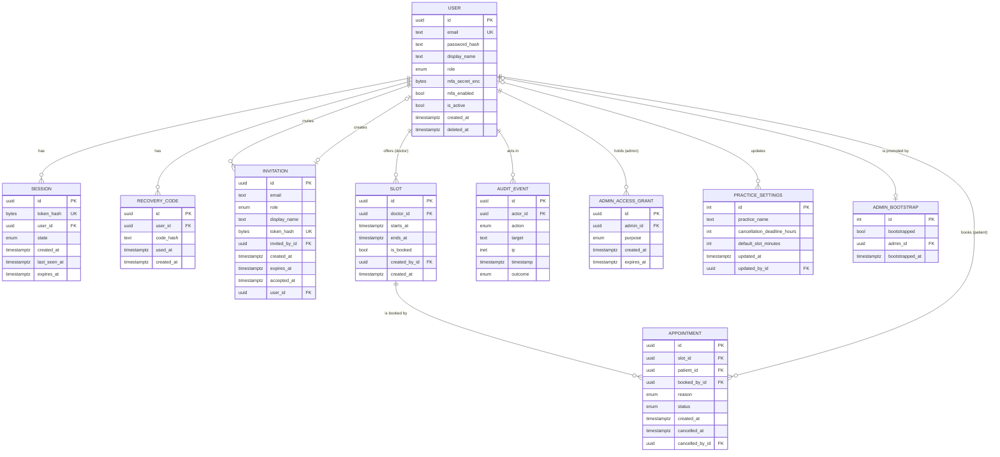
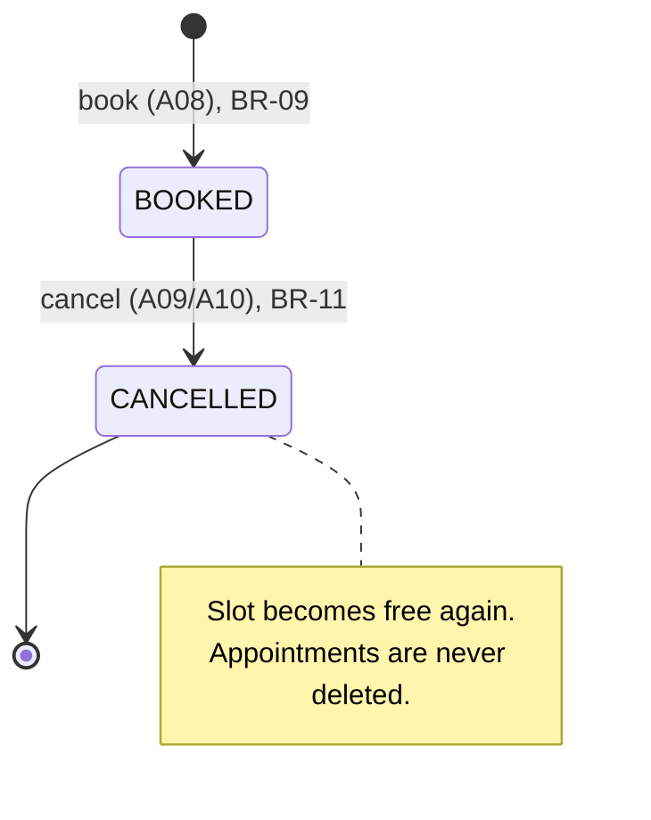

# Functional Requirements, Domain Model and API Contract

This document defines what Doctor Holiday does (functional requirements), which data it keeps (domain model) and how frontend and backend talk to each other (API contract).

- **Issue:** [#4 – Define functional requirements, domain model and API contract (OpenAPI)](https://github.com/jankrus/doctorholiday/issues/4)
- **Grading:** Anforderungen & Architektur → *Umsetzung Anforderungen*, *Konsistenz Architektur/Umsetzung*; basis for input validation (Secure Coding).
- **Builds on:** [ADR-001](adr/ADR-001-tech-stack.md) (stack), [roles-and-permissions.md](roles-and-permissions.md) (roles, permission matrix A01–A29).
- **API contract:** [`backend/openapi.yaml`](../../backend/openapi.yaml) (OpenAPI 3.1). If this document and the spec disagree, the spec is wrong and must be fixed.
- **Implementation:** [#12](https://github.com/jankrus/doctorholiday/issues/12) (schema), [#13](https://github.com/jankrus/doctorholiday/issues/13) (validation, errors), [#14](https://github.com/jankrus/doctorholiday/issues/14)–[#18](https://github.com/jankrus/doctorholiday/issues/18) (endpoints), [#21](https://github.com/jankrus/doctorholiday/issues/21) (MFA), [#24](https://github.com/jankrus/doctorholiday/issues/24)–[#26](https://github.com/jankrus/doctorholiday/issues/26) (UI).

## Scope

Doctor Holiday is a booking system for **one** medical practice. Doctors and staff publish appointment slots, patients book and cancel them, and an admin manages accounts. The scope is deliberately small (exam brief §0, "klein, aber vollständig"); security and traceability matter more than features.

Out of scope: several practices, e-mail or SMS notifications, password reset by e-mail, medical records, calendar sync, payment. A forgotten password is handled by the practice (an admin deactivates the account and the patient registers again; staff accounts are re-invited).

## Functional requirements

Every requirement maps to exactly one action of the [permission matrix](roles-and-permissions.md#permission-matrix) and thereby to exactly one endpoint. Business rules (BR) that several requirements share are listed [below](#business-rules).

### Anonymous visitors

| ID | User story | Action | Endpoint | Rules |
| --- | --- | --- | --- | --- |
| FR-01 | As a visitor I want to register with e-mail and password so that I can book appointments. | A01 | `POST /api/v1/auth/register` | BR-01, BR-02 |
| FR-02 | As an invited practice member I want to accept my invitation and set a password so that I get my account. | A02 | `POST /api/v1/auth/invitations/accept` | BR-01, BR-14 |
| FR-03 | As a user I want to log in with e-mail and password so that I can use the system. The first user who logs in while no admin exists becomes admin. | A03 | `POST /api/v1/auth/login` | BR-03, BR-04, BR-05 |
| FR-04 | As a user with MFA I want to confirm my login with a TOTP code or a recovery code so that a stolen password alone is not enough. | A04 | `POST /api/v1/auth/mfa/verify` | BR-05, BR-07 |

### All logged-in users

| ID | User story | Action | Endpoint | Rules |
| --- | --- | --- | --- | --- |
| FR-05 | As a user I want to enrol a TOTP authenticator and confirm it with a first code so that my account is protected by MFA. I receive ten recovery codes once. | A05, A04 | `POST /api/v1/auth/mfa/enroll`, then `POST /api/v1/auth/mfa/verify` | BR-06, BR-07 |
| FR-06 | As a user I want to log out so that my session ends on this device. | A06 | `POST /api/v1/auth/logout` | BR-05 |
| FR-07 | As a user I want to see my own account and session state so that the UI shows what I may do next. | A22 | `GET /api/v1/auth/me` | BR-05 |
| FR-08 | As a user I want to change my password so that I can rotate it after a suspected leak. | A23 | `POST /api/v1/auth/password` | BR-01, BR-15 |
| FR-09 | As a user I want to see the practice settings (name, cancellation deadline) so that I know the rules. | A26 | `GET /api/v1/settings` | BR-18 |
| FR-10 | As a user I want to see the list of doctors so that I can filter slots by doctor (patients) or create slots for a doctor (staff). | A27 | `GET /api/v1/doctors` | – |
| FR-11 | As a user I want to list free future slots, optionally filtered by doctor and time range. | A07 | `GET /api/v1/slots?free=true` | BR-20 |

### Patients

| ID | User story | Action | Endpoint | Rules |
| --- | --- | --- | --- | --- |
| FR-12 | As a patient I want to book a free slot and pick a reason category so that I get an appointment. | A08 | `POST /api/v1/appointments` | BR-09, BR-10 |
| FR-13 | As a patient I want to list my own appointments. | A11 | `GET /api/v1/appointments/me` | BR-20 |
| FR-14 | As a patient I want to cancel one of my appointments before the cancellation deadline so that the slot becomes free again. | A09 | `POST /api/v1/appointments/{id}/cancel` | BR-11 |
| FR-15 | As a patient I want to delete my account so that my personal data is erased (GDPR Art. 17). | A24 | `POST /api/v1/auth/account/delete` | BR-13 |

### Staff and doctors

| ID | User story | Action | Endpoint | Rules |
| --- | --- | --- | --- | --- |
| FR-16 | As staff I want to create a slot for a doctor; as a doctor I want to create a slot for myself. | A13 | `POST /api/v1/slots` | BR-08 |
| FR-17 | As staff I want to delete any free slot; as a doctor I want to delete my own free slots. | A14 | `DELETE /api/v1/slots/{id}` | BR-12 |
| FR-18 | As staff or doctor I want to see all appointments, filtered by doctor, status and time range. | A12 | `GET /api/v1/appointments` | BR-20 |
| FR-19 | As staff or doctor I want to cancel any appointment that has not started yet. | A10 | `POST /api/v1/appointments/{id}/cancel` | BR-11 |
| FR-20 | As staff I want to book a slot on behalf of a patient identified by e-mail, e.g. for a phone booking. | A08 | `POST /api/v1/appointments` | BR-09, BR-10 |

### Admin

| ID | User story | Action | Endpoint | Rules |
| --- | --- | --- | --- | --- |
| FR-21 | As admin I want to list all users with role and status. | A15 | `GET /api/v1/users` | BR-20 |
| FR-22 | As admin I want to invite a staff member, doctor or further admin by e-mail. | A16 | `POST /api/v1/users/invitations` | BR-14 |
| FR-23 | As admin I want to change the role of a practice member between `STAFF`, `DOCTOR` and `ADMIN`. | A17 | `PATCH /api/v1/users/{id}/role` | BR-15 |
| FR-24 | As admin I want to deactivate a user so that they can no longer log in. | A18 | `POST /api/v1/users/{id}/deactivate` | BR-15 |
| FR-25 | As admin I want to reset another user's MFA after they lost their device and recovery codes. | A25 | `POST /api/v1/users/{id}/mfa/reset` | BR-16 |
| FR-26 | As admin I want to unlock access to appointment data for 30 minutes, stating a purpose, so that I can handle a support case. | A19 | `POST /api/v1/admin/appointment-access` | BR-17 |
| FR-27 | As admin I want to update the practice settings. | A20 | `PUT /api/v1/settings` | BR-18 |
| FR-28 | As admin I want to read the audit log, filtered by action, actor, outcome and time range. | A21 | `GET /api/v1/audit-events` | BR-19, BR-20 |

### Operations

| ID | User story | Action | Endpoint | Rules |
| --- | --- | --- | --- | --- |
| FR-29 | As the Kubernetes kubelet I want a liveness endpoint so that a hung process is restarted. | A28 | `GET /healthz` | BR-21 |
| FR-30 | As the Kubernetes kubelet I want a readiness endpoint that checks the database so that traffic only reaches ready pods. | A29 | `GET /readyz` | BR-21 |

## Business rules

| ID | Rule |
| --- | --- |
| BR-01 | **Passwords** are 12–128 characters long. The upper bound limits Argon2id hashing cost per request. Passwords are stored only as Argon2id hashes and never logged. |
| BR-02 | **Registration does not reveal whether an e-mail is taken.** `POST /auth/register` always answers `202 Accepted` with no body. If the e-mail already exists, no account is created; the password is hashed anyway so response times match. Registration always creates a `PATIENT`. |
| BR-03 | **Login errors are generic.** Wrong e-mail, wrong password and deactivated account all return `401 INVALID_CREDENTIALS`. Login, registration, MFA verification, invitation acceptance and re-authentication are rate limited (`429`, details in #14). |
| BR-04 | **First-admin bootstrap** as defined in [roles-and-permissions.md](roles-and-permissions.md#bootstrapping-the-first-admin): the first successful login while no admin exists promotes that account to `ADMIN`, atomically under a row lock. |
| BR-05 | **Session states.** After a correct password the server creates a session in one of three states: `MFA_PENDING` (MFA enrolled, code still missing), `MFA_ENROLLMENT_REQUIRED` (role `STAFF`/`DOCTOR`/`ADMIN` without MFA) or `ACTIVE`. In `MFA_PENDING` only A04, A06 and A22 are allowed; in `MFA_ENROLLMENT_REQUIRED` only A04, A05, A06 and A22. Every other request returns `403 MFA_REQUIRED`. The session ID is rotated on every state change and on password change (session fixation). |
| BR-06 | **MFA enrolment.** `POST /auth/mfa/enroll` creates a new TOTP secret (RFC 6238, SHA-1, 6 digits, 30 s) and returns it once with an `otpauth://` URI. MFA counts as enabled only after the first valid code was sent to `/auth/mfa/verify`. Calling enroll again before confirmation replaces the unconfirmed secret; calling it with MFA already enabled returns `409 MFA_ALREADY_ENABLED`. The secret is stored encrypted (#21, #30). |
| BR-07 | **Recovery codes.** Confirming the enrolment returns ten single-use recovery codes, exactly once. They are stored only as hashes. A recovery code can replace the TOTP code in `/auth/mfa/verify` during login and is used up afterwards. |
| BR-08 | **Slots.** `endsAt > startsAt`, duration 5–240 minutes, `startsAt` in the future and at most 365 days ahead, both on full minutes. The doctor must be an active `DOCTOR`. Slots of the same doctor must not overlap (`409 SLOT_OVERLAP`). A `DOCTOR` creates slots only for themselves (`doctorId` omitted or equal to their own ID); `STAFF` and `ADMIN` must name the doctor. |
| BR-09 | **Booking.** The slot must exist, be free and start in the future. Booking marks the slot as booked in the same transaction; a database constraint allows at most one `BOOKED` appointment per slot, so concurrent bookings cannot both succeed (`409 SLOT_ALREADY_BOOKED`). A patient may have at most 5 open appointments (`409 APPOINTMENT_LIMIT_REACHED`). A `PATIENT` always books for themselves and must not send `patientEmail` (`403`). `STAFF` must send `patientEmail` of an active `PATIENT`; otherwise `404`. |
| BR-10 | **Reason.** The reason is one category out of `CHECKUP`, `FOLLOW_UP`, `VACCINATION`, `PRESCRIPTION`, `CONSULTATION`, `OTHER`. There is no free text, so no diagnoses or symptoms are stored (data minimisation, GDPR Art. 9) and the field cannot carry injected content. |
| BR-11 | **Cancellation.** Only `BOOKED` appointments whose slot has not started can be cancelled (`409 APPOINTMENT_NOT_CANCELLABLE`). A `PATIENT` may cancel only up to `cancellationDeadlineHours` before the start (`409 CANCELLATION_DEADLINE_PASSED`); `STAFF`, `DOCTOR` and `ADMIN` (with TBAC grant) may cancel until the start. Cancelling frees the slot again. Appointments are never deleted. |
| BR-12 | **Deleting slots.** Only free slots can be deleted (`409 SLOT_ALREADY_BOOKED`); a booked slot has to be cancelled first. A `DOCTOR` gets `404` for slots of other doctors. |
| BR-13 | **Account deletion.** Only a `PATIENT` can delete their own account, and only after re-entering the password (`403 REAUTHENTICATION_FAILED`). In one transaction: all future `BOOKED` appointments are cancelled, e-mail, display name, password hash, MFA secret and recovery codes are erased, the account is deactivated and all sessions are deleted. Past appointments and audit events keep only the pseudonymous user ID. Staff accounts are deactivated by an admin instead (A18). |
| BR-14 | **Invitations.** Rules from [roles-and-permissions.md](roles-and-permissions.md#permission-matrix) footnote 1: the token is random (32 bytes, base64url), single use, valid 72 hours, stored only as a hash and sent in the request body. The admin receives it once in the response and hands it over out of band. The role and e-mail come from the invitation, never from the accept request. Inviting an e-mail that already has an account returns `409 CONFLICT`. |
| BR-15 | **Role changes and deactivation** follow the [role assignment rules](roles-and-permissions.md#role-assignment-rules), including the last-admin protection (`409 LAST_ADMIN`) and the ban on promoting `PATIENT` accounts (`409 ROLE_CHANGE_NOT_ALLOWED`). A role change, deactivation or password change deletes all other sessions of the user. |
| BR-16 | **MFA reset.** An admin can reset the MFA of another user, never their own (`403`); own recovery uses the recovery codes. The reset deletes TOTP secret, recovery codes and all sessions of the user. A `STAFF`, `DOCTOR` or `ADMIN` must enrol again at the next login. |
| BR-17 | **Time-based admin access (TBAC)** as defined in [roles-and-permissions.md](roles-and-permissions.md#admin-and-health-data-rbac--tbac): a grant lasts 30 minutes and needs a purpose. While a grant is active, creating another returns `409 ACCESS_GRANT_ACTIVE`. Without an active grant, A10 and A12 return `403 ACCESS_GRANT_REQUIRED`. `GET /auth/me` shows the expiry of the active grant. |
| BR-18 | **Practice settings** form a single record: practice name (1–100 characters), cancellation deadline (0–168 hours, default 24) and default slot length for the UI (5–240 minutes, default 15). |
| BR-19 | **Audit log.** Security-relevant events are recorded with actor, action, target, client IP, timestamp and outcome: login success/failure, MFA enrolment/verification/reset, bootstrap, invitation, role change, deactivation, password change, account deletion, bookings and cancellations, slot changes, TBAC grants and every appointment access under a grant, settings changes and authorisation denials. Audit events never contain passwords, session IDs, tokens, TOTP secrets, recovery codes or request bodies (details in #20). |
| BR-20 | **Lists are paginated** with `limit` (1–100, default 20) and `offset` (0–10 000). Lists are sorted by time; free slots and appointments ascending by start, users by creation, audit events descending by timestamp. Time filters `from`/`to` are inclusive/exclusive. |
| BR-21 | **Health endpoints** live outside `/api/v1` because they are infrastructure, not API. They need no authentication and return only a status word, no versions, hostnames or error details. `/readyz` returns `503` when the database is unreachable. |

## API conventions

These conventions apply to every endpoint in [`backend/openapi.yaml`](../../backend/openapi.yaml).

- **Versioning:** All business endpoints live under `/api/v1`. Breaking changes require `/api/v2`.
- **Format:** JSON (`application/json`, UTF-8) with camelCase field names. Timestamps are ISO 8601 / RFC 3339 in UTC (`2026-10-07T09:30:00Z`). IDs are random UUIDs, so they cannot be enumerated.
- **Strict input:** Every request body sets `additionalProperties: false` (Pydantic `extra="forbid"`): unknown fields are rejected, not ignored. Every string has a `maxLength`, IDs are `format: uuid`, e-mails `format: email`, codes and tokens have a `pattern`, and closed value sets are enums. Query parameters are bounded the same way.
- **Authentication:** Server-side session in the cookie `__Host-dh_session` (`HttpOnly; Secure; SameSite=Strict; Path=/`), see ADR-001. The `__Host-` prefix makes the browser refuse the cookie without `Secure` or with a `Domain` attribute. CSRF protection beyond `SameSite=Strict` is decided in #19.
- **Authorisation:** Each operation names its actions (`x-action`), allowed roles (`x-roles`), roles restricted to own resources (`x-own-only`), roles that additionally need a TBAC grant (`x-tbac`) and allowed session states (`x-session-states`). These extensions are the machine-readable copy of the permission matrix and feed the role × endpoint tests in #16.
- **Errors:** Every error uses one schema and never contains stack traces, SQL, file paths or library names:

  ```json
  { "error": { "code": "SLOT_ALREADY_BOOKED", "message": "This slot is no longer available.", "requestId": "3f2c9a4e-…" } }
  ```

  `code` is a stable, machine-readable enum for the frontend; `message` is a short generic English text; `requestId` correlates the response with the server log. Every response also carries the `X-Request-Id` header.

  | Status | Meaning |
  | --- | --- |
  | `400` | Semantically invalid credential material: `INVALID_MFA_CODE`, `INVALID_INVITATION` |
  | `401` | No valid session (`UNAUTHENTICATED`) or failed login (`INVALID_CREDENTIALS`) |
  | `403` | Role or session state not allowed (`FORBIDDEN`, `MFA_REQUIRED`, `ACCESS_GRANT_REQUIRED`, `REAUTHENTICATION_FAILED`) |
  | `404` | Resource does not exist **or** belongs to someone else (`NOT_FOUND`) |
  | `409` | Business rule conflict (codes listed in the BR table) |
  | `413` | Request body too large (`PAYLOAD_TOO_LARGE`) |
  | `422` | Schema validation failed (`VALIDATION_ERROR`) |
  | `429` | Rate limit hit (`RATE_LIMITED`, with `Retry-After`) |
  | `500` / `503` | `INTERNAL_ERROR` / `SERVICE_UNAVAILABLE`, details only in the log |

- **Caching:** Responses that contain personal data, secrets or tokens set `Cache-Control: no-store`.

## Domain model

The model below is the logical model; #12 turns it into SQLAlchemy models and migrations. Column names are snake_case in the database and camelCase in the API (`starts_at` ↔ `startsAt`). `start`/`end` from the issue are named `starts_at`/`ends_at` because `END` is an SQL keyword.

### Entities

**User** – every account, regardless of role.

| Field | Type | Constraints / notes |
| --- | --- | --- |
| `id` | UUID | PK, random |
| `email` | text | unique (case-insensitive), max 254; `NULL` only after account deletion |
| `password_hash` | text | Argon2id; `NULL` only after account deletion |
| `display_name` | text | optional, max 100 |
| `role` | enum | `PATIENT`, `STAFF`, `DOCTOR`, `ADMIN` |
| `mfa_secret_enc` | bytes | TOTP secret, encrypted with a key from the environment; `NULL` if not enrolled |
| `mfa_enabled` | bool | `true` only after the first valid code |
| `is_active` | bool | `false` after deactivation or deletion |
| `created_at` | timestamptz | |
| `deleted_at` | timestamptz | set by account deletion (BR-13) |

**Session** – server-side session; the cookie only holds the random token.

| Field | Type | Constraints / notes |
| --- | --- | --- |
| `id` | UUID | PK |
| `token_hash` | bytes | SHA-256 of the cookie value, unique; the raw token is never stored |
| `user_id` | UUID | FK → User |
| `state` | enum | `MFA_PENDING`, `MFA_ENROLLMENT_REQUIRED`, `ACTIVE` |
| `created_at`, `last_seen_at`, `expires_at` | timestamptz | idle and absolute timeout, values set in #14 |

**RecoveryCode** – MFA recovery codes (BR-07).

| Field | Type | Constraints / notes |
| --- | --- | --- |
| `id` | UUID | PK |
| `user_id` | UUID | FK → User |
| `code_hash` | text | hash of the code |
| `used_at` | timestamptz | `NULL` until used |
| `created_at` | timestamptz | |

**Invitation** – admin invitation for `STAFF`, `DOCTOR` or `ADMIN` (BR-14).

| Field | Type | Constraints / notes |
| --- | --- | --- |
| `id` | UUID | PK |
| `email` | text | max 254 |
| `role` | enum | `STAFF`, `DOCTOR`, `ADMIN` |
| `display_name` | text | max 100 |
| `token_hash` | bytes | SHA-256 of the token, unique |
| `invited_by_id` | UUID | FK → User |
| `created_at`, `expires_at` | timestamptz | `expires_at = created_at + 72 h` |
| `accepted_at` | timestamptz | `NULL` until used; single use |
| `user_id` | UUID | FK → User created on acceptance |

**Slot** – a bookable time window of one doctor.

| Field | Type | Constraints / notes |
| --- | --- | --- |
| `id` | UUID | PK |
| `doctor_id` | UUID | FK → User with role `DOCTOR` |
| `starts_at`, `ends_at` | timestamptz | `ends_at > starts_at`; no overlap per doctor (exclusion constraint) |
| `is_booked` | bool | kept in sync with Appointment in the same transaction |
| `created_by_id` | UUID | FK → User |
| `created_at` | timestamptz | |

**Appointment** – a booking of one slot by one patient.

| Field | Type | Constraints / notes |
| --- | --- | --- |
| `id` | UUID | PK |
| `slot_id` | UUID | FK → Slot; partial unique index `WHERE status = 'BOOKED'` |
| `patient_id` | UUID | FK → User with role `PATIENT` |
| `booked_by_id` | UUID | FK → User (patient or staff) |
| `reason` | enum | BR-10, bounded by design |
| `status` | enum | `BOOKED`, `CANCELLED` |
| `created_at` | timestamptz | |
| `cancelled_at` | timestamptz | `NULL` while booked |
| `cancelled_by_id` | UUID | FK → User |

**AuditEvent** – append-only security log (BR-19).

| Field | Type | Constraints / notes |
| --- | --- | --- |
| `id` | UUID | PK |
| `actor_id` | UUID | FK → User; `NULL` for anonymous requests |
| `action` | enum | e.g. `LOGIN`, `ROLE_CHANGED`, `APPOINTMENT_BOOKED` (full list in the spec) |
| `target` | text | `<type>:<uuid>`, max 100; no personal data |
| `ip` | inet | client IP |
| `timestamp` | timestamptz | |
| `outcome` | enum | `SUCCESS`, `FAILURE`, `DENIED` |

**AdminAccessGrant** – time-limited admin access to appointment data (BR-17).

| Field | Type | Constraints / notes |
| --- | --- | --- |
| `id` | UUID | PK |
| `admin_id` | UUID | FK → User with role `ADMIN` |
| `purpose` | enum | `SUPPORT_REQUEST`, `INCIDENT_RESPONSE`, `DATA_SUBJECT_REQUEST`, `AUDIT` |
| `created_at`, `expires_at` | timestamptz | `expires_at = created_at + 30 min` |

**PracticeSettings** – single row (BR-18).

| Field | Type | Constraints / notes |
| --- | --- | --- |
| `id` | int | always `1` (check constraint) |
| `practice_name` | text | 1–100 |
| `cancellation_deadline_hours` | int | 0–168 |
| `default_slot_minutes` | int | 5–240 |
| `updated_at` | timestamptz | |
| `updated_by_id` | UUID | FK → User |

**AdminBootstrap** – single row that serialises the first-admin bootstrap (BR-04).

| Field | Type | Constraints / notes |
| --- | --- | --- |
| `id` | int | always `1` |
| `bootstrapped` | bool | locked with `SELECT … FOR UPDATE` during login |
| `admin_id` | UUID | FK → User promoted by the bootstrap |
| `bootstrapped_at` | timestamptz | |

### ER diagram



### Appointment lifecycle



## Traceability: permission matrix ↔ endpoints

Each row of the permission matrix maps to exactly one operation in the spec; each operation lists its roles in `x-roles`. A09/A10 and A04 (login and enrolment confirmation) share one endpoint each, as defined in #3.

| Action | Endpoint | `operationId` | FR |
| --- | --- | --- | --- |
| A01 | `POST /api/v1/auth/register` | `register` | FR-01 |
| A02 | `POST /api/v1/auth/invitations/accept` | `acceptInvitation` | FR-02 |
| A03 | `POST /api/v1/auth/login` | `login` | FR-03 |
| A04 | `POST /api/v1/auth/mfa/verify` | `verifyMfa` | FR-04, FR-05 |
| A05 | `POST /api/v1/auth/mfa/enroll` | `enrollMfa` | FR-05 |
| A06 | `POST /api/v1/auth/logout` | `logout` | FR-06 |
| A07 | `GET /api/v1/slots?free=true` | `listFreeSlots` | FR-11 |
| A08 | `POST /api/v1/appointments` | `bookAppointment` | FR-12, FR-20 |
| A09, A10 | `POST /api/v1/appointments/{id}/cancel` | `cancelAppointment` | FR-14, FR-19 |
| A11 | `GET /api/v1/appointments/me` | `listMyAppointments` | FR-13 |
| A12 | `GET /api/v1/appointments` | `listAppointments` | FR-18 |
| A13 | `POST /api/v1/slots` | `createSlot` | FR-16 |
| A14 | `DELETE /api/v1/slots/{id}` | `deleteSlot` | FR-17 |
| A15 | `GET /api/v1/users` | `listUsers` | FR-21 |
| A16 | `POST /api/v1/users/invitations` | `inviteUser` | FR-22 |
| A17 | `PATCH /api/v1/users/{id}/role` | `changeUserRole` | FR-23 |
| A18 | `POST /api/v1/users/{id}/deactivate` | `deactivateUser` | FR-24 |
| A19 | `POST /api/v1/admin/appointment-access` | `grantAppointmentAccess` | FR-26 |
| A20 | `PUT /api/v1/settings` | `updateSettings` | FR-27 |
| A21 | `GET /api/v1/audit-events` | `listAuditEvents` | FR-28 |
| A22 | `GET /api/v1/auth/me` | `getCurrentSession` | FR-07 |
| A23 | `POST /api/v1/auth/password` | `changePassword` | FR-08 |
| A24 | `POST /api/v1/auth/account/delete` | `deleteOwnAccount` | FR-15 |
| A25 | `POST /api/v1/users/{id}/mfa/reset` | `resetUserMfa` | FR-25 |
| A26 | `GET /api/v1/settings` | `getSettings` | FR-09 |
| A27 | `GET /api/v1/doctors` | `listDoctors` | FR-10 |
| A28 | `GET /healthz` | `liveness` | FR-29 |
| A29 | `GET /readyz` | `readiness` | FR-30 |

## Validating the spec

```sh
cd backend && npx @redocly/cli@2.60.0 lint openapi.yaml
```

The CLI version is pinned (supply chain). `backend/.redocly.lint-ignore.yaml` records the only accepted exception: the health probes have no `4xx` response because they take no input and need no authentication.
