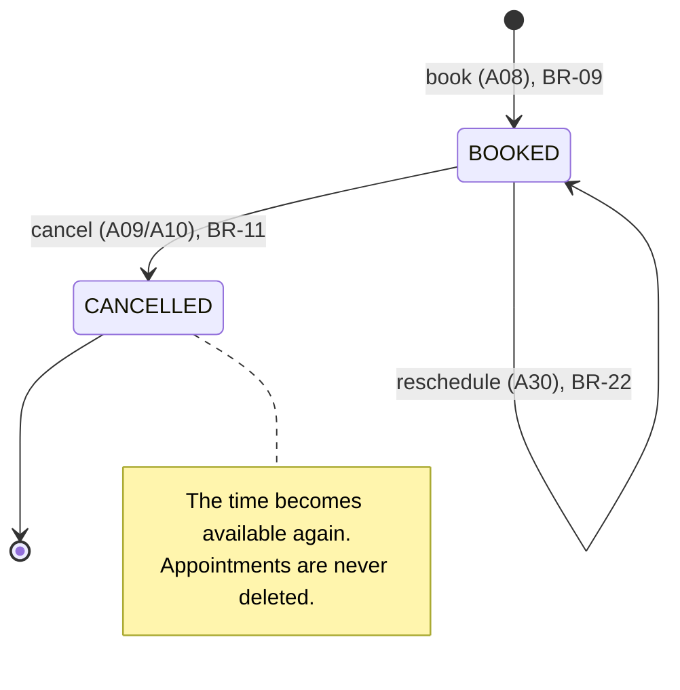

# Functional Requirements, Domain Model and API Contract

This document defines what Doctor Holiday does (functional requirements), which data it keeps (domain model) and how frontend and backend talk to each other (API contract).

- **Issue:** [#4 – Define functional requirements, domain model and API contract (OpenAPI)](https://github.com/jankrus/doctorholiday/issues/4)
- **Grading:** Anforderungen & Architektur → *Umsetzung Anforderungen*, *Konsistenz Architektur/Umsetzung*; basis for input validation (Secure Coding).
- **Builds on:** [ADR-001](adr/ADR-001-tech-stack.md) (stack), [roles-and-permissions.md](roles-and-permissions.md) (roles, permission matrix A01–A35).
- **API contract:** [`backend/openapi.yaml`](../../backend/openapi.yaml) (OpenAPI 3.1). If this document and the spec disagree, the spec is wrong and must be fixed.
- **Implementation:** [#12](https://github.com/jankrus/doctorholiday/issues/12) (schema), [#13](https://github.com/jankrus/doctorholiday/issues/13) (validation, errors), [#14](https://github.com/jankrus/doctorholiday/issues/14)–[#18](https://github.com/jankrus/doctorholiday/issues/18) (endpoints), [#21](https://github.com/jankrus/doctorholiday/issues/21) (MFA), [#24](https://github.com/jankrus/doctorholiday/issues/24)–[#26](https://github.com/jankrus/doctorholiday/issues/26) (UI).

## Scope

Doctor Holiday is a booking system for **one** medical practice. Doctors and staff maintain each doctor's weekly working hours and block times of absence; the free times inside the working hours are offered for booking. Patients book, reschedule and cancel appointments; patients who do not want an account are booked as guests by the practice. An admin manages accounts. The scope is deliberately small (exam brief §0, "klein, aber vollständig"); security and traceability matter more than features.

Out of scope: several practices, e-mail or SMS notifications, password reset by e-mail, medical records, calendar sync, payment. A forgotten password is reset with a one-time code that the practice hands over in person or by phone (BR-25).

## Functional requirements

Every requirement maps to at least one action of the [permission matrix](roles-and-permissions.md#permission-matrix), and every action to exactly one endpoint ([traceability](#traceability-permission-matrix--endpoints)). Business rules (BR) that several requirements share are listed [below](#business-rules).

### Anonymous visitors

| ID | User story | Action | Endpoint | Rules |
| --- | --- | --- | --- | --- |
| FR-01 | As a visitor I want to register with e-mail and password so that I can book appointments. | A01 | `POST /api/v1/auth/register` | BR-01, BR-02 |
| FR-02 | As an invited practice member I want to accept my invitation and set a password so that I get my account. | A02 | `POST /api/v1/auth/invitations/accept` | BR-01, BR-14 |
| FR-03 | As a user I want to log in with e-mail and password so that I can use the system. The first user who logs in while no admin exists becomes admin. | A03 | `POST /api/v1/auth/login` | BR-03, BR-04, BR-05 |
| FR-04 | As a user with MFA I want to confirm my login with a TOTP code or a recovery code so that a stolen password alone is not enough. | A04 | `POST /api/v1/auth/mfa/verify` | BR-05, BR-07 |
| FR-39 | As a user who forgot their password I want to set a new one with a one-time code from the practice so that I keep my account and appointments. | A35 | `POST /api/v1/auth/password-reset` | BR-01, BR-25 |

### All logged-in users

| ID | User story | Action | Endpoint | Rules |
| --- | --- | --- | --- | --- |
| FR-05 | As a user I want to enrol a TOTP authenticator and confirm it with a first code so that my account is protected by MFA. I receive ten recovery codes once. | A05, A04 | `POST /api/v1/auth/mfa/enroll`, then `POST /api/v1/auth/mfa/verify` | BR-06, BR-07 |
| FR-06 | As a user I want to log out so that my session ends on this device. | A06 | `POST /api/v1/auth/logout` | BR-05 |
| FR-07 | As a user I want to see my own account and session state so that the UI shows what I may do next. | A22 | `GET /api/v1/auth/me` | BR-05 |
| FR-08 | As a user I want to change my password so that I can rotate it after a suspected leak. | A23 | `POST /api/v1/auth/password` | BR-01, BR-15 |
| FR-09 | As a user I want to see the practice settings (name, cancellation deadline, appointment length) so that I know the rules. | A26 | `GET /api/v1/settings` | BR-18 |
| FR-10 | As a user I want to see the names of the doctors so that I can pick one as a filter (patients) or choose whose schedule to manage (staff). | A27 | `GET /api/v1/doctors` | – |
| FR-11 | As a user I want to see which doctor is available when in a time range, optionally for one doctor, so that I can pick a time to book (FR-12). | A07 | `GET /api/v1/availability` | BR-20, BR-23 |

### Patients

| ID | User story | Action | Endpoint | Rules |
| --- | --- | --- | --- | --- |
| FR-12 | As a patient I want to book an available time of a doctor and pick a reason category so that I get an appointment. | A08 | `POST /api/v1/appointments` | BR-09, BR-10 |
| FR-13 | As a patient I want to list my own appointments. | A11 | `GET /api/v1/appointments/me` | BR-20 |
| FR-14 | As a patient I want to cancel one of my appointments before the cancellation deadline so that the time becomes available again. | A09 | `POST /api/v1/appointments/{id}/cancel` | BR-11 |
| FR-31 | As a patient I want to move one of my appointments to another available time before the cancellation deadline so that I do not risk losing it by cancelling first. | A30 | `POST /api/v1/appointments/{id}/reschedule` | BR-22 |
| FR-15 | As a patient I want to delete my account so that my personal data is erased (GDPR Art. 17). | A24 | `POST /api/v1/auth/account/delete` | BR-13 |

### Staff and doctors

| ID | User story | Action | Endpoint | Rules |
| --- | --- | --- | --- | --- |
| FR-16 | As staff I want to set the weekly working hours of a doctor; as a doctor I want to set my own, so that patients can book inside them. | A13 | `PUT /api/v1/doctors/{id}/working-hours` | BR-08 |
| FR-17 | As staff I want to block a time range of a doctor (vacation, training, illness); as a doctor I want to block my own time. | A14 | `POST /api/v1/absences` | BR-12 |
| FR-33 | As staff or doctor I want to remove an absence so that the time becomes bookable again. | A31 | `DELETE /api/v1/absences/{id}` | BR-12 |
| FR-34 | As staff or doctor I want to see a doctor's working hours and absences (doctors only their own). | A32 | `GET /api/v1/doctors/{id}/schedule` | BR-08, BR-12 |
| FR-18 | As staff or doctor I want to see all appointments, filtered by doctor, status and time range. | A12 | `GET /api/v1/appointments` | BR-20 |
| FR-19 | As staff or doctor I want to cancel any appointment that has not started yet. | A10 | `POST /api/v1/appointments/{id}/cancel` | BR-11 |
| FR-20 | As staff I want to book an appointment on behalf of a patient identified by e-mail, e.g. for a phone booking. | A08 | `POST /api/v1/appointments` | BR-09, BR-10 |
| FR-35 | As staff I want to book an appointment for a guest who does not want an account, identified by name and phone number, so that everyone can get an appointment. | A08 | `POST /api/v1/appointments` | BR-09, BR-10, BR-24 |
| FR-32 | As staff or doctor I want to move any appointment that has not started yet to another available time, e.g. when a doctor is unavailable. | A30 | `POST /api/v1/appointments/{id}/reschedule` | BR-22 |
| FR-37 | As staff I want to issue a one-time password reset code for a patient who forgot their password and proved their identity in person or by phone. | A34 | `POST /api/v1/users/password-reset-codes` | BR-25 |

### Admin

| ID | User story | Action | Endpoint | Rules |
| --- | --- | --- | --- | --- |
| FR-21 | As admin I want to list all users with role and status. | A15 | `GET /api/v1/users` | BR-20 |
| FR-22 | As admin I want to invite a staff member, doctor or further admin by e-mail. | A16 | `POST /api/v1/users/invitations` | BR-14 |
| FR-23 | As admin I want to change the role of a practice member between `STAFF`, `DOCTOR` and `ADMIN`. | A17 | `PATCH /api/v1/users/{id}/role` | BR-15 |
| FR-24 | As admin I want to deactivate a user so that they can no longer log in. | A18 | `POST /api/v1/users/{id}/deactivate` | BR-15 |
| FR-36 | As admin I want to reactivate a deactivated user so that they can log in again. | A33 | `POST /api/v1/users/{id}/reactivate` | BR-15 |
| FR-38 | As admin I want to issue a one-time password reset code for any other user who forgot their password. | A34 | `POST /api/v1/users/password-reset-codes` | BR-25 |
| FR-25 | As admin I want to reset another user's MFA after they lost their device and recovery codes. | A25 | `POST /api/v1/users/{id}/mfa/reset` | BR-16 |
| FR-26 | As admin I want to unlock access to appointment data for 30 minutes, stating a purpose, so that I can handle a support case. | A19 | `POST /api/v1/admin/appointment-access` | BR-17 |
| FR-27 | As admin I want to update the practice settings. | A20 | `PUT /api/v1/settings` | BR-18 |
| FR-28 | As admin I want to read the audit log, filtered by action, actor, outcome and time range. | A21 | `GET /api/v1/audit-events` | BR-19, BR-20 |

### Operations

| ID | User story | Action | Endpoint | Rules |
| --- | --- | --- | --- | --- |
| FR-29 | As the Kubernetes kubelet I want a liveness endpoint so that a hung process is restarted. | A28 | `GET /healthz` | BR-21 |
| FR-30 | As the Kubernetes kubelet I want a readiness endpoint that checks the database so that traffic only reaches ready pods. | A29 | `GET /readyz` | BR-21 |

## Business rules

| ID | Rule |
| --- | --- |
| BR-01 | **Passwords** are 12–128 characters long. The long maximum allows passphrases and password managers (NIST SP 800-63B requires at least 64); it only limits Argon2id hashing cost per request. Passwords are stored only as Argon2id hashes, whose length is fixed regardless of the password length, and never logged. |
| BR-02 | **Registration does not reveal whether an e-mail is taken.** `POST /auth/register` always answers `202 Accepted` with no body. If the e-mail already exists, no account is created; the password is hashed anyway so response times match. Registration always creates a `PATIENT`. |
| BR-03 | **Login errors are generic.** Wrong e-mail, wrong password and deactivated account all return `401 INVALID_CREDENTIALS`. Login, registration, MFA verification, invitation acceptance, password reset and re-authentication are rate limited (`429`, details in #14). |
| BR-04 | **First-admin bootstrap** as defined in [roles-and-permissions.md](roles-and-permissions.md#bootstrapping-the-first-admin): the first successful login while no admin exists promotes that account to `ADMIN`, atomically under a row lock. |
| BR-05 | **Session states.** After a correct password the server creates a session in one of three states: `MFA_PENDING` (MFA enrolled, code still missing), `MFA_ENROLLMENT_REQUIRED` (role `STAFF`/`DOCTOR`/`ADMIN` without MFA) or `ACTIVE`. In `MFA_PENDING` only A04, A06 and A22 are allowed; in `MFA_ENROLLMENT_REQUIRED` only A04, A05, A06 and A22. Every other request returns `403 MFA_REQUIRED`. `GET /auth/me` returns the account only in `ACTIVE`; before that it returns the session state alone. The session ID is rotated on every state change and on password change (session fixation). |
| BR-06 | **MFA enrolment.** `POST /auth/mfa/enroll` creates a new TOTP secret (RFC 6238, SHA-1, 6 digits, 30 s) and returns it once with an `otpauth://` URI. MFA counts as enabled only after the first valid code was sent to `/auth/mfa/verify`. Calling enroll again before confirmation replaces the unconfirmed secret; calling it with MFA already enabled returns `409 MFA_ALREADY_ENABLED`. Sending a code to `/auth/mfa/verify` while the account has neither MFA nor an unconfirmed secret returns `409 MFA_NOT_ENABLED`; in practice this concerns patients, who use MFA voluntarily, and staff roles only if they call verify before enroll. The secret is stored encrypted (#21, #30). |
| BR-07 | **Recovery codes.** Confirming the enrolment returns ten single-use recovery codes, exactly once. They are stored only as hashes. A recovery code can replace the TOTP code in `/auth/mfa/verify` during login and is used up afterwards. |
| BR-08 | **Working hours** are a weekly schedule per doctor: entries of weekday (1 = Monday … 7 = Sunday), start and end time as local time in the practice time zone (`Europe/Berlin`), on full 5 minutes, `endTime > startTime`. A weekday may have up to 5 entries (e.g. 08:00–12:00 and 14:00–18:00); entries of the same weekday must not overlap (`409 WORKING_HOURS_OVERLAP`). `PUT` replaces the whole schedule in one transaction. Changing working hours never touches booked appointments; times outside the new hours are simply no longer offered. The doctor must be an active `DOCTOR`; a `DOCTOR` sets only their own hours. |
| BR-09 | **Booking.** `startsAt` must be an available time of the named doctor (BR-23), otherwise `409 TIME_NOT_AVAILABLE`; the server sets `endsAt = startsAt + appointmentMinutes`. A database exclusion constraint forbids overlapping `BOOKED` appointments of the same doctor, so concurrent bookings of the same time cannot both succeed (`409 TIME_ALREADY_BOOKED`). A patient may have at most 5 open appointments (`409 APPOINTMENT_LIMIT_REACHED`). A `PATIENT` always books for themselves and must send neither `patientEmail` nor `guest` (`403`). `STAFF` sends exactly one of them (both or none: `422`): `patientEmail` of an active `PATIENT` (otherwise `404`) or `guest` (BR-24). |
| BR-10 | **Reason.** The reason is one category out of `CHECKUP`, `FOLLOW_UP`, `VACCINATION`, `PRESCRIPTION`, `CONSULTATION`, `BLOOD_TEST`, `BLOOD_TEST_FASTING`, `OTHER`; `BLOOD_TEST_FASTING` lets the UI remind the patient to come fasting. There is no free text, so no diagnoses or symptoms are stored (data minimisation, GDPR Art. 9) and the field cannot carry injected content. |
| BR-11 | **Cancellation.** Only `BOOKED` appointments that have not started can be cancelled (`409 APPOINTMENT_NOT_CANCELLABLE`). A `PATIENT` may cancel only up to `cancellationDeadlineHours` before the start (`409 CANCELLATION_DEADLINE_PASSED`); `STAFF`, `DOCTOR` and `ADMIN` (with TBAC grant) may cancel until the start. Cancelling makes the time available again. Appointments are never deleted. |
| BR-12 | **Absences** block a time range of one doctor: `endsAt > startsAt`, both on full minutes, at most 90 days long, `endsAt` in the future and `startsAt` at most 365 days ahead. No reason is stored (data minimisation). An absence that overlaps `BOOKED` appointments is rejected (`409 ABSENCE_HAS_APPOINTMENTS`); those appointments are rescheduled (A30) or cancelled first, so no patient silently loses an appointment. Absences may overlap each other; a doctor has at most 100 absences that have not ended (`409 CONFLICT`). A `DOCTOR` blocks and removes only their own absences (`doctorId` omitted or own ID; others return `404`); `STAFF` and `ADMIN` must name the doctor. Removing an absence makes the time available again. |
| BR-13 | **Account deletion.** Only a `PATIENT` can delete their own account, and only after re-entering the password (`403 REAUTHENTICATION_FAILED`). In one transaction: all future `BOOKED` appointments are cancelled, e-mail and display name are erased, the Credential row (password hash, MFA secret) and the recovery codes are deleted, the account is deactivated and all sessions are deleted. Past appointments and audit events keep only the pseudonymous user ID; staff views show such appointments as a deleted patient. A deleted account cannot be reactivated: it no longer appears in user lists, and A17, A18, A25, A33 and A34 return `404` for it. Staff accounts are deactivated by an admin instead (A18). |
| BR-14 | **Invitations.** Rules from [roles-and-permissions.md](roles-and-permissions.md#permission-matrix) footnote 1: the token is random (32 bytes, base64url), single use, valid 72 hours, stored only as a hash and sent in the request body. The admin receives it once in the response and hands it over out of band. The role and e-mail come from the invitation, never from the accept request. Inviting an e-mail that already has an account returns `409 CONFLICT`. If the e-mail got an account between invitation and acceptance (e.g. the person registered as a patient), the acceptance also returns `409 CONFLICT` and the invitation stays unused; since patient and staff identities stay separate ([role assignment rule 2](roles-and-permissions.md#role-assignment-rules)), the staff account needs another e-mail address. |
| BR-15 | **Role changes and deactivation** follow the [role assignment rules](roles-and-permissions.md#role-assignment-rules), including the last-admin protection (`409 LAST_ADMIN`) and the ban on promoting `PATIENT` accounts (`409 ROLE_CHANGE_NOT_ALLOWED`). A role change, deactivation or password change deletes all other sessions of the user. An admin can reactivate a deactivated account (A33); it gets back its previous role, password and MFA, but no sessions. Reactivating an active account returns `409 CONFLICT`. If the account was deactivated because of a suspected compromise, the admin also resets the MFA (A25) and has a password reset code issued (A34). |
| BR-16 | **MFA reset.** An admin can reset the MFA of another user, never their own (`403`); own recovery uses the recovery codes. The reset deletes TOTP secret, recovery codes and all sessions of the user; a user with neither MFA nor an unconfirmed secret returns `409 MFA_NOT_ENABLED`. A `STAFF`, `DOCTOR` or `ADMIN` must enrol again at the next login. |
| BR-17 | **Time-based admin access (TBAC)** as defined in [roles-and-permissions.md](roles-and-permissions.md#admin-and-health-data-rbac--tbac): a grant lasts 30 minutes and needs a purpose. While a grant is active, creating another returns `409 ACCESS_GRANT_ACTIVE`. Without an active grant, A10 and A12 return `403 ACCESS_GRANT_REQUIRED`. `GET /auth/me` shows the expiry of the active grant. When a grant expires, the server writes an `APPOINTMENT_ACCESS_EXPIRED` audit event (actor: the admin, target: the grant, no IP). |
| BR-18 | **Practice settings** form a single record: practice name (1–100 characters), cancellation deadline (0–168 hours, default 24) and appointment length `appointmentMinutes` (5–240 minutes, default 15). A new appointment length only affects availability from then on; booked appointments keep their times. The record is seeded with practice name `Doctor Holiday` and the defaults, without `updated_by_id`; until an admin saves it for the first time, `GET /auth/me` returns `setupRequired: true` to `ADMIN` sessions and the UI forwards them to the setup page. |
| BR-19 | **Audit log.** Security-relevant events are recorded with actor, action, target, client IP, timestamp and outcome: login success/failure, MFA enrolment/verification/reset, bootstrap, invitation, role change, deactivation, reactivation, password change, password reset codes issued and redeemed, account deletion, bookings, reschedulings and cancellations, working-hour and absence changes, TBAC grants, their expiry and every appointment access under a grant, settings changes and authorisation denials. Audit events never contain passwords, session IDs, tokens, TOTP secrets, recovery codes or request bodies (details in #20). |
| BR-20 | **Lists are paginated** with `limit` (1–100, default 20) and `offset` (0–10 000). Lists are sorted by time; available times and appointments ascending by start, users by creation, audit events descending by timestamp. Time filters `from`/`to` are inclusive/exclusive. |
| BR-21 | **Health endpoints** live outside `/api/v1` because they are infrastructure, not API. They need no authentication and return only a status word, no versions, hostnames or error details. `/readyz` returns `503` when the database is unreachable. |
| BR-22 | **Rescheduling** moves a `BOOKED` appointment to another time in one transaction: the appointment keeps its ID, patient and reason; `doctor_id` (optional, default unchanged), `starts_at` and `ends_at` are updated, so the old time becomes available. If any step fails, nothing changes, so the patient never loses the old appointment. The new time must be available (BR-23; `409 TIME_NOT_AVAILABLE`, `409 TIME_ALREADY_BOOKED`); the appointment's own old time does not block the new one. The old appointment must not have started (`409 APPOINTMENT_NOT_RESCHEDULABLE`); a `PATIENT` may reschedule only until `cancellationDeadlineHours` before the old start (`409 CANCELLATION_DEADLINE_PASSED`). The open-appointment limit is unaffected because the count does not change. The audit event records the old and the new time. |
| BR-23 | **Availability** is computed, never stored. For each doctor and each local date in the requested range, every working-hours entry of that weekday is cut into consecutive start times of `appointmentMinutes` from its start; a remainder shorter than one appointment is dropped. A start time is available if it lies in the future and at most 365 days ahead, and the appointment would overlap neither an absence nor a `BOOKED` appointment of the doctor. Local times are converted to UTC per date, so daylight-saving changes are handled. `from` and `to` are required and span at most 31 days (`422`), which bounds the work per request. |
| BR-24 | **Guest appointments** are for people who do not want an account. Only `STAFF` books them, with `guest.name` (1–100 characters) and `guest.phone` (E.164, e.g. `+4971112345678`) instead of `patientEmail`. A guest has no account, no login and no online access; cancelling and rescheduling go through the practice (A10, A30), and the cancellation deadline does not apply. At most 5 open appointments per guest phone number (`409 APPOINTMENT_LIMIT_REACHED`). Guest name and phone are erased by a daily cleanup job 30 days after the appointment ended or was cancelled; the job sets `guest_erased_at`, and the appointment then keeps only doctor, time, reason and status. Audit events reference only the appointment ID, never guest data. |
| BR-25 | **Password reset without e-mail.** A user who forgot their password asks the practice. The issuer verifies the person's identity out of band (in person, or by calling back a known phone number); this is an organisational measure, and the remaining social-engineering risk is listed among the non-secure parts (brief §5e). `STAFF` issues codes only for active `PATIENT` accounts, `ADMIN` for any active account except their own (`403`); any other e-mail returns `404`. The code has the format `xxxxx-xxxxx` (10 random base32 characters, 50 bits), is returned once to the issuer, stored only as a hash, single use and valid for 15 minutes; issuing a new code replaces an unused one. The user sends e-mail, code and new password to `POST /auth/password-reset`. Every failure (unknown e-mail, wrong, expired or used code, deactivated account) returns the same `400 INVALID_RESET_CODE`, and the server does the same work in every case so response times match. After 5 failed attempts the code is invalidated. A successful reset stores the new password, uses up the code and deletes all sessions of the user; it does not log in. MFA stays unchanged, so a user with MFA still needs a TOTP or recovery code; if the device is lost too, the admin also resets the MFA (A25). |

## API conventions

These conventions apply to every endpoint in [`backend/openapi.yaml`](../../backend/openapi.yaml).

- **Versioning:** All business endpoints live under `/api/v1`. Breaking changes require `/api/v2`.
- **Format:** JSON (`application/json`, UTF-8) with camelCase field names. Timestamps are ISO 8601 / RFC 3339 in UTC (`2026-10-07T09:30:00Z`). IDs are random UUIDs, so they cannot be enumerated.
- **Strict input:** Every request body sets `additionalProperties: false` (Pydantic `extra="forbid"`): unknown fields are rejected, not ignored. Every string has a `maxLength`, IDs are `format: uuid`, e-mails `format: email`, codes and tokens have a `pattern`, and closed value sets are enums. Query parameters are bounded the same way.
- **Authentication:** Server-side session in the cookie `__Host-dh_session` (`HttpOnly; Secure; SameSite=Strict; Path=/`), see ADR-001. The `__Host-` prefix makes the browser refuse the cookie without `Secure` or with a `Domain` attribute. CSRF protection beyond `SameSite=Strict` is decided in #19.
- **Authorisation:** `ANONYMOUS` means a request without a valid session; an expired or unknown session cookie counts as no session, so a stale cookie never blocks a login. Operations only for `ANONYMOUS` (A01–A03, A35) return `403 FORBIDDEN` to requests with a valid session, in any state; a user who wants to start over ends the session first (A06). Each operation names its actions (`x-action`), allowed roles (`x-roles`), roles restricted to own resources (`x-own-only`), roles that additionally need a TBAC grant (`x-tbac`) and allowed session states (`x-session-states`). These extensions are the machine-readable copy of the permission matrix and feed the role × endpoint tests in #16.
- **Errors:** Every error uses one schema and never contains stack traces, SQL, file paths or library names:

  ```json
  { "error": { "code": "TIME_ALREADY_BOOKED", "message": "This time is no longer available.", "requestId": "3f2c9a4e-…" } }
  ```

  `code` is a stable, machine-readable enum for the frontend; `message` is a short generic English text; `requestId` correlates the response with the server log. Every response also carries the `X-Request-Id` header.

  | Status | Meaning |
  | --- | --- |
  | `400` | Semantically invalid credential material: `INVALID_MFA_CODE`, `INVALID_INVITATION`, `INVALID_RESET_CODE` |
  | `401` | No valid session (`UNAUTHENTICATED`) or failed login (`INVALID_CREDENTIALS`) |
  | `403` | Role or session state not allowed (`FORBIDDEN`, `MFA_REQUIRED`, `ACCESS_GRANT_REQUIRED`, `REAUTHENTICATION_FAILED`) |
  | `404` | Resource does not exist **or** belongs to someone else (`NOT_FOUND`) |
  | `409` | Business rule conflict (codes listed in the BR table) |
  | `413` | Request body too large (`PAYLOAD_TOO_LARGE`); checked before the body is parsed, limit set in #13 |
  | `422` | Schema validation failed (`VALIDATION_ERROR`) |
  | `429` | Rate limit hit (`RATE_LIMITED`, with `Retry-After`) |
  | `500` | `INTERNAL_ERROR`, details only in the log |
  | `503` | Only from `/readyz` (BR-21); while no pod is ready, ingress-nginx answers itself |

- **Caching:** Responses that contain personal data, secrets or tokens set `Cache-Control: no-store`.

## Domain model

The model below is the logical model; #12 turns it into SQLAlchemy models and migrations. Its physical form (column types, constraints, indexes, grants) is defined in [database.md](database.md) and the diagram [database-erm.drawio](database-erm.drawio). Column names are snake_case in the database and camelCase in the API (`starts_at` ↔ `startsAt`). `start`/`end` from the issue are named `starts_at`/`ends_at` because `END` is an SQL keyword.

### Entities

PostgreSQL has no built-in e-mail type. E-mail columns therefore use the domain `email_address`: `citext` (case-insensitive, so uniqueness ignores case) with `CHECK (length(VALUE) <= 254 AND VALUE ~ '^[^@\s]+@[^@\s]+$')`. The database thus rejects malformed values even if a code path skips validation; the full syntax check stays in the API (`format: email`, Pydantic `EmailStr`).

**User** – every account, regardless of role.

| Field | Type | Constraints / notes |
| --- | --- | --- |
| `id` | UUID | PK, random |
| `email` | email_address | unique; `NULL` only after account deletion |
| `display_name` | text | optional, max 100 |
| `role` | enum | `PATIENT`, `STAFF`, `DOCTOR`, `ADMIN` |
| `is_active` | bool | `false` after deactivation or deletion |
| `created_at` | timestamptz | |
| `deleted_at` | timestamptz | set by account deletion (BR-13) |

**Credential** – the secrets of an account, 1:1 with User. They live in their own table so that user lists, joins and serialisation of `User` never load them; only the authentication module reads this table, and the database role of the app could restrict it further (#12).

| Field | Type | Constraints / notes |
| --- | --- | --- |
| `user_id` | UUID | PK, FK → User |
| `password_hash` | text | Argon2id |
| `mfa_secret_enc` | bytes | TOTP secret, encrypted with a key from the environment; `NULL` if not enrolled |
| `mfa_enabled` | bool | `true` only after the first valid code |
| `password_changed_at` | timestamptz | |

**Session** – server-side session; the cookie only holds the random token. All session data, including the state, lives only in the database: the server never reads it from the request and changes it only in login, MFA verification and enrolment (A03, A04, A05). A client cannot manipulate it without write access to the database.

| Field | Type | Constraints / notes |
| --- | --- | --- |
| `id` | UUID | PK |
| `token_hash` | bytes | SHA-256 of the cookie value, unique; the raw token is never stored |
| `user_id` | UUID | FK → User |
| `state` | enum | `MFA_PENDING`, `MFA_ENROLLMENT_REQUIRED`, `ACTIVE` |
| `created_at`, `last_seen_at`, `expires_at` | timestamptz | idle and absolute timeout, values set in #14 |

**RecoveryCode** – MFA recovery codes (BR-07).

| Field | Type | Constraints / notes |
| --- | --- | --- |
| `id` | UUID | PK |
| `user_id` | UUID | FK → User |
| `code_hash` | text | hash of the code |
| `used_at` | timestamptz | `NULL` until used |
| `created_at` | timestamptz | |

**Invitation** – admin invitation for `STAFF`, `DOCTOR` or `ADMIN` (BR-14).

| Field | Type | Constraints / notes |
| --- | --- | --- |
| `id` | UUID | PK |
| `email` | email_address | |
| `role` | enum | `STAFF`, `DOCTOR`, `ADMIN` |
| `display_name` | text | max 100 |
| `token_hash` | bytes | SHA-256 of the token, unique |
| `invited_by_id` | UUID | FK → User |
| `created_at`, `expires_at` | timestamptz | `expires_at = created_at + 72 h` |
| `accepted_at` | timestamptz | `NULL` until used; single use |
| `user_id` | UUID | FK → User created on acceptance |

**PasswordResetCode** – one-time code for a forgotten password (BR-25). At most one unused code per user.

| Field | Type | Constraints / notes |
| --- | --- | --- |
| `id` | UUID | PK |
| `user_id` | UUID | FK → User |
| `code_hash` | text | hash of the code |
| `issued_by_id` | UUID | FK → User (staff or admin) |
| `created_at`, `expires_at` | timestamptz | `expires_at = created_at + 15 min` |
| `used_at` | timestamptz | `NULL` until used; single use |
| `failed_attempts` | smallint | 0–5; the code is invalid at 5 |

**WorkingHours** – one entry of a doctor's weekly schedule (BR-08). There are no stored slots; availability is computed (BR-23).

| Field | Type | Constraints / notes |
| --- | --- | --- |
| `id` | UUID | PK |
| `doctor_id` | UUID | FK → User with role `DOCTOR` |
| `weekday` | smallint | 1–7 (ISO, 1 = Monday) |
| `start_time`, `end_time` | time | local time in the practice time zone; `end_time > start_time`; no overlap per doctor and weekday |
| `updated_by_id` | UUID | FK → User |
| `updated_at` | timestamptz | |

**Absence** – a blocked time range of one doctor (BR-12).

| Field | Type | Constraints / notes |
| --- | --- | --- |
| `id` | UUID | PK |
| `doctor_id` | UUID | FK → User with role `DOCTOR` |
| `starts_at`, `ends_at` | timestamptz | `ends_at > starts_at`, at most 90 days |
| `created_by_id` | UUID | FK → User |
| `created_at` | timestamptz | |

**Appointment** – a booking of one doctor's time by one patient or guest.

| Field | Type | Constraints / notes |
| --- | --- | --- |
| `id` | UUID | PK |
| `doctor_id` | UUID | FK → User with role `DOCTOR` |
| `starts_at`, `ends_at` | timestamptz | `ends_at = starts_at + appointmentMinutes` at booking time; exclusion constraint `EXCLUDE USING gist (doctor_id WITH =, tstzrange(starts_at, ends_at) WITH &&) WHERE (status = 'BOOKED')` |
| `patient_id` | UUID | FK → User with role `PATIENT`; `NULL` for guest appointments |
| `guest_name` | text | max 100; only for guest appointments (BR-24); see the check below |
| `guest_phone` | text | E.164, max 16; set together with `guest_name`; erased after 30 days |
| `guest_erased_at` | timestamptz | set by the cleanup job when guest name and phone are erased (BR-24) |
| `booked_by_id` | UUID | FK → User (patient or staff) |
| `reason` | enum | BR-10, bounded by design |
| `status` | enum | `BOOKED`, `CANCELLED` |
| `created_at` | timestamptz | |
| `cancelled_at` | timestamptz | `NULL` while booked |
| `cancelled_by_id` | UUID | FK → User |

A check constraint allows exactly three shapes: a patient appointment, a guest appointment and a guest appointment after erasure.

```sql
CHECK (
  (patient_id IS NOT NULL AND guest_name IS NULL AND guest_phone IS NULL AND guest_erased_at IS NULL)
  OR (patient_id IS NULL AND guest_erased_at IS NULL AND guest_name IS NOT NULL AND guest_phone IS NOT NULL)
  OR (patient_id IS NULL AND guest_erased_at IS NOT NULL AND guest_name IS NULL AND guest_phone IS NULL)
)
```

**AuditEvent** – append-only security log (BR-19).

| Field | Type | Constraints / notes |
| --- | --- | --- |
| `id` | UUID | PK |
| `actor_id` | UUID | FK → User; `NULL` for anonymous requests |
| `action` | enum | e.g. `LOGIN`, `ROLE_CHANGED`, `APPOINTMENT_BOOKED` (full list in the spec) |
| `target` | text | `<type>:<uuid>`, max 100; no personal data |
| `ip` | inet | client IP; `NULL` for events the server writes itself (grant expiry) |
| `timestamp` | timestamptz | |
| `outcome` | enum | `SUCCESS`, `FAILURE`, `DENIED` |

**AdminAccessGrant** – time-limited admin access to appointment data (BR-17).

| Field | Type | Constraints / notes |
| --- | --- | --- |
| `id` | UUID | PK |
| `admin_id` | UUID | FK → User with role `ADMIN` |
| `purpose` | enum | `SUPPORT_REQUEST`, `INCIDENT_RESPONSE`, `DATA_SUBJECT_REQUEST`, `AUDIT` |
| `created_at`, `expires_at` | timestamptz | `expires_at = created_at + 30 min` |

**PracticeSettings** – single row (BR-18).

| Field | Type | Constraints / notes |
| --- | --- | --- |
| `id` | int | always `1` (check constraint) |
| `practice_name` | text | 1–100 |
| `cancellation_deadline_hours` | int | 0–168 |
| `appointment_minutes` | int | 5–240 |
| `updated_at` | timestamptz | |
| `updated_by_id` | UUID | FK → User; `NULL` until the first save (practice setup pending, BR-18) |

**AdminBootstrap** – single row that serialises the first-admin bootstrap (BR-04).

| Field | Type | Constraints / notes |
| --- | --- | --- |
| `id` | int | always `1` |
| `bootstrapped` | bool | locked with `SELECT … FOR UPDATE` during login |
| `admin_id` | UUID | FK → User promoted by the bootstrap |
| `bootstrapped_at` | timestamptz | |

### ER diagram

```mermaid
erDiagram
    USER ||--o{ SESSION : "has"
    USER ||--o| CREDENTIAL : "has"
    USER ||--o{ RECOVERY_CODE : "has"
    USER ||--o{ INVITATION : "invites"
    INVITATION |o--o| USER : "creates"
    USER ||--o{ PASSWORD_RESET_CODE : "resets with"
    USER ||--o{ WORKING_HOURS : "works (doctor)"
    USER ||--o{ ABSENCE : "is absent (doctor)"
    USER ||--o{ APPOINTMENT : "is booked with (doctor)"
    USER ||--o{ APPOINTMENT : "books (patient)"
    USER ||--o{ AUDIT_EVENT : "acts in"
    USER ||--o{ ADMIN_ACCESS_GRANT : "holds (admin)"
    USER |o--o{ PRACTICE_SETTINGS : "updates"
    USER |o--o| ADMIN_BOOTSTRAP : "is promoted by"

    USER {
        uuid id PK
        email_address email UK
        text display_name
        enum role
        bool is_active
        timestamptz created_at
        timestamptz deleted_at
    }
    CREDENTIAL {
        uuid user_id PK, FK
        text password_hash
        bytes mfa_secret_enc
        bool mfa_enabled
        timestamptz password_changed_at
    }
    SESSION {
        uuid id PK
        bytes token_hash UK
        uuid user_id FK
        enum state
        timestamptz created_at
        timestamptz last_seen_at
        timestamptz expires_at
    }
    RECOVERY_CODE {
        uuid id PK
        uuid user_id FK
        text code_hash
        timestamptz used_at
        timestamptz created_at
    }
    INVITATION {
        uuid id PK
        email_address email
        enum role
        text display_name
        bytes token_hash UK
        uuid invited_by_id FK
        timestamptz created_at
        timestamptz expires_at
        timestamptz accepted_at
        uuid user_id FK
    }
    PASSWORD_RESET_CODE {
        uuid id PK
        uuid user_id FK
        text code_hash
        uuid issued_by_id FK
        timestamptz created_at
        timestamptz expires_at
        timestamptz used_at
        smallint failed_attempts
    }
    WORKING_HOURS {
        uuid id PK
        uuid doctor_id FK
        smallint weekday
        time start_time
        time end_time
        uuid updated_by_id FK
        timestamptz updated_at
    }
    ABSENCE {
        uuid id PK
        uuid doctor_id FK
        timestamptz starts_at
        timestamptz ends_at
        uuid created_by_id FK
        timestamptz created_at
    }
    APPOINTMENT {
        uuid id PK
        uuid doctor_id FK
        timestamptz starts_at
        timestamptz ends_at
        uuid patient_id FK
        text guest_name
        text guest_phone
        timestamptz guest_erased_at
        uuid booked_by_id FK
        enum reason
        enum status
        timestamptz created_at
        timestamptz cancelled_at
        uuid cancelled_by_id FK
    }
    AUDIT_EVENT {
        uuid id PK
        uuid actor_id FK
        enum action
        text target
        inet ip
        timestamptz timestamp
        enum outcome
    }
    ADMIN_ACCESS_GRANT {
        uuid id PK
        uuid admin_id FK
        enum purpose
        timestamptz created_at
        timestamptz expires_at
    }
    PRACTICE_SETTINGS {
        int id PK
        text practice_name
        int cancellation_deadline_hours
        int appointment_minutes
        timestamptz updated_at
        uuid updated_by_id FK
    }
    ADMIN_BOOTSTRAP {
        int id PK
        bool bootstrapped
        uuid admin_id FK
        timestamptz bootstrapped_at
    }
```



### Appointment lifecycle



## Traceability: permission matrix ↔ endpoints

Each row of the permission matrix maps to exactly one operation in the spec; each operation lists its roles in `x-roles`. A09/A10 and A04 (login and enrolment confirmation) share one endpoint each, as defined in #3.

| Action | Endpoint | `operationId` | FR |
| --- | --- | --- | --- |
| A01 | `POST /api/v1/auth/register` | `register` | FR-01 |
| A02 | `POST /api/v1/auth/invitations/accept` | `acceptInvitation` | FR-02 |
| A03 | `POST /api/v1/auth/login` | `login` | FR-03 |
| A04 | `POST /api/v1/auth/mfa/verify` | `verifyMfa` | FR-04, FR-05 |
| A05 | `POST /api/v1/auth/mfa/enroll` | `enrollMfa` | FR-05 |
| A06 | `POST /api/v1/auth/logout` | `logout` | FR-06 |
| A07 | `GET /api/v1/availability` | `listAvailability` | FR-11 |
| A08 | `POST /api/v1/appointments` | `bookAppointment` | FR-12, FR-20, FR-35 |
| A09, A10 | `POST /api/v1/appointments/{id}/cancel` | `cancelAppointment` | FR-14, FR-19 |
| A11 | `GET /api/v1/appointments/me` | `listMyAppointments` | FR-13 |
| A12 | `GET /api/v1/appointments` | `listAppointments` | FR-18 |
| A13 | `PUT /api/v1/doctors/{id}/working-hours` | `setWorkingHours` | FR-16 |
| A14 | `POST /api/v1/absences` | `createAbsence` | FR-17 |
| A15 | `GET /api/v1/users` | `listUsers` | FR-21 |
| A16 | `POST /api/v1/users/invitations` | `inviteUser` | FR-22 |
| A17 | `PATCH /api/v1/users/{id}/role` | `changeUserRole` | FR-23 |
| A18 | `POST /api/v1/users/{id}/deactivate` | `deactivateUser` | FR-24 |
| A19 | `POST /api/v1/admin/appointment-access` | `grantAppointmentAccess` | FR-26 |
| A20 | `PUT /api/v1/settings` | `updateSettings` | FR-27 |
| A21 | `GET /api/v1/audit-events` | `listAuditEvents` | FR-28 |
| A22 | `GET /api/v1/auth/me` | `getCurrentSession` | FR-07 |
| A23 | `POST /api/v1/auth/password` | `changePassword` | FR-08 |
| A24 | `POST /api/v1/auth/account/delete` | `deleteOwnAccount` | FR-15 |
| A25 | `POST /api/v1/users/{id}/mfa/reset` | `resetUserMfa` | FR-25 |
| A26 | `GET /api/v1/settings` | `getSettings` | FR-09 |
| A27 | `GET /api/v1/doctors` | `listDoctors` | FR-10 |
| A28 | `GET /healthz` | `liveness` | FR-29 |
| A29 | `GET /readyz` | `readiness` | FR-30 |
| A30 | `POST /api/v1/appointments/{id}/reschedule` | `rescheduleAppointment` | FR-31, FR-32 |
| A31 | `DELETE /api/v1/absences/{id}` | `deleteAbsence` | FR-33 |
| A32 | `GET /api/v1/doctors/{id}/schedule` | `getDoctorSchedule` | FR-34 |
| A33 | `POST /api/v1/users/{id}/reactivate` | `reactivateUser` | FR-36 |
| A34 | `POST /api/v1/users/password-reset-codes` | `issuePasswordResetCode` | FR-37, FR-38 |
| A35 | `POST /api/v1/auth/password-reset` | `resetPassword` | FR-39 |

## Validating the spec

```sh
cd backend && npx @redocly/cli@2.60.0 lint openapi.yaml
```

The CLI version is pinned (supply chain). `backend/.redocly.lint-ignore.yaml` records the only accepted exception: the health probes have no `4xx` response because they take no input and need no authentication.
