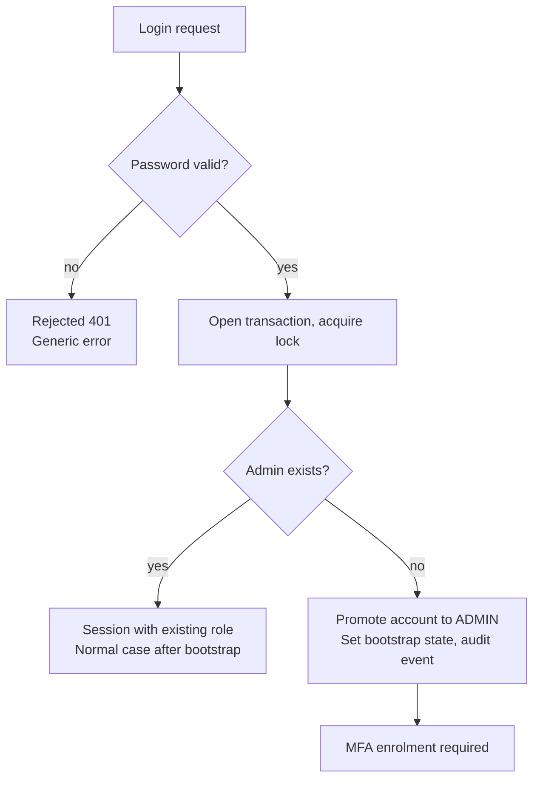

# Roles and Permissions

This document defines which roles exist in Doctor Holiday, what each role may do on which resource, and how roles are assigned.

- **Issue:** [#3 – Define roles and the permission concept (RBAC matrix)](https://github.com/jankrus/doctorholiday/issues/3)
- **Grading:** Secure Coding & App-Security → *Berechtigungskonzept* (5 points)
- **Exam brief:** §1 requires clarifying which roles exist; §4 requires that the first user to log in becomes the admin.
- **Protection needs:** Appointment data of a medical practice is health data (GDPR Art. 9). Access follows need-to-know and data minimisation.
- **API contract:** Each action in the matrix is mapped to exactly one API endpoint in [#4](https://github.com/jankrus/doctorholiday/issues/4): [requirements.md](requirements.md#traceability-permission-matrix--endpoints) and [`backend/openapi.yaml`](../../backend/openapi.yaml), where every operation names its roles (`x-roles`). A22–A29 were added in #4 to close gaps the API contract revealed; A30–A32 (rescheduling, working hours and absences instead of slots) were added in the #4 review.
- **Implementation:** [#15](https://github.com/jankrus/doctorholiday/issues/15) (admin bootstrap), [#16](https://github.com/jankrus/doctorholiday/issues/16) (authorisation and default deny), [#55](https://github.com/jankrus/doctorholiday/issues/55) (invitations, TBAC, MFA for staff, admin self-demotion).

## Roles

Four authenticated roles plus the unauthenticated actor `ANONYMOUS`. Every account has exactly one role.

| Role | Who | Core permissions |
| --- | --- | --- |
| `ANONYMOUS` | Visitors without a session (not logged in) | Register, accept an invitation, log in, call the health probes. No access to availability or appointments. |
| `PATIENT` | Self-registered patients | See available times; book, view, reschedule and cancel their own appointments; delete their own account |
| `STAFF` | Practice staff (reception, administration), invited by `ADMIN` | Manage working hours and absences of all doctors, view and manage all appointments, book on behalf of patients |
| `DOCTOR` | Doctors, invited by `ADMIN` | Manage their own working hours and absences, view and manage all appointments |
| `ADMIN` | Practice manager; the first user to log in becomes `ADMIN` ([bootstrap](#bootstrapping-the-first-admin)) | User and role management, MFA reset of other users, practice settings, audit log; access to appointment data only time-limited (see [ADMIN and health data](#admin-and-health-data-rbac--tbac)) |

`STAFF` and `DOCTOR` are separate roles (least privilege): only `STAFF` books on behalf of patients, and `DOCTOR` manages only their own working hours and absences.

## Permission matrix

Values: **allow**, **own only** (only resources of the logged-in user), **deny**. Anything not listed in the matrix is denied ([default deny](#default-deny)).

| ID | Action | ANONYMOUS | PATIENT | STAFF | DOCTOR | ADMIN | Endpoint (cross-check #4) |
| --- | --- | --- | --- | --- | --- | --- | --- |
| A01 | Register | allow | deny | deny | deny | deny | `POST /api/v1/auth/register` |
| A02 | Accept invitation | allow ¹ | deny | deny | deny | deny | `POST /api/v1/auth/invitations/accept` |
| A03 | Log in | allow | deny | deny | deny | deny | `POST /api/v1/auth/login` |
| A04 | Verify MFA ² | deny | own only | own only | own only | own only | `POST /api/v1/auth/mfa/verify` |
| A05 | Enable MFA ² | deny | own only | own only | own only | own only | `POST /api/v1/auth/mfa/enroll` |
| A06 | Log out ² | deny | own only | own only | own only | own only | `POST /api/v1/auth/logout` |
| A07 | List available times | deny | allow | allow | allow | allow | `GET /api/v1/availability` |
| A08 | Book appointment | deny | own only ³ | allow ³ ⁴ | deny | deny | `POST /api/v1/appointments` |
| A09 | Cancel own appointment | deny | own only | deny | deny | deny | `POST /api/v1/appointments/{id}/cancel` |
| A10 | Cancel any appointment | deny | deny | allow | allow | allow (TBAC) ⁵ | `POST /api/v1/appointments/{id}/cancel` |
| A11 | View own appointments | deny | own only | deny | deny | deny | `GET /api/v1/appointments/me` |
| A12 | View all appointments | deny | deny | allow | allow | allow (TBAC) ⁵ | `GET /api/v1/appointments` |
| A13 | Set working hours | deny | deny | allow | own only ⁶ | allow | `PUT /api/v1/doctors/{id}/working-hours` |
| A14 | Block time (create absence) | deny | deny | allow | own only ⁶ | allow | `POST /api/v1/absences` |
| A15 | List users | deny | deny | deny | deny | allow | `GET /api/v1/users` |
| A16 | Invite user | deny | deny | deny | deny | allow | `POST /api/v1/users/invitations` |
| A17 | Change role | deny | deny | deny | deny | allow ⁷ | `PATCH /api/v1/users/{id}/role` |
| A18 | Deactivate user | deny | deny | deny | deny | allow ⁷ | `POST /api/v1/users/{id}/deactivate` |
| A19 | Activate time-limited access to appointment data | deny | deny | deny | deny | allow | `POST /api/v1/admin/appointment-access` |
| A20 | Update practice settings (practice name, cancellation deadline, appointment length; [BR-18](requirements.md#business-rules)) | deny | deny | deny | deny | allow | `PUT /api/v1/settings` |
| A21 | View audit log | deny | deny | deny | deny | allow | `GET /api/v1/audit-events` |
| A22 | View own account and session state ² | deny | own only | own only | own only | own only | `GET /api/v1/auth/me` |
| A23 | Change own password | deny | own only | own only | own only | own only | `POST /api/v1/auth/password` |
| A24 | Delete own account | deny | own only ⁸ | deny | deny | deny | `POST /api/v1/auth/account/delete` |
| A25 | Reset another user's MFA | deny | deny | deny | deny | allow ⁹ | `POST /api/v1/users/{id}/mfa/reset` |
| A26 | View practice settings ([BR-18](requirements.md#business-rules)) | deny | allow | allow | allow | allow | `GET /api/v1/settings` |
| A27 | List doctors (ID and display name) | deny | allow | allow | allow | allow | `GET /api/v1/doctors` |
| A28 | Liveness probe | allow | allow | allow | allow | allow | `GET /healthz` |
| A29 | Readiness probe | allow | allow | allow | allow | allow | `GET /readyz` |
| A30 | Reschedule appointment | deny | own only ¹⁰ | allow ¹⁰ | allow ¹⁰ | deny | `POST /api/v1/appointments/{id}/reschedule` |
| A31 | Remove absence | deny | deny | allow | own only ⁶ | allow | `DELETE /api/v1/absences/{id}` |
| A32 | View doctor schedule (working hours and absences) | deny | deny | allow | own only ⁶ | allow | `GET /api/v1/doctors/{id}/schedule` |
| A36 | Decline optional MFA offer ([BR-26](requirements.md#business-rules)) | deny | own only | deny | deny | deny | `POST /api/v1/auth/mfa/decline` |

1. Only with a valid invitation token from A16. The token is single-use, expires after 72 hours, is stored only as a hash and is sent in the request body, never in the URL. The role comes from the invitation, never from the request.
2. Also allowed before MFA is verified. After a correct password (A03) the session already belongs to an account and therefore to its role, so the role columns apply; `ANONYMOUS` means no session at all. What the session may do is restricted by its state instead ([BR-05](requirements.md#business-rules)): in `MFA_PENDING` only A04, A06 and A22, in `MFA_ENROLLMENT_REQUIRED` additionally A05. A22 then returns only the session state, not the account.
3. A patient may have at most 5 open (future, not cancelled) appointments, regardless of who booked them. The limit is checked server-side in the same transaction as the booking.
4. `STAFF` books on behalf of a patient, identified by the patient's e-mail in the request body (no patient search for `STAFF`, data minimisation). The e-mail must belong to an active `PATIENT`; the booking is recorded in the audit log with `STAFF` as the actor. Alternatively `STAFF` books for a guest without an account (name and phone, [BR-24](requirements.md#business-rules)); guests have no login and manage their appointments through the practice.
5. Permitted via RBAC; the actual access additionally requires an active time-limited grant from A19 (TBAC), see below.
6. Only the own schedule: `doctor_id == user.id`. Other doctors' working hours and absences return `404`.
7. Subject to the [role assignment rules](#role-assignment-rules), in particular protection of the last admin.
8. Only after re-entering the password. Personal data is erased; past appointments and audit events keep only the pseudonymous user ID (GDPR Art. 17). Staff accounts are deactivated by an admin instead (A18).
9. Never for the own account, so a stolen admin session cannot replace the admin's MFA. The reset deletes TOTP secret, recovery codes and all sessions of the user; staff roles must enrol MFA again at the next login.
10. Moves an appointment to another available time in one transaction; patient and reason stay the same. `PATIENT` only until the cancellation deadline, `STAFF` and `DOCTOR` until the start. `ADMIN` does not book and therefore does not reschedule.

**Ownership check:** A09 and A10 share one endpoint. For `PATIENT` (A09, A30), the backend checks `appointment.patient_id == user.id`. "Own only" is always checked server-side against the session, never against IDs from the request (IDOR protection).

## ADMIN and health data (RBAC + TBAC)

`ADMIN` may in principle do everything the matrix allows. Access to appointment data (A10, A12) is relevant under Art. 9 and is therefore additionally time-limited (time-based access control):

- RBAC decides **whether** the role may perform the action at all.
- TBAC decides **whether access is currently unlocked**: `ADMIN` explicitly activates access to appointment data (A19). The grant expires automatically after 30 minutes and is checked server-side on every request. It is not additionally restricted to practice hours.
- Activation, expiry and every access within the window produce an audit event with actor, target and timestamp.

## MFA requirement

- `ADMIN`, `STAFF` and `DOCTOR` must use MFA. Until MFA is enrolled and verified in the session, these roles may only verify MFA, enrol MFA, log out and read their session state (A04–A06, A22).
- `PATIENT` may enable MFA voluntarily (A05).
- Confirming the enrolment returns ten single-use recovery codes once. If both device and codes are lost, an admin resets the MFA (A25). If the last admin loses both, only a database reset helps; this residual risk is documented with the non-secure parts (brief §5e).

## Bootstrapping the first admin

The bootstrap implements exam brief §4 literally: "Der erste Login eines Users soll der Admin sein". Registration always creates a `PATIENT`. The first account that logs in successfully while no admin exists is promoted to `ADMIN`; every later login keeps its role.

- **Race condition:** Two simultaneous first logins must not both become `ADMIN`. The bootstrap state lives in a single-row table (`admin_bootstrapped`). The login locks this row with `SELECT … FOR UPDATE`, checks the state, promotes the account and sets the state in the same transaction. A concurrent login waits for the lock, sees the updated state after the commit and keeps its role.
- **MFA:** The new admin falls under the [MFA requirement](#mfa-requirement) at once: until MFA is enrolled and verified, the session may only verify MFA, enrol MFA, log out and read its session state.
- **Audit:** The promotion produces an audit event (`ADMIN_BOOTSTRAPPED`) with account and timestamp, so an unexpected admin is visible in the audit log.
- **Practice setup:** After the bootstrap (and MFA enrolment) the new admin is forwarded to a setup page to save the practice settings (name, cancellation deadline, appointment length) for the first time ([BR-18](requirements.md#business-rules)). This is a UX step only; it grants no rights beyond the `ADMIN` role.
- **Database reset:** A reset deletes the bootstrap state, so the system is back to "no admin" and the next first login becomes `ADMIN` again.
- **Residual risk:** Whoever registers and logs in first after deployment or a database reset becomes admin. This follows directly from §4 and is accepted. It is limited by operation: the app runs on a local kind cluster whose ingress is only reachable from the operator's machine, and the setup guide makes the operator's first login the step right after `make up`. A one-time setup token would close the window completely but would contradict §4, so it is not used. The risk is listed among the non-secure parts of the final documentation (brief §5e).

## Role assignment rules

Only an `ADMIN` changes roles; every change is recorded in the audit log.

1. Self-registration always creates `PATIENT`. A `role` field in the request is rejected (`additionalProperties: false`, Pydantic `extra="forbid"`), not ignored.
2. `STAFF`, `DOCTOR` and additional `ADMIN` accounts are created only by invitation from an `ADMIN` (A16, A02). Apart from the [bootstrap](#bootstrapping-the-first-admin), a `PATIENT` account is never promoted, and staff accounts are never demoted to `PATIENT`, so patient and staff identities stay separate.
3. Only `ADMIN` may change roles between `STAFF`, `DOCTOR` and `ADMIN` (A17).
4. An admin may demote themselves only if another active admin remains. The last active admin can be neither demoted nor deactivated. The check locks the admin rows (`SELECT … FOR UPDATE`) in the same transaction as the change, so two admins cannot demote each other at the same time.
5. A role change or deactivation immediately deletes all server-side sessions of the affected user. The user must log in again and gets the new permissions only then.

## Default deny

Any action not listed in the matrix is forbidden. This applies to every role, including `ADMIN`.

- Authorisation is enforced centrally in the backend (middleware/guard per route), never only in the frontend.
- New endpoints are unreachable without an explicit role grant.
- Rejections return `403` (or `404` for other users' resources, so their existence is not disclosed) using the uniform error schema from #4.
- A role × endpoint test matrix generated from this document, plus a test that fails for any route without an authorisation rule, verifies the matrix ([#16](https://github.com/jankrus/doctorholiday/issues/16)).
