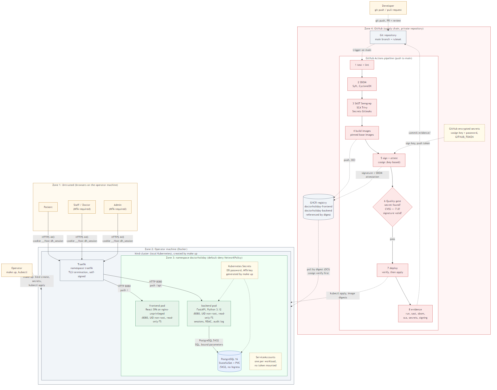
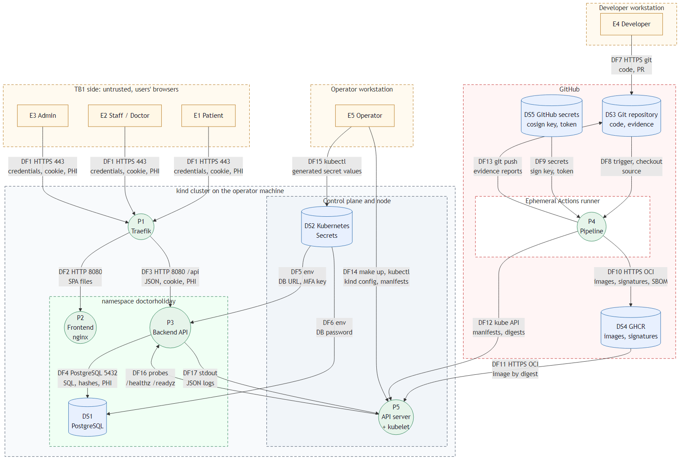
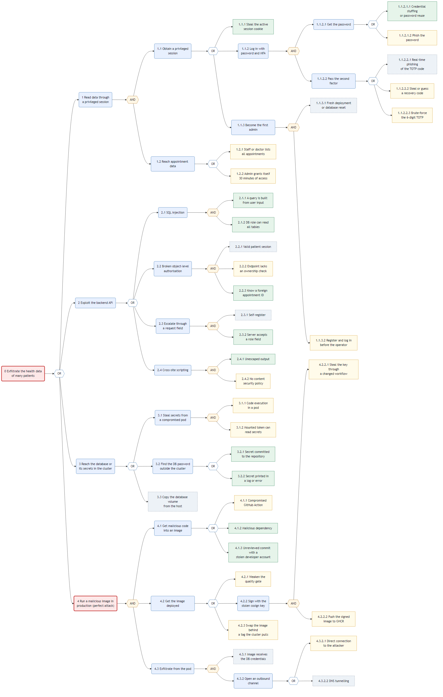

# Ziel und Ansatz

- Terminbuchung für **eine Arztpraxis**: Patient, Staff, Doctor, Admin
- Funktion klein, **Schwerpunkt: Security by Design** und eine nachvollziehbare Lieferkette
- Termindaten sind **Gesundheitsdaten** (DSGVO Art. 9): das bestimmt, was für uns der schlimmste Schaden ist
- Von der Anforderung bis zum signierten Image im lokalen Kubernetes, **alles mit Belegen**

::: notes
Ca. 0:30. Nicht die Funktionen erklären, sondern sagen: die App ist das Mittel, nicht das Ziel. Gesundheitsdaten als Begründung für alle späteren Entscheidungen.
:::

# Architektur

:::::: columns
::: {.column width="62%"}

:::
::: {.column width="38%"}
Vier Vertrauenszonen:

- Browser (nicht vertrauenswürdig)
- Betreiber-Maschine mit kind und Traefik
- Namespace `doctorholiday`
- GitHub mit GHCR
:::
::::::

::: notes
Ca. 0:40. Auf die Zonen zeigen, nicht auf jede Box. Stack in einem Satz: React, FastAPI, PostgreSQL, kind mit Traefik und Calico, Pipeline mit GitHub Actions.
:::

# Threat Modeling: Systemmodell, DFD, STRIDE

:::::: columns
::: {.column width="58%"}

:::
::: {.column width="42%"}
- **88 Bedrohungen** aus 5 Entitäten, 5 Prozessen, 5 Speichern, 17 Datenflüssen
- Umgesetzt: **Spoofing, Elevation of Privilege, Information Disclosure** (45 Bedrohungen)
- Nicht gewählt: Tampering, Repudiation, DoS, mit Begründung
:::
::::::

::: notes
Ca. 1:00. Warum S, E, I: Login ist Pflicht, Rollen und Least Privilege sind Pflicht, Termine sind Gesundheitsdaten. Die drei anderen: stärkste Maßnahmen gehören sowieso zu anderen Anforderungen, lokaler Einzelknoten.
:::

# Attack-Tree: der schlimmste Fall

:::::: columns
::: {.column width="58%"}

:::
::: {.column width="42%"}
- Ziel des Angreifers: Gesundheitsdaten **vieler** Patienten
- **Ast 4, ein bösartiges Image in Produktion**, umgeht alle Anwendungskontrollen auf einmal
- Deshalb früh: Digest, Signatur, Quality Gate, gepinnte Actions
:::
::::::

::: notes
Ca. 0:40. Das ist die Brücke zwischen Anwendungssicherheit und Lieferkette. Restrisiko offen nennen: TOTP ist phishbar, MFA noch nicht gebaut.
:::

# Sicherheitsfeatures der Anwendung

- **Login und Sitzungen:** Argon2id, serverseitige Sitzung, `__Host-`-Cookie, neue ID beim Login, gleiche Antworten und Zeit bei Fehlern, Rate-Limit mit Sperre
- **Autorisierung:** Default-Deny (App startet nicht ohne Regel), Rollenmatrix aus dem API-Vertrag, fremde Objekte liefern 404
- **Eingaben und Fehler:** strikte Schemas, nur gebundene SQL-Parameter, ein Fehlerschema ohne Interna, Log mit Schwärzung
- **Browser:** Origin-Prüfung gegen CSRF, kein CORS, Security-Header, TLS und HSTS am Ingress
- **Erster Login wird Admin** (Vorgabe), Race getestet

::: notes
Ca. 1:30. Zeigen, nicht aufzählen: Default-Deny ist das Beispiel (zwei Zeilen Code). Ehrlich: MFA (Bonus) und Admin-API sind nicht fertig, das steht auf der Folie zu Abweichungen und Restrisiken.
:::

# Pipeline und Lieferkette

```
context ─ meta ─┬─ Tests ─────┐
                ├─ SBOM ─ SAST / SCA / Secrets ─┤
                                                 └─ build ─ sign ─ Quality Gate ─ deploy ─ evidence
```

- SBOM (Syft), SAST (Semgrep), SCA und Image-Scan (Trivy), Secrets (Gitleaks)
- Images **per Digest**, signiert mit cosign, SBOM als Attestation
- **Quality Gate blockiert:** Secret, CVSS ≥ 7,0, fehlende oder ungültige Signatur, fehlender Bericht
- Jeder Lauf schreibt seine Berichte in die **Evidence**

::: notes
Ca. 1:30. Das Gate ist erst durch absichtlich fehlgeschlagene Läufe glaubwürdig: drei Läufe, jeder blockiert aus genau dem erwarteten Grund (im Demo-Teil zeigen).
:::

# Kubernetes-Härtung

- Eigener Namespace, **Pod Security `restricted`**
- Ein **ServiceAccount** je Workload, Token nicht eingehängt
- Jeder Container: Nicht-Root, schreibgeschütztes Dateisystem, keine Privilegien-Erhöhung, **alle Capabilities entfernt**, seccomp
- **NetworkPolicies:** `default-deny-all`, dann nur nötige Freigaben
- Nachweis im Deploy: **36 Pod-Prüfungen** und **Netzwerktest** mit blockierten und erlaubten Verbindungen

::: notes
Ca. 1:00. Der Test beweist blockiert und erlaubt, weil eine blockierte Verbindung nur etwas zeigt, wenn das Werkzeug funktioniert. kind erzwingt NetworkPolicies nicht, deshalb Calico.
:::

# Nachweis: Traceability-Matrix

- **45 Controls** für alle elf Sicherheitsanforderungen: Umsetzung, Test, Evidence
- **45 gewählte Bedrohungen** zugeordnet: 24 umgesetzt, 12 teilweise, 3 geplant, 6 akzeptiert
- Ein Skript prüft, dass jede Datei, jedes Symbol, jeder Link und jede Evidence-Datei existiert
- Lücken stehen **offen** in der Matrix

::: notes
Ca. 0:40. Das beantwortet die Frage "wo ist das umgesetzt und wie beweist ihr es" mit einem Klick.
:::

# Abweichungen, Restrisiken, Lessons Learned

- **Bewusst unsicher:** selbstsigniertes TLS, lokaler Einzelknoten, Klartext im Cluster, Shell im Backend-Image, kein öffentliches Transparenzlog
- **Offen:** MFA (Bonus), Admin-API und TBAC, Passwort-Reset, Audit-Lücken, CSP im Frontend
- **Gelernt:** der erste echte Lauf fand sechs Fehler, die lokal nicht auffielen; Prüfer müssen bei fehlenden Eingaben **fehlschlagen**; Status nur, wenn er prüfbar ist

::: notes
Ca. 0:40. Ehrlichkeit ist hier Punktegewinn: jede Abweichung ist begründet und in der Doku erklärt. Die Lessons Learned um die eigene Erfahrung des Teams ergänzen (Abschnitt zu KI-Agenten in der Dokumentation).
:::

# Demo

1. `make up` bis **Ready** (vorgewärmt)
2. Anwendung und Absicherung: Smoke-Test (Erst-Admin, CSRF 403, Patient ohne Zugriff, Logout)
3. Gate blockiert ein Secret (aufgezeichneter Lauf)
4. `cosign verify` und `cosign tree`
5. NetworkPolicy-Test: blockiert und erlaubt
6. `securityContext` der laufenden Pods

::: notes
Ca. 6:00 insgesamt, Ablauf und Rückfallebenen in demo-script.md.
:::
