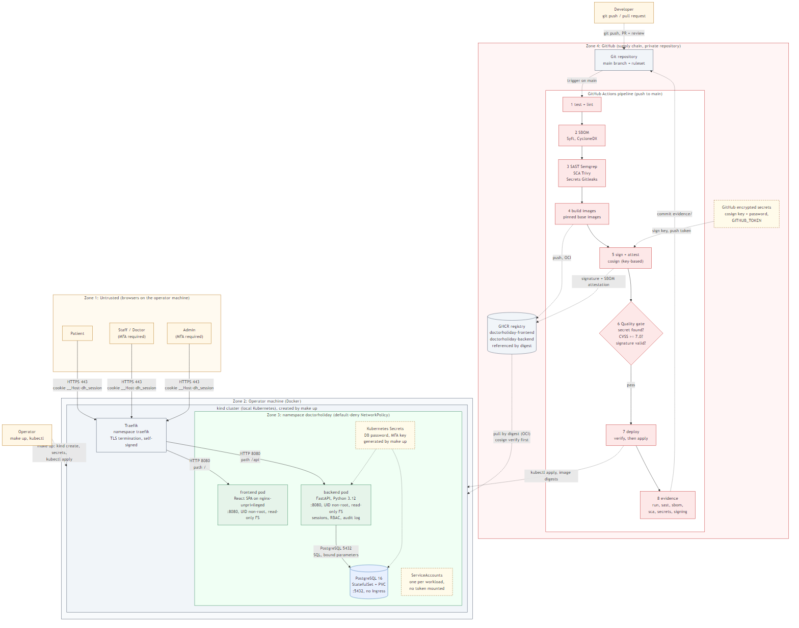
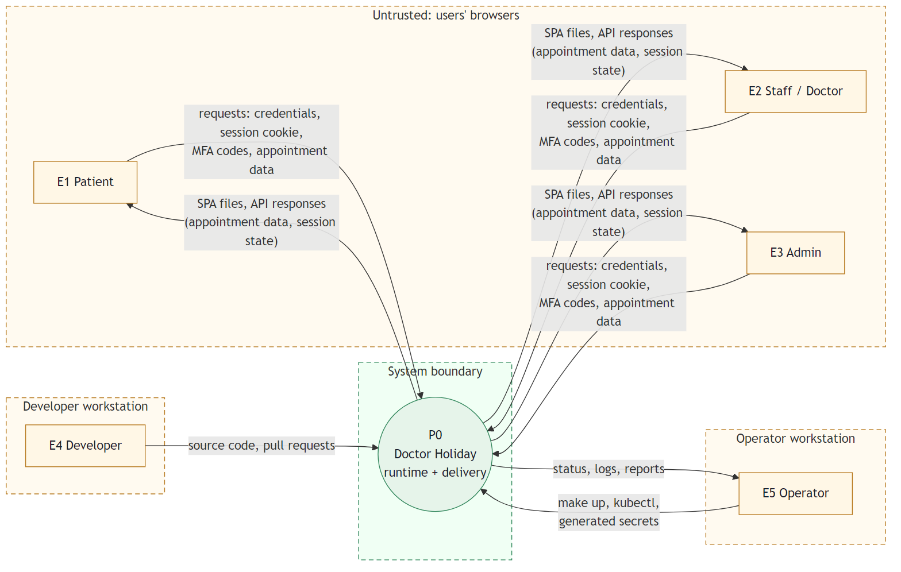
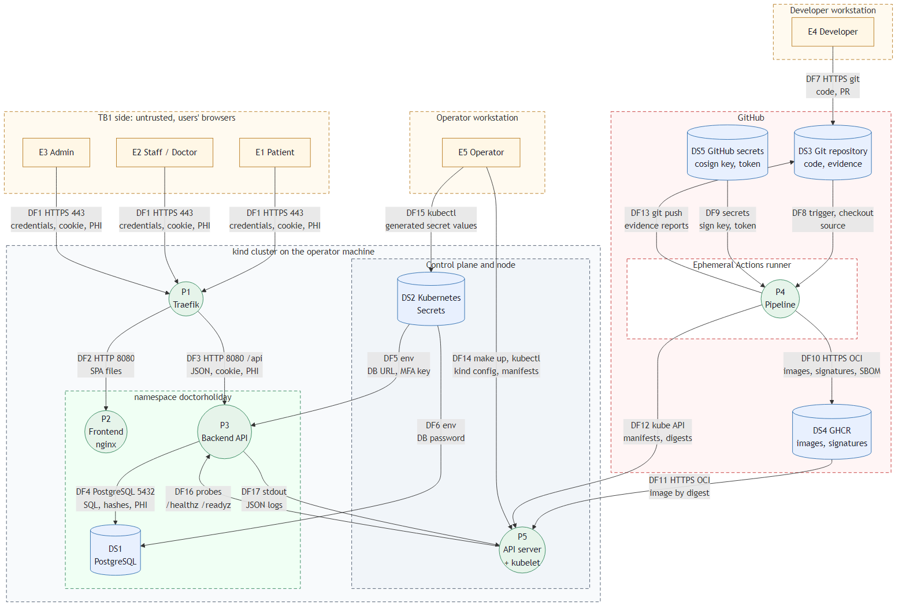
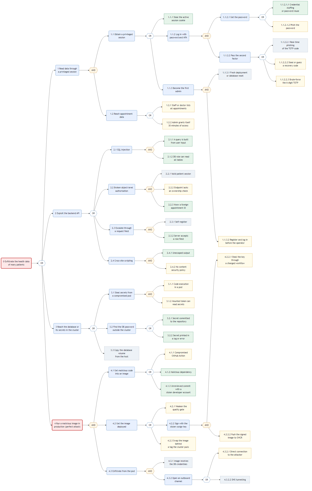

# Doctor Holiday: Abschlussdokumentation

Prüfungsleistung „Security by Design“ (STG-TINF24F), Aufgabenstellung §5. Diese Dokumentation fasst Ziel, Architektur, Threat Modeling, Sicherheitsfeatures, bewusst unsichere Teile, den Deployment-Prozess und die Lessons Learned zusammen. Sie verweist für die Einzelheiten auf die Dokumente im Repository, statt sie zu kopieren; wo etwas belegt wird, steht die Fundstelle dabei (Datei, Test oder Pipeline-Lauf).

- **Stand:** 2026-11-26, Branch `main`, Pipeline-Läufe bis Nr. 107.
- **Repository:** <https://github.com/jankrus/doctorholiday>, Planung: [Kanban-Board](https://github.com/users/jankrus/projects/1/).
- **Aufbau:** die Kapitel a bis g folgen der Reihenfolge von §5 der Aufgabenstellung. Das PDF ([documentation.pdf](documentation.pdf)) entsteht aus dieser Datei mit `make report`.
- **Belege:** Die Evidence jedes Pipeline-Laufs liegt unter `evidence/<image>/<typ>/<lauf>-<sha>-<datei>` auf dem Branch `evidence` und wird vor der Abgabe nach `main` übernommen (Abweichung [D-09](deviations.md)). Beispiele in dieser Dokumentation stammen aus Lauf 95 ([Link](https://github.com/jankrus/doctorholiday/actions/runs/45288791506), Präfix `00095-d01d074`).
- **Rückverfolgbarkeit:** [traceability.md](traceability.md) verbindet jede Sicherheitsanforderung und jede ausgewählte Bedrohung mit Umsetzung, Test und Evidence. Dieses Dokument erklärt, die Matrix belegt.

| Dokument | Inhalt |
| :--- | :--- |
| [architecture.md](../architecture/architecture.md), [ADRs](../architecture/adr/) | Architektur, Tech-Stack und Entscheidungen |
| [security-requirements.md](../architecture/security-requirements.md) | die elf Sicherheitsanforderungen SR-01 bis SR-11 |
| [roles-and-permissions.md](../architecture/roles-and-permissions.md) | Rollen und Berechtigungsmatrix |
| [system-model.md](../threat-model/system-model.md), [stride.md](../threat-model/stride.md), [stride-selection.md](../threat-model/stride-selection.md), [attack-tree.md](../threat-model/attack-tree.md) | Threat Modeling |
| [traceability.md](traceability.md) | Anforderung ↔ Bedrohung ↔ Umsetzung ↔ Evidence |
| [deviations.md](deviations.md), [deployment.md](deployment.md), [repository_configuration.md](repository_configuration.md) | Abweichungen, Deployment, Repository-Einstellungen |
| [.github/workflows/README.md](../../.github/workflows/README.md), [signing.md](../architecture/signing.md), [quality-gate.md](../architecture/quality-gate.md) | Pipeline, Signatur, Quality Gate |

---

## a. Ziel, Architektur-Schaubild, Tech-Stack

### Ziel

Doctor Holiday ist ein Terminbuchungssystem für **eine** Arztpraxis mit den Rollen Patient, Staff, Doctor und Admin. Patienten registrieren sich selbst und buchen, verschieben und stornieren eigene Termine; Staff und Ärzte pflegen Arbeitszeiten und Abwesenheiten; der Admin verwaltet Konten. Die Funktionalität ist bewusst klein. Der Schwerpunkt der Arbeit liegt auf **Security by Design** und einer nachvollziehbaren Lieferkette: von der Anforderung über die Bedrohungsanalyse und die Umsetzung bis zum signierten Image, das die Pipeline in einen lokalen Kubernetes-Cluster ausrollt. Termindaten sind Gesundheitsdaten (DSGVO Art. 9); das bestimmt, welche Schäden wir als gravierend einstufen (siehe Kapitel c).

### Architektur-Schaubild



*Quelle:* [architecture.mmd](../architecture/architecture.mmd) (Mermaid), Vektorfassung [architecture.svg](../architecture/architecture.svg). Das Schaubild zeigt die vier Vertrauenszonen: den nicht vertrauenswürdigen Browser, die Maschine des Betreibers mit dem kind-Cluster und Traefik, den Namespace `doctorholiday` mit Frontend, Backend und PostgreSQL sowie GitHub mit Repository, Actions und GHCR.

### Tech-Stack

| Schicht | Technik | Entscheidung |
| :--- | :--- | :--- |
| Frontend | React 18, TypeScript, Vite 8, Radix Themes, React Router 7, ausgeliefert von `nginx-unprivileged` | [ADR-001](../architecture/adr/ADR-001-tech-stack.md), [ADR-004](../architecture/adr/ADR-004-frontend-libraries.md) |
| Backend | Python 3.12, FastAPI, Pydantic 2, SQLAlchemy 2 (synchron, psycopg 3), Argon2id | ADR-001, [ADR-003](../architecture/adr/ADR-003-synchronous-data-access.md) |
| Python-Werkzeuge | `uv` mit `uv.lock` | [ADR-002](../architecture/adr/ADR-002-python-package-manager.md) |
| Datenbank | PostgreSQL 16 | ADR-001, [database.md](../architecture/database.md) |
| Sitzung | serverseitig, Cookie `__Host-dh_session` (`HttpOnly; Secure; SameSite=Strict`) | ADR-001 |
| Container-Images | `python:3.12-alpine` (Backend), `nginx-unprivileged:alpine` (Frontend), `postgres:16-alpine`, alle per Digest festgelegt | ADR-001, Abweichung [D-03](deviations.md) |
| Pipeline | GitHub Actions, Syft, Semgrep, Trivy, Gitleaks, cosign, GHCR | [.github/workflows/README.md](../../.github/workflows/README.md) |
| Laufzeit | kind-Cluster mit Traefik (Ingress), Calico (erzwingt NetworkPolicies), Kustomize, gesteuert über das Makefile | [ADR-005](../architecture/adr/ADR-005-ingress-controller.md), [infrastructure/k8s/README.md](../../infrastructure/k8s/README.md) |

Die Entscheidungen stehen in fünf ADRs. Zwei davon korrigieren spätere Erkenntnisse: [ADR-004](../architecture/adr/ADR-004-frontend-libraries.md) hebt Vite und Vitest auf neuere Hauptversionen, weil die alten bekannte HIGH- und CRITICAL-Lücken hatten ([D-01](deviations.md)); [ADR-005](../architecture/adr/ADR-005-ingress-controller.md) ersetzt ingress-nginx durch Traefik, weil ingress-nginx eingestellt wird.

---

## b. Beschreibung aller Komponenten im Schaubild

Jede Komponente mit Zweck, Technik, den Geheimnissen, die sie hält, und den Sicherheitsmaßnahmen. Die Kennungen `C-xx.n` verweisen auf die Controls in [traceability.md](traceability.md), dort stehen Code, Test und Evidence. Der ausführliche Komponentenkatalog ist [architecture.md](../architecture/architecture.md#component-catalogue); sein Statusvermerk („geplant“, „in Review“) stammt aus der Entwurfsphase und ist überholt, der Stand ist hier und in der Matrix.

### Akteure

| Komponente | Rolle im System | Sicherheitsmaßnahmen |
| :--- | :--- | :--- |
| **Patient** | registriert sich selbst, bucht eigene Termine; nutzt einen Browser | Argon2id-Passwort, Rate-Limit, nur eigene Termine sichtbar (C-01.x, C-02.3) |
| **Staff / Doctor** | wird vom Admin eingeladen; pflegt Arbeitszeiten, Ärzte nur ihren eigenen Plan | Rollenmatrix (C-02.2); MFA und Einladungen sind geplant (SR-09, #21, #55) |
| **Admin** | erster Nutzer, der sich einloggt (Vorgabe §4); verwaltet Konten | Bootstrap in einer gesperrten Transaktion (C-01.5); Zugriff auf Termindaten nur über eine zeitlich begrenzte Freigabe (geplant, #55) |
| **Betreiber** | führt `make up` aus, erzeugt Cluster und Secrets | gilt als vertrauenswürdig (Annahme, Kapitel e) |
| **Entwickler** | arbeitet über Branches und Pull Requests, nie direkt auf `main` | Ruleset `protect-main`, Review durch eine zweite Person, SHA-gepinnte Actions (C-06.5) |

### Laufzeit (Namespace `doctorholiday` und Ingress)

| Komponente | Zweck und Technik | Sicherheitsmaßnahmen |
| :--- | :--- | :--- |
| **Traefik** | Ingress-Controller in eigenem Namespace `traefik`, Ports 80/443 nur auf `127.0.0.1`; leitet `/api` an das Backend, `/` an das Frontend | TLS, HTTP wird umgeleitet, HSTS, Rate-Limit- und Größen-Middleware, kein Dashboard, nur lesende Rechte außerhalb des eigenen Namespaces (C-08.5, C-11.3, [ADR-005](../architecture/adr/ADR-005-ingress-controller.md)) |
| **Frontend-Pod** | statische Dateien über `nginx-unprivileged`, kennt keine Geheimnisse | Security-Header, Nicht-Root, schreibgeschütztes Dateisystem (C-08.3, C-11.2) |
| **Backend-Pod** | FastAPI mit Sitzungen, Rollenprüfung, Terminlogik | Validierung, Default-Deny, Fehlerhülle, Audit, Header, Origin-Prüfung (C-01 bis C-04, C-10, C-11.1) |
| **PostgreSQL** | StatefulSet mit einem Replikat, drei Datenbankrollen (Superuser, Owner, Anwendung) | Anwendungsrolle mit minimalen Rechten, Audit-Tabelle nur `INSERT` (C-10.1), erreichbar nur vom Backend (C-08.4) |
| **Kubernetes-Secrets** | Datenbankpasswörter, `MFA_ENCRYPTION_KEY`, TLS-Schlüssel; zur Deploy-Zeit erzeugt | nie im Repository, nur per `secretKeyRef` in den Containern, die sie brauchen (C-05.2) |
| **ServiceAccounts** | einer je Workload (`frontend`, `backend`, `postgres`, `db-migrate`) | keine Rollenbindungen, Token nicht eingehängt (C-08.2) |
| **NetworkPolicies** | `default-deny-all` für Ingress und Egress, dann ausdrückliche Freigaben je Workload | getestet mit blockierten und erlaubten Verbindungen (C-08.4) |
| **kind-Cluster und Makefile** | `make up` erzeugt Cluster, Calico, Namespace, Ingress, Secrets, Images, Manifeste und wartet auf „Ready“ | alle Werkzeuge und Fremd-Manifeste per Version und SHA-256 festgelegt ([infrastructure/kind/versions.env](../../infrastructure/kind/versions.env)) |

### Lieferkette

| Komponente | Zweck und Technik | Sicherheitsmaßnahmen |
| :--- | :--- | :--- |
| **Git-Repository** | Quellcode, Pipeline-Definition, Doku | Ruleset `protect-main`: Pull Request, eine Freigabe, veraltete Freigaben verfallen, kein Force-Push, kein Löschen, keine Ausnahmen ([repository_configuration.md](repository_configuration.md)) |
| **Pipeline** | GitHub Actions: Test, SBOM, SAST/SCA/Secrets, Build, Signatur, Quality Gate, Deploy, Evidence | Rechte je Job, Release-Läufe nur auf `main`, Actions per SHA, Workflow-Linting (C-06.x) |
| **GitHub-Secrets** | `COSIGN_PRIVATE_KEY`, `COSIGN_PASSWORD` | nur im Environment `signing`, das nur `main` nutzen darf; in Logs maskiert (C-05.4) |
| **GHCR** | Container-Registry zwischen Pipeline und Cluster | Images nur per Digest, signiert und mit SBOM-Attestation (C-07.x) |
| **Evidence-Branch** | Berichte jedes Laufs | die Pipeline schreibt nie nach `main` ([D-09](deviations.md)) |

---

## c. Threat Modeling: Systemmodell, DFD, STRIDE, Attack-Tree

### Systemmodell und DFD

Das Systemmodell ([system-model.md](../threat-model/system-model.md)) beschreibt fünf externe Entitäten (E1 bis E5), fünf Prozesse (P1 bis P5), fünf Datenspeicher (DS1 bis DS5) und 17 Datenflüsse (DF1 bis DF17). Es beginnt mit der Kontextsicht (Ebene 0), dann folgt die Detailsicht (Ebene 1) mit den Vertrauensgrenzen.





Die **Vertrauensgrenzen** entsprechen den vier Zonen aus Kapitel a: Browser, Maschine des Betreibers, Namespace `doctorholiday`, GitHub. Jeder Datenfluss, der eine Grenze kreuzt, wurde einzeln analysiert (Abschnitt 7 des Systemmodells). Die Annahmen stehen am Anfang des Dokuments: lokaler Einzelknoten-Cluster, ein Betreiber, ein Angreifer mit Internet-Zugang zum Ingress, aber ohne Zugriff auf die Maschine des Betreibers.

### STRIDE

[stride.md](../threat-model/stride.md) analysiert jedes DFD-Element nach seinem Typ (Entität: S, R; Prozess: alle sechs; Datenspeicher: T, R, I, D; Datenfluss: T, I, D) und ergibt **88 Bedrohungen** (TH-01 bis TH-88) mit Beispielangriff, Voraussetzung, Gegenmaßnahme, Sicherheitsanforderung, Risiko und Status. Die Abdeckungsmatrix im Dokument zeigt, dass jedes sinnvolle Paar aus Element und Kategorie mindestens eine Bedrohung hat.

**Auswahl der drei Kategorien** ([stride-selection.md](../threat-model/stride-selection.md), Aufgabenstellung §2): Wir setzen gezielt **Spoofing**, **Elevation of Privilege** und **Information Disclosure** um, 45 der 88 Bedrohungen.

| Kategorie | Entscheidung | Begründung |
| :--- | :--- | :--- |
| Spoofing | umgesetzt | Der Login ist Pflicht, gestohlene Identitäten sind der Einstieg für alles Weitere. |
| Elevation of Privilege | umgesetzt | Rollenmodell, Objektprüfung und Kubernetes-Least-Privilege sind Pflicht und haben die schwersten Folgen. |
| Information Disclosure | umgesetzt | Termine sind Gesundheitsdaten; die Aufgabe nennt Fehlerbehandlung ohne Lecks und keine fest eingebauten Geheimnisse. |
| Tampering | nicht gewählt | Die stärksten Maßnahmen gehören ohnehin zu anderen Anforderungen (Validierung, Signatur, Pipeline). |
| Repudiation | nicht gewählt | Keine Bedrohung mit hohem Risiko; ein einfaches Audit-Log genügt. |
| Denial of Service | nicht gewählt | Lokaler Einzelknoten ohne Internet-Anbindung; echter Schutz bräuchte Infrastruktur außerhalb des Rahmens. |

„Nicht gewählt“ heißt: keine eigene, bedrohungsgetriebene Gegenmaßnahme, aber der Status in der Tabelle bleibt der tatsächliche Stand. SQL-Injection (TH-25) zum Beispiel ist gemildert, obwohl Tampering nicht gewählt ist.

**Stand der Umsetzung** (Spalte *Status* in stride.md, übereinstimmend mit der Matrix):

| Status | Alle 88 | davon gewählt (45) | davon nicht gewählt (43) |
| :--- | :---: | :---: | :---: |
| Umgesetzt | 34 | 24 | 10 |
| Teilweise | 35 | 12 | 23 |
| Nicht umgesetzt | 7 | 3 | 4 |
| Akzeptiert | 12 | 6 | 6 |

### Attack-Tree

Der Attack-Tree ([attack-tree.md](../threat-model/attack-tree.md)) beschreibt das **Worst-Case-Szenario**: *Gesundheitsdaten vieler Patienten abgreifen.* Er hat vier Äste: Daten über eine privilegierte Sitzung lesen (1), Schwachstellen der Backend-API ausnutzen (2), die Datenbank oder ihre Secrets im Cluster erreichen (3) und ein bösartiges Image in Produktion ausführen (4).



Der **Ast 4 ist der „perfekte Angriff“**: Ein bösartiges Image *ist* die Anwendung und besitzt schon die Datenbankzugangsdaten, damit umgeht er Authentifizierung, MFA, Rollen und Validierung auf einmal. Er verbindet Anwendungssicherheit und Lieferkette; deshalb steckt so viel Aufwand in Signatur, Quality Gate und Pipeline-Härtung. Die Gegenmaßnahmen, die den Baum am wirksamsten kappen, sind: verpflichtende MFA, Default-Deny mit Objektprüfung, Egress-Default-Deny im Cluster, Digest-Referenzen mit Signaturprüfung sowie gepinnte Actions mit Review. Die **Restrisiken** (TOTP ist phishbar, Shell im Backend-Image, Datenbank-Volume unverschlüsselt, DNS-Tunneling, Missbrauch einer legitimen Berechtigung) stehen in Kapitel e.

Der Attack-Tree hat die Reihenfolge der Arbeit bestimmt: Weil Ast 4 am schlimmsten ist, kamen Dockerfiles und Pipeline früh, die MFA später (Kapitel g).

---

## d. Die Anwendung mit allen Sicherheitsfeatures

Die elf Sicherheitsanforderungen ([security-requirements.md](../architecture/security-requirements.md)) sind das Gerüst dieses Kapitels. Jeder Abschnitt sagt, **wie** die Maßnahme funktioniert, zeigt ein Stück Code oder eine Ausgabe, und nennt den Nachweis. Test- und Dateinamen sind vollständig in [traceability.md](traceability.md) (Tabelle 1); `python3 scripts/check_traceability.py` prüft, dass sie existieren. Nicht jede Anforderung ist vollständig umgesetzt: die Lücken stehen am Ende jedes Abschnitts und gesammelt in Kapitel e.

### SR-01 Authentifizierung und Sitzungen

**Wie es funktioniert.** Passwörter haben 12 bis 128 Zeichen, häufige Passwörter und die eigene E-Mail werden abgelehnt, gespeichert wird nur ein Argon2id-Hash. Eine Sitzung ist ein zufälliges Token; in der Datenbank steht nur dessen SHA-256, das Cookie `__Host-dh_session` trägt `HttpOnly; Secure; SameSite=Strict` und das Präfix `__Host-`. Beim Login entsteht eine **neue** Sitzungs-ID, eine mitgebrachte wird nicht übernommen; es gibt Leerlauf- und Gesamt-Timeout. Falsche E-Mail, falsches Passwort und deaktiviertes Konto antworten gleich und in ähnlicher Zeit (ein Dummy-Hash wird gerechnet). Die Anmeldung wird pro IP und pro Konto begrenzt (der sechste schnelle Fehlversuch liefert `429`), die Registrierung pro IP. Der **erste erfolgreiche Login auf einem frischen System wird Admin** (Vorgabe §4); gleichzeitige erste Logins befördern genau einen. Das Passwort lässt sich nur mit dem alten Passwort ändern, danach enden alle anderen Sitzungen.

**Nachweis.** Datenbanktests in `backend/tests/db/test_auth.py` (zum Beispiel `test_unknown_email_and_wrong_password_answer_identically`, `test_planted_session_id_is_not_adopted_at_login`, `test_concurrent_first_logins_promote_exactly_one`); im Smoke-Test des Deployments steht `PASS  first login on a fresh system became ADMIN` ([Lauf 95](https://github.com/jankrus/doctorholiday/actions/runs/45288791506), `evidence/backend/run/00095-d01d074-smoke-test-20261123T233655Z.txt`).

**Lücken.** Passwort-Reset (#61) und MFA fehlen; hinter dem Ingress sehen alle Clients die IP des Ingress-Pods, deshalb greifen die IP-Limits nur eingeschränkt (#75).

### SR-02 Autorisierung mit Default-Deny und Objektprüfung

**Wie es funktioniert.** Jede Route muss ihre erlaubten Rollen deklarieren (über eine Abhängigkeit wie `ActiveUser` oder `CurrentSession`). Hat eine Route keine Regel, **startet die Anwendung nicht**. Die Rollen jeder Route müssen mit `x-roles` im API-Vertrag `backend/openapi.yaml` übereinstimmen, das ist die maschinenlesbare Form der Berechtigungsmatrix aus [roles-and-permissions.md](../architecture/roles-and-permissions.md). Bei „nur eigene“-Aktionen wird gegen die Sitzung geprüft, fremde Objekte antworten mit `404`.

```python
def enforce_default_deny(app: FastAPI) -> None:
    missing = routes_without_rule(app)
    if missing:
        raise RuntimeError(f"routes without an authorization rule: {', '.join(missing)}")
```

*(`backend/src/doctorholiday/auth/policy.py`)*

**Nachweis.** `test_the_real_app_has_a_rule_on_every_route`, `test_every_route_of_the_app_matches_the_permission_matrix`, `test_patient_a_cannot_read_cancel_or_modify_the_appointment_of_patient_b`.

**Lücken.** Admin-Verwaltung mit Schutz des letzten Admins (#18) und zeitlich begrenzter Zugriff auf Termindaten (TBAC, #55) fehlen.

### SR-03 Eingabevalidierung und sichere Datenzugriffe

**Wie es funktioniert.** Jede Anfrage wird gegen ein striktes Schema geprüft: unbekannte Felder werden abgelehnt, jeder String hat eine Obergrenze, IDs sind UUIDs, Wertemengen sind Enums, undeklarierte Query-Parameter werden abgelehnt. Es gibt ein Größenlimit (`413`) und nur JSON-Bodys (`415`), zusätzlich am Ingress (Middleware `request-limit`). SQL wird nie aus Strings gebaut: Zugriff nur über ORM und gebundene Parameter, eine eigene Semgrep-Regel (`.semgrep/raw-sql.yml`) meldet Verkettung. Integrität sichert die Datenbank selbst: eine Ausschluss-Constraint verhindert überlappende Buchungen, auch bei gleichzeitigen Anfragen.

**Nachweis.** `test_every_route_uses_the_validation_layer`, `test_schema_violations`, `test_only_one_of_several_concurrent_overlapping_bookings_succeeds`; Semgrep-Bericht `evidence/backend/sast/00095-d01d074-semgrep-backend.json`.

### SR-04 Fehlerbehandlung und Logging ohne Lecks

**Wie es funktioniert.** Fehler haben genau ein Schema mit stabilem `code`, kurzer Meldung und `requestId`; ein unerwarteter Fehler liefert nur den generischen Text, der Stacktrace steht im Log. Das Log ist einzeilig-JSON mit Schwärzung sensibler Felder und enthält weder Passwörter noch Tokens oder eingereichte Werte. `/docs`, `/redoc` und `/openapi.json` sind abgeschaltet. Die Konfiguration wird beim Start geprüft; Fehler nennen den Namen der Variable, nie den Wert.

**Nachweis.** `test_internal_exception_returns_the_generic_body_only`, `test_stack_trace_is_in_the_log_but_not_in_the_response`, `test_sensitive_extra_fields_are_redacted`, `test_invalid_value_is_named_but_not_echoed`, `test_no_framework_docs_or_server_header`.

### SR-05 Keine Geheimnisse im Repository oder in Images

**Wie es funktioniert.** Jede Konfiguration kommt aus Umgebungsvariablen; `.env.example` enthält nur Platzhalter. Die Kubernetes-Secrets erzeugt `scripts/k8s-secrets.sh` zur Deploy-Zeit, überschreibt nie bestehende und mountet sie nur in die Container, die sie brauchen (`secretKeyRef`). Gitleaks prüft die **gesamte Historie** aller Refs und blockiert im Quality Gate. Der Signaturschlüssel liegt nur als verschlüsseltes Secret im GitHub-Environment `signing`, das nur `main` nutzen darf; im Log steht `COSIGN_PRIVATE_KEY: ***`.

**Nachweis.** [Demo-Lauf „secret“](https://github.com/jankrus/doctorholiday/actions/runs/45626604342): ein eingeschleustes Token-förmiges Geheimnis lässt das Gate blockieren; Gitleaks-Bericht `evidence/backend/secrets/00095-d01d074-gitleaks.json`.

**Lücken.** Ein Geheimnis-Inventar (`docs/architecture/secrets.md`) und eigene Gitleaks-Regeln für unsere Variablennamen stehen aus (#30); ein automatischer Manifest-Check, dass kein Secret als Wert angegeben ist, fehlt.

### SR-06 SBOM, Scans und blockierendes Quality Gate

**Wie es funktioniert.** Jeder Push auf `main` erzeugt je Komponente ein CycloneDX-SBOM (Syft), führt SAST (Semgrep), SCA (Trivy auf Lockfiles), einen Image-Scan (Trivy) und den Geheimnis-Scan (Gitleaks) aus. Das **Quality Gate** (`scripts/quality_gate.py`) bricht ab bei: einem Geheimnis, einem Fund mit HIGH oder CRITICAL oder CVSS ≥ 7,0, einem Semgrep-Fund der Stufe ERROR (Semgrep kennt kein CVSS, ERROR steht für HIGH), einer fehlenden oder ungültigen Signatur, einem fehlenden oder kaputten Bericht und einem Job, der nicht erfolgreich war. Das Gate **schlägt fehl, statt durchzulassen**, wenn etwas fehlt. Alle Abhängigkeiten sind über Lockfiles, alle Actions per Commit-SHA und alle Images per Digest festgelegt; `scripts/check-pinning.sh` prüft das in jedem Lauf.

```
### Quality gate: BLOCKED
| every job the gate depends on succeeded | pass | 0 |
| Gitleaks found no secret in the history | **FAIL** | 1 |
| no HIGH/CRITICAL or CVSS >= 7.0 finding | pass | 0 |
| every image has a valid signature and SBOM attestation | pass | 0 |
```

*(Auszug aus dem [Demo-Lauf „secret“](https://github.com/jankrus/doctorholiday/actions/runs/45626604342))*

**Nachweis.** Drei absichtlich fehlgeschlagene Läufe, die jeweils genau die erwartete Regel auslösen: [secret](https://github.com/jankrus/doctorholiday/actions/runs/45626604342), [verwundbare Abhängigkeit](https://github.com/jankrus/doctorholiday/actions/runs/45626611223), [unsigniertes Image](https://github.com/jankrus/doctorholiday/actions/runs/45626616466), dazu die Kontrolle [clean](https://github.com/jankrus/doctorholiday/actions/runs/45626597215). Ein echter Lauf wurde ebenfalls blockiert ([Lauf 87](https://github.com/jankrus/doctorholiday/actions/runs/45212878779), Deploy übersprungen). 12 Tests in `scripts/test_quality_gate.py`. Erklärung: [quality-gate.md](../architecture/quality-gate.md).

### SR-07 Signierte Images, vor dem Deployment geprüft

**Wie es funktioniert.** Jedes Image wird per **Digest** gebaut und gepusht, nie über einen Tag verwendet. cosign (schlüsselbasiert) signiert den Digest und hängt das SBOM als CycloneDX-Attestation an; `scripts/sign-image.sh` lehnt Referenzen ohne Digest ab. Die Signatur wird im Quality Gate und **noch einmal im Deploy-Job** gegen den öffentlichen Schlüssel `infrastructure/signing/cosign.pub` geprüft, ein Fehler bricht ab. Warum ohne Eintrag im öffentlichen Rekor-Log: [D-10](deviations.md).

```sh
cosign verify --key infrastructure/signing/cosign.pub --insecure-ignore-tlog=true \
  ghcr.io/jankrus/doctorholiday-backend@sha256:<digest>
```

**Nachweis.** `evidence/backend/signing/00095-d01d074-verify-backend.json`, `…-signature-backend.bundle`, `…-attestation-backend.bundle`, `…-tree-backend.txt`; [Demo-Lauf „unsigned“](https://github.com/jankrus/doctorholiday/actions/runs/45626616466). Einzelheiten: [signing.md](../architecture/signing.md).

**Lücke.** Eine Prüfung der Signatur beim Zulassen im Cluster (Kyverno, #45) ist ein Zusatzziel und nicht gebaut.

### SR-08 Kubernetes Least Privilege

**Wie es funktioniert.** Die Anwendung läuft im eigenen Namespace `doctorholiday` mit Pod Security Admission `restricted`. Jeder Workload hat einen eigenen ServiceAccount ohne Rechte und ohne eingehängtes Token. Jeder Container läuft als Nicht-Root mit schreibgeschütztem Root-Dateisystem, ohne Privilegien-Erhöhung, mit allen Capabilities entfernt und seccomp `RuntimeDefault`. `default-deny-all` sperrt Ingress und Egress, danach öffnen ausdrückliche Regeln nur, was gebraucht wird (zum Beispiel erreicht nur das Backend die Datenbank).

```yaml
# infrastructure/k8s/networkpolicies.yaml
kind: NetworkPolicy
metadata:
  name: default-deny-all
spec:
  podSelector: {}
  policyTypes: [Ingress, Egress]
```

```yaml
# infrastructure/k8s/backend.yaml
securityContext:
  allowPrivilegeEscalation: false
  privileged: false
  readOnlyRootFilesystem: true
  capabilities:
    drop: ["ALL"]
```

**Nachweis.** Im Deploy-Job prüft `scripts/check_pod_security.py` die **laufenden** Pods (36 Prüfungen, `evidence/backend/run/00095-d01d074-pod-security.txt`); `scripts/test-netpol.sh` zeigt blockierte und erlaubte Verbindungen (`…-test-netpol-20261123T233657Z.txt`: zum Beispiel „throwaway pod -> postgres:5432 is blocked“, „backend -> postgres:5432 works“).

**Lücke.** Die Rechte der ServiceAccounts werden nicht zusätzlich mit `kubectl auth can-i` geprüft.

### SR-09 MFA mit TOTP (Bonus)

**Stand.** Nur die Grundlagen sind gebaut: der Sitzungszustand `MFA_ENROLLMENT_REQUIRED` (eine Sitzung davor darf nur ihren Zustand lesen) und der Schlüssel `MFA_ENCRYPTION_KEY` in der Konfiguration. Anmeldung, Prüfung und Wiederherstellungscodes fehlen (#21). Das ist im Attack-Tree der wichtigste offene Punkt (Ast 1).

### SR-10 Sicherheits-Audit-Log

**Wie es funktioniert.** Die Tabelle `audit_events` ist angehängt-nur: die Anwendungsrolle hat nur `SELECT` und `INSERT` (`V004__app_grants.sql`). Ereignisse tragen Akteur, Aktion, Ziel, IP und Ergebnis. Erfasst sind Login (Erfolg und Fehler, ohne die E-Mail eines unbekannten Kontos), Rate-Limits, Bootstrap, Passwortänderung und Abwesenheiten.

**Nachweis.** `test_audit_events`, `test_failed_login_for_unknown_email_is_audited_without_the_email`, `test_password_change_is_audited`.

**Lücken.** Ereignisse der Admin-Funktionen, Zugriffsverweigerungen und die Lese-Schnittstelle fehlen (#20, #100); es gibt keinen Test, dass die Anwendungsrolle die Tabelle nicht ändern kann.

### SR-11 HTTP-Härtung gegen Browser-Angriffe

**Wie es funktioniert.** Das Backend setzt auf jede Antwort `nosniff`, `Cache-Control: no-store`, `Referrer-Policy`, HSTS und eine restriktive CSP. Zustandsändernde Anfragen (alles außer GET, HEAD, OPTIONS) werden mit `403` abgelehnt, wenn `Origin` nicht in der erlaubten Liste steht oder, ohne `Origin`, `Sec-Fetch-Site` nicht `same-origin` oder `none` ist; **CORS ist abgeschaltet**, weil Frontend und API über den Ingress dieselbe Origin haben. Der Ingress terminiert TLS und leitet HTTP um.

**Nachweis.** `test_cross_site_post_with_foreign_origin_is_rejected`, `test_security_headers_on_every_response`; im Smoke-Test des Deployments `PASS  cross-site write is refused (403)` und `PASS  HSTS header on the API response`.

**Lücke.** Dem Frontend fehlt die Content-Security-Policy (#27); `nosniff`, Frame-Verbot, Referrer- und Permissions-Policy sind gesetzt.

---

## e. Nicht-sichere Teile und ihre Begründung

Dieses Kapitel nennt alles, was bewusst nicht dem Stand einer Produktivumgebung entspricht, mit der Begründung und dem, was Produktion bräuchte. Die Abweichungen von der Aufgabenstellung und von unseren eigenen Entscheidungen stehen vollständig in [deviations.md](deviations.md), die Scanner-Ausnahmen ebenfalls dort.

### Bewusste Entscheidungen und Abweichungen

| Teil | Warum so | Restrisiko | Produktion bräuchte |
| :--- | :--- | :--- | :--- |
| **Selbstsigniertes TLS-Zertifikat** (D-06) | Für einen lokalen Cluster gibt es keine öffentliche Zertifizierungsstelle. | Clients müssen dem Zertifikat manuell vertrauen. | Zertifikat einer anerkannten CA, automatisch erneuert |
| **Lokaler Einzelknoten-Cluster (kind), eine Datenbank-Replik ohne Backup** | Vorgabe der Aufgabe; die Demo soll auf jedem Laptop laufen. | Kein Ausfallschutz, Datenverlust beim Löschen des Clusters. | Mehrere Knoten, replizierte Datenbank, Backups |
| **Klartext im Cluster** (TH-71, TH-74) | Der Verkehr zwischen Pods bleibt im Einzelknoten; NetworkPolicies begrenzen, wer zuhören kann. | Mitlesen auf dem Knoten. | mTLS (Service Mesh) und TLS zur Datenbank |
| **Keine etcd-Verschlüsselung, kein Kubernetes-Audit-Log** (TH-10, TH-43, TH-52, TH-53) | Kein Zugriff auf die Steuerungsebene von kind in diesem Umfang; Betreiber gilt als vertrauenswürdig. | Secrets im etcd nur base64. | Verschlüsselung im etcd, API-Audit-Log |
| **Datenbank-Volume unverschlüsselt** (TH-49) | lokale Demo | Datenträger-Dump liest Gesundheitsdaten (die Passwörter sind nur als Hash gespeichert). | Verschlüsselte Volumes |
| **Erster Login wird Admin** (D-07) | Vorgabe §4. | Wer nach dem Deployment zuerst einloggt, wird Admin. Gegenmaßnahme: der eigene Login direkt nach `make up`. | Einmal-Token oder Einladung für den ersten Admin |
| **Backend-Image mit Shell** (D-03) | Es gibt kein kostenloses Distroless- oder Chainguard-Image für Python 3.12. | Bei Codeausführung im Pod gibt es eine Shell und `apk`. | Distroless mit passender Python-Version |
| **`apk upgrade` im Build** (D-04) | Sonst blockiert das Gate jeden Build wegen bereits behobener Alpine-Lücken. | Die Digests zweier Builds an verschiedenen Tagen unterscheiden sich; Reproduzierbarkeit über den Digest des gebauten Images und das SBOM. | Zeitgesteuerter Neubau mit Basis-Image-Updates über Dependabot |
| **Kein Eintrag im öffentlichen Transparenzlog** (D-10) | Schlüsselbasierte Signatur, kein öffentlicher Bezug; offline prüfbar. | Niemand kann nachträglich beweisen, *wann* signiert wurde. | Rekor oder ein eigenes Transparenzlog |
| **Keine Signaturprüfung bei der Zulassung im Cluster** (D-05) | Zusatzziel; die Aufgabe verlangt die Prüfung in der Pipeline. | Wer direkt `kubectl apply` ausführt, umgeht die Prüfung. | Kyverno oder policy-controller |
| **Evidence auf eigenem Branch, nicht auf `main`** (D-09) | Ein Bot mit Schreibrecht auf `main` wäre ein Loch im Ruleset. | Bis zum Zusammenführen vor der Abgabe zeigt `main` nur Platzhalter. | Ein dediziertes Artefakt-Archiv |
| **Smoke-Test ohne Buchung, keine Digest-Rückschreibung** (D-11) | Arzt-Konten entstehen erst mit Einladungen (#55, #18); Rückschreiben bräuchte einen Bypass. | Die Buchung ist nur durch Datenbanktests belegt. | Smoke-Test mit Arzt-Konto |
| **Vite 8 und Vitest 5, `argon2-cffi` statt `passlib`** (D-01, D-02) | Neuere Versionen wegen bekannter Lücken bzw. weil `passlib` nicht gepflegt wird. | keines für die Sicherheit | – |
| **Frontend-Major-Versionen ignoriert** | React 19, ESLint 9, jsdom 30, TypeScript 6 und andere brauchen eine abgestimmte Migration (Tabelle in [.github/workflows/README.md](../../.github/workflows/README.md)). | Technische Schuld bei den Werkzeugen, nicht bei der Laufzeit. | Geplante Migration |

### Scanner-Ausnahmen

Keine Schwachstelle steht in `.trivyignore`. Die Ausnahmen sind in [deviations.md](deviations.md#scanner-exceptions-33) einzeln begründet: Semgrep ignoriert Testdateien und eine Python-3.7-Regel, Gitleaks erlaubt die öffentliche Python-Schlüssel-ID im Image-Verlauf und die Berichte der eigenen Scanner im Evidence-Branch. Semgrep kennt kein CVSS; seine Stufe ERROR wird als HIGH behandelt.

### Nicht gewählte STRIDE-Kategorien

Tampering, Repudiation und Denial of Service haben keine eigene, bedrohungsgetriebene Gegenmaßnahme (Begründung in Kapitel c und [stride-selection.md](../threat-model/stride-selection.md)). Was Produktion ergänzen würde: Rate-Limits und Ressourcenquoten auf Infrastrukturebene (DoS), manipulationssichere Protokollierung außerhalb der Anwendungsdatenbank (Repudiation), signierte Commits und verpflichtende Statusprüfungen (Tampering).

### Noch nicht umgesetzt (offen und benannt)

| Teil | Stand | Folge |
| :--- | :--- | :--- |
| **MFA mit TOTP** (SR-09, #21) | Grundlagen vorhanden, Ablauf fehlt | Staff, Doctor und Admin haben nur ein Passwort; TOTP wäre ohnehin phishbar (Produktion: WebAuthn). |
| **Admin-Verwaltung und TBAC** (#18, #55) | nicht gebaut | Es gibt keine Einladungen, Rollenwechsel und keine zeitlich begrenzte Freigabe von Termindaten für den Admin. |
| **Passwort-Reset** (#61) | nicht gebaut | |
| **Audit-Log** (#20, #100) | teilweise | Admin-Ereignisse und Verweigerungen werden nicht erfasst. |
| **Client-IP hinter dem Ingress** (#75) | nicht gebaut | IP-Limits und Audit-IP zeigen die IP des Ingress-Pods. |
| **Content-Security-Policy im Frontend** (#27) | nicht gebaut | Weitere Header sind gesetzt. |
| **Privates Repository und private Pakete** (#48) | geplant vor der Abgabe | Bis dahin sind Quellcode, Berichte und Images öffentlich lesbar. Nach dem Umstellen braucht der Cluster ein Pull-Secret (`GHCR_USER`, `GHCR_TOKEN`, siehe [deployment.md](deployment.md)). |
| **Pflicht-Statusprüfungen im Ruleset** | nicht gesetzt | Ein Pull Request kann bei roten Checks gemergt werden, sofern jemand freigibt. |

Die vollständige Liste der Lücken mit den betroffenen Bedrohungen ist am Ende von [traceability.md](traceability.md#known-gaps).

---

## f. Deployment-Prozess und CI/CD-Pipeline

### Überblick

Jede Änderung an `main` startet `.github/workflows/ci-cd.yml`. Ein Pull Request läuft mit den Prüfungen, **baut, signiert und deployt nie** (der Job `context` entscheidet einmal, ob es ein Release-Lauf ist: nur `push` oder manueller Lauf auf `refs/heads/main`). Das Ergebnis jedes Laufs ist ein Satz von Berichten, die der Job `evidence` sammelt.

```
context (Release-Lauf?)
meta ─┬─ test-backend ──┐
      ├─ test-frontend ─┤
      └─ sbom ─┬─ sast ─┤
               ├─ sca ──┼─ build (frontend, backend) ─ sign ─ quality-gate ─ deploy ─ evidence
               └─ secrets ┘
```

### Die Jobs

| Job | Aufgabe | Ergebnis |
| :--- | :--- | :--- |
| `context` | entscheidet, ob Release-Lauf | Ausgabe `release` |
| `meta` | Pinning-Prüfung, Traceability-Prüfung, liest `VERSION.txt` | Version, Kurz-SHA |
| `test-backend`, `test-frontend` | Linter und Tests (Backend gegen eine echte PostgreSQL), Frontend-Build | Testprotokoll |
| `sbom` | CycloneDX-SBOM je Komponente (Syft), validiert | `sbom/` |
| `sast`, `sca`, `secrets` | Semgrep, Trivy auf Lockfiles, Gitleaks über die ganze Historie | `sast/`, `sca/`, `secrets/` |
| `build` | baut beide Images, pusht nach GHCR, prüft Digest und Labels | `image-ref.txt`, `digest.txt` |
| `sign` | signiert den Digest, hängt das SBOM an, prüft ohne Secret nach | `signing/` |
| `quality-gate` | lädt die Berichte, scannt die Images, wendet die Regeln an, prüft Signaturen | `quality-gate.json`, Image-Scans |
| `deploy` | kind-Cluster auf dem Runner, prüft Signaturen erneut, rollt die Digests aus, Smoke-Test, NetworkPolicy-Test, Pod-Check | `smoke-test-*.txt`, `test-netpol-*.txt`, `pod-security.txt` |
| `evidence` | sammelt alles, speichert die Job-Logs, schiebt auf den Evidence-Branch | `evidence/<image>/…` |

Jeder Job hat nur die nötigen Rechte; die Actions sind per Commit-SHA festgelegt; die Pipeline selbst wird mit actionlint und zizmor geprüft (`make lint-actions`). Die Einzelheiten stehen im [README der Workflows](../../.github/workflows/README.md).

### Gate-Regeln

Das Quality Gate ist hart: ein Geheimnis, ein Fund mit CVSS ≥ 7,0 (HIGH oder CRITICAL), eine fehlende oder ungültige Signatur, ein fehlender Bericht oder ein nicht erfolgreicher Vor-Job **stoppt den Lauf, `deploy` wird übersprungen**. Die Regeln und ihre Abbildung sind in [quality-gate.md](../architecture/quality-gate.md) beschrieben; belegt ist das durch die Demo-Läufe in Kapitel d (SR-06).

### Ablauf des Deployments

1. Der Deploy-Job lädt die Digests aus dem Build (`image-backend`, `image-frontend`).
2. Er installiert kind in der festgelegten Version mit SHA-256-Prüfung.
3. `make up IMAGE_SOURCE=registry` erledigt, was auch ein Betreiber lokal tut: Cluster, Calico, Namespace, Traefik, Secrets, dann **`registry-images`**: erneute Signaturprüfung (bei Fehler Abbruch) und Manifeste mit den Digests; der Cluster zieht die Images aus GHCR. Anschließend Manifeste anwenden, Migration, warten, „Ready“.
4. Smoke-Test, NetworkPolicy-Test, Pod-Sicherheitsprüfung.
5. Die Berichte werden zur Evidence.

Einzelheiten und der Vergleich mit einem selbst gehosteten Runner: [deployment.md](deployment.md).

### Der lokale Weg (`make up`)

`make up` baut die Images lokal aus dem Checkout (`IMAGE_SOURCE=local`), damit es ohne Registry-Zugang läuft: Werkzeuge prüfen, kind-Cluster, Calico, Namespace mit Pod Security `restricted`, Traefik, Secrets, Images, Manifeste, Migration, Warten auf alle Pods und der Aufruf der Anwendung, dann `Ready`. Mit `IMAGE_SOURCE=registry` nimmt es stattdessen die signierten Images der Pipeline. Die Anleitung steht in der [README](../../README.md).

### Wie man die Evidence liest

- **Wo:** `evidence/<image>/<typ>/<lauf>-<kurz-sha>-<datei>`, mit den Typen `run`, `sast`, `sbom`, `sca`, `secrets`, `signing`. Die Läufe werden fortlaufend nummeriert, nichts wird überschrieben.
- **Ein Lauf:** alle Dateien mit demselben Präfix gehören zusammen, zum Beispiel `00095-d01d074-*`. Unter `run/` liegen Digest (`image-ref.txt`), Gate-Ergebnis (`quality-gate.json`), Smoke-Test, NetworkPolicy-Test, Pod-Check und die Job-Logs.
- **Signatur selbst prüfen:** der Befehl aus Kapitel d (SR-07) mit dem Digest aus `image-ref.txt`; ohne Netz und ohne Transparenzlog.
- **Absichtlich fehlgeschlagene Läufe:** `evidence/<image>/run/demo-<szenario>-<nr>-*` und die verlinkten Läufe aus Kapitel d.
- **Reihenfolge der Abgabe:** `make evidence-sync` übernimmt den Branch nach `main`, danach `make package` ([D-09](deviations.md)).

---

## g. Lessons Learned

Diese Auswertung stützt sich auf das, was im Repository und im Verlauf der Pull Requests nachvollziehbar ist. Die Abschnitte zu Threat Modeling, Lieferkette, Kubernetes und Arbeitsweise sind ein erster Entwurf aus diesen Belegen; das Team ergänzt sie um die eigenen Erfahrungen.

### Threat Modeling

- **Der Attack-Tree hat die Prioritäten bestimmt.** Dass ein bösartiges Image der schlimmste Weg ist, hat Dockerfiles, Pipeline und Signatur nach vorn gezogen, vor die MFA. Rückblickend bleibt MFA die größte Lücke im Baum.
- **Status in einer Tabelle veraltet schnell.** Die Statusspalte der STRIDE-Tabelle stand am Ende bei 2 von 88 umgesetzt, obwohl vieles gebaut war. Erst die Traceability-Matrix mit automatischer Prüfung und dem Abgleich der Status hat das gelöst. Lehre: Jede Aussage über den Stand sollte an etwas Prüfbares gebunden sein.
- **STRIDE per Element erzeugt viel.** 88 Bedrohungen waren mehr, als sich einzeln umsetzen lässt; die Auswahl dreier Kategorien und die Gruppierung nach Anforderungen machten es handhabbar.

### Lieferkette

- **Der erste echte Lauf auf `main` hat sechs Fehler gezeigt, die lokale Tests nicht fanden:** fehlende Ausführrechte der Skripte (unter Windows committet), Gitleaks, das den Evidence-Branch mit den Berichten der eigenen Scanner scannt (zweimal, mit unterschiedlichen Funden), `gh` das Logs mit Farbcodes verweigert und den Fehler dabei verschluckt wurde, ein YAML statt JSON im Pod-Check, abgebrochene Evidence-Jobs durch die Warteschlange. Lehre: die echte Pipeline früh laufen lassen, und ein Prüfer muss bei fehlenden Eingaben fehlschlagen, nicht still durchlaufen.
- **Werkzeuge, die ihre eigene Ausgabe prüfen, erzeugen Schleifen.** Ein Scanner, der seine Berichte wieder scannt, produziert mit jedem Lauf mehr Funde. Ausnahmen müssen eng sein: eine erste, zu breite Gitleaks-Ausnahme hat im Test auch ein echtes eingeschleustes Token verdeckt und wurde deshalb ersetzt.
- **Die Prüfung muss selbst geprüft werden.** Das Gate hat erst durch absichtlich fehlerhafte Läufe Vertrauen verdient; ein grüner Lauf allein beweist nichts.
- **cosign 3 hat andere Voreinstellungen als frühere Versionen** (Bundle-Format, Transparenzlog). Wir haben die Version festgelegt und die Entscheidung gegen das öffentliche Log in [D-10](deviations.md) festgehalten.
- **Dependabot-Hauptversionen erzeugen Lärm.** Viele PRs waren nicht mergebar, weil Hauptversionen abgestimmte Migrationen brauchen. Die Ignore-Tabelle mit Begründung und Aufgabe hält das sichtbar, ohne die Pull-Request-Liste zu füllen.

### Kubernetes-Härtung

- **Pod Security `restricted` erzwingt die Disziplin.** Es lässt nur Pods durch, die Nicht-Root, ohne Capabilities und mit seccomp laufen; das Schreiben ins Dateisystem musste für jede Komponente bewusst gelöst werden (`/tmp` als begrenztes `emptyDir`).
- **kind erzwingt NetworkPolicies nicht.** Erst mit Calico sind sie wirksam; ohne Test wären sie Dekoration gewesen. Der NetworkPolicy-Test zeigt blockierte **und** erlaubte Verbindungen, weil eine blockierte Verbindung nur etwas beweist, wenn das Werkzeug funktioniert.
- **Die Wahl der Bausteine altert.** ingress-nginx wurde eingestellt, wir sind auf Traefik gewechselt ([ADR-005](../architecture/adr/ADR-005-ingress-controller.md)) und haben die Rechte des Controllers dabei auf das Nötige begrenzt.
- **Messen statt annehmen.** Der Pod-Check an den laufenden Pods hat mehr Wert als das Lesen der Manifeste.

### Arbeitsweise im Team

- **Kleine Pull Requests mit Review einer zweiten Person** haben Fehler gefangen; das Ruleset mit „veraltete Freigaben verfallen“ kostet Zeit nach jedem Konflikt-Commit, ist aber richtig.
- **Windows als Entwicklungsumgebung** brachte eigene Fehler: Zeilenenden in erzeugten Secrets (`openssl` aus Git Bash schreibt CRLF, PostgreSQL lehnte das Passwort ab), fehlende Ausführrechte, `bash` unter WSL statt Git Bash. Lehre: Skripte so schreiben und testen, dass sie unter beiden Systemen laufen, und das in der Pipeline absichern.
- **Abweichungen früh aufschreiben.** [deviations.md](deviations.md) wuchs mit der Arbeit (elf Einträge); das war später die Grundlage für Kapitel e.
- **Was wir anders machen würden:** MFA früher beginnen; Pflicht-Statusprüfungen im Ruleset sofort setzen; das Repository früher auf privat stellen und den GHCR-Zugriff dann testen; die Evidence von Anfang an in die Pipeline einbauen statt später.

### Zusammenarbeit mit KI-Agenten

*Dieser Abschnitt ist für das Team: Was haben wir an Aufgaben an KI-Agenten gegeben, wo hat es geholfen, wo musste nachgearbeitet werden, wie haben wir die Ergebnisse geprüft (Review, Tests, absichtliche Fehlerläufe)? Die Aufgabenstellung verlangt hier eine ehrliche eigene Einschätzung, die nur das Team geben kann.*
