# Attack Tree: Worst-Case Scenario

The attack tree for the worst case of Doctor Holiday, with the countermeasures mapped to its leaves. It shows how an attacker could reach the goal and where our controls cut the path.

- **Issue:** [#10 – Create the worst-case attack tree with countermeasures](https://github.com/jankrus/doctorholiday/issues/10)
- **Grading:** Threat Modeling → *Attack Tree* (4 points); brief §2 and the submission folder *Threat Modelling* (§7b-iv-3). Attack and damage costs are not calculated (brief).
- **Builds on:** [system-model.md](system-model.md) (elements and flows), [stride.md](stride.md) (threat IDs TH-xx), [stride-selection.md](stride-selection.md), [security-requirements.md](../architecture/security-requirements.md) (SR-01 … SR-11).
- **Diagram:** source [`attack-tree.mmd`](attack-tree.mmd) (Mermaid), exports [`attack-tree.svg`](attack-tree.svg) and [`attack-tree.png`](attack-tree.png).

## 1. The worst-case scenario

**Root goal: exfiltrate the health data of many patients.**

Appointment data of a medical practice is health data (GDPR Art. 9). The worst case is not a single leaked appointment but the loss of the data of *many* patients, unnoticed, because it combines legal, reputational and trust damage and cannot be undone.

**The "perfect attack" is branch 4: run a malicious image in production.** It is the worst path because it bypasses every application-level control at once: authentication, MFA, RBAC, input validation and rate limits all protect the running application, but a malicious image *is* the application and already holds the database credentials. It also joins the two halves of this project, application security and supply-chain security. Branches 1 to 3 are the realistic, cheaper alternatives an attacker would try first and are modelled so that the countermeasures for the whole system can be derived.

## 2. How to read the tree



| Symbol | Meaning |
| --- | --- |
| **OR** gate (white hexagon) | Any one child is enough to reach the parent goal. The attacker picks the cheapest. |
| **AND** gate (orange hexagon) | All children are needed. One blocked child blocks the parent. |
| Rounded blue box | Sub-goal. |
| Red rounded box | Root goal and the worst-case path (branch 4). |
| Rectangle | Leaf: a concrete step an attacker takes. |
| Green leaf | A countermeasure is **at least partly on `main`** today. |
| Yellow leaf | Countermeasure **planned** (issue open). |
| Grey dashed leaf | **Accepted** or inherent: a precondition we cannot or do not remove (reason below). |

The tree has up to five levels (root, branch, sub-goal, step, leaf) and both gate types. Leaf IDs follow the numbering in the picture (`1.1.2.1.1` and so on); they are also the row IDs of the table in [section 4](#4-countermeasures-per-leaf).

## 3. The branches

**Branch 1: read data through a privileged session (AND).** The attacker needs a privileged session *and* access to appointment data. The session comes from a stolen cookie, from a login with password and second factor, or by becoming the first admin on a fresh system (1.1.3). Access then comes from a staff or doctor account (legitimate permission) or from an admin who grants itself 30 minutes of access (1.2.2). This is the most likely path because it needs no software vulnerability, only a user mistake.

**Branch 2: exploit the backend API (OR).** Four classic application flaws: SQL injection, broken object-level authorisation (IDOR), privilege escalation through a request field (for example `role` at registration), and cross-site scripting that lets a victim's browser call the API. Each is an AND of the precondition and the missing control, so one working control blocks it.

**Branch 3: reach the database or its secrets in the cluster (OR).** From a compromised pod with a mounted token that can read secrets, from a DB password found in the repository or in a log, or by copying the database volume from the host.

**Branch 4: run a malicious image in production (AND, worst case).** Three things must all succeed: get malicious code into an image (compromised action, malicious dependency, unreviewed commit), get that image deployed past the quality gate and the signature check (weaken the gate, sign with a stolen key, swap an image behind a tag), and get the data out of the pod (an outbound channel). The attacker must beat all three; our design therefore puts one independent control on each (review and pinning, gate and signature verification, egress deny).

## 4. Countermeasures per leaf

**State** is the situation on `main` when this document was written: *Partly* means part of the countermeasure is merged, *Planned* means the issue is open, *Accepted* means we keep the residual risk (see [section 6](#6-residual-risks)). Issue links: [#n](https://github.com/jankrus/doctorholiday/issues).

| Leaf | Attacker step | Countermeasure | SR | Threats | Issues | State |
| --- | --- | --- | --- | --- | --- | --- |
| 1.1.1 | Steal the active session cookie | `__Host-` cookie with `HttpOnly; Secure; SameSite=Strict`, token stored only as SHA-256, session ID rotation, idle and absolute timeout, strict CSP against XSS | SR-01, SR-11 | TH-24, TH-18 | #14, #19, #27 | Partly (cookie, hashing, rotation, timeouts merged; CSP planned) |
| 1.1.2.1.1 | Credential stuffing or password reuse | Argon2id, 12+ character policy, common-password check, rate limit per IP and account with lockout, generic login errors; MFA for staff and admin | SR-01, SR-09 | TH-01, TH-23 | #14, #76 | Partly (login and registration limits merged) |
| 1.1.2.1.2 | Phish the password | Mandatory MFA for staff, doctor and admin makes a phished password insufficient; user awareness is organisational | SR-09 | TH-03 | #21, #55 | Planned |
| 1.1.2.2.1 | Real-time phishing of the TOTP code | Short code lifetime, rate limit on verification; TOTP stays phishable, a phishing-resistant factor (WebAuthn) is not planned | SR-09 | TH-03 | #21, #76 | Accepted |
| 1.1.2.2.2 | Steal or guess a recovery code | Ten codes, shown once, stored only as hashes, single use, rate-limited verification | SR-09 | TH-03 | #21, #76 | Planned |
| 1.1.2.2.3 | Brute-force the 6-digit TOTP | Per-user rate limit with lockout on MFA verification | SR-09, SR-01 | TH-03, TH-23 | #76 | Planned |
| 1.1.3.1 | Fresh deployment or database reset | The brief demands that the first login becomes admin, so the window exists after every deployment; the operator logs in right after `make up` | SR-02 | TH-05 | #15 | Accepted (residual risk documented in [roles-and-permissions.md](../architecture/roles-and-permissions.md#bootstrapping-the-first-admin)) |
| 1.1.3.2 | Register and log in before the operator | Bootstrap in one locked transaction, MFA enrolment forced at once, audit event `ADMIN_BOOTSTRAPPED`, ingress reachable only from the operator's machine | SR-02, SR-09, SR-10 | TH-05, TH-33 | #15, #21, #20 | Planned |
| 1.2.1 | Staff or doctor lists all appointments | This is a permitted action; it is limited to MFA-protected accounts, per-user accounts, audit events and least-privilege roles (no admin for daily work) | SR-02, SR-09, SR-10 | TH-03, TH-04 | #16, #20 | Planned |
| 1.2.2 | Admin grants itself 30 minutes of access | Time-based grant with a stated purpose, expiry checked on every request, audit event for the grant and for every access; this is detection, not prevention | SR-02, SR-10 | TH-34, TH-06 | #55, #20 | Planned |
| 2.1.1 | A query is built from user input | ORM with bound parameters, Pydantic validation, project Semgrep rule against SQL built from strings (`.semgrep/raw-sql.yml`) | SR-03 | TH-25, TH-73 | #12, #13, #33 | Partly (ORM and rule merged; Semgrep not in a pipeline yet) |
| 2.1.2 | DB role can read all tables | Separate non-superuser application role, credentials in their own table, constraints as last guard | SR-03, SR-08 | TH-47, TH-49 | #12, #39 | Partly (roles script and schema merged; cluster setup planned) |
| 2.2.1 | Valid patient session | Open self-registration is a feature; it is rate limited and every other control in this branch applies after it | SR-01 | TH-01 | #14 | Accepted (precondition) |
| 2.2.2 | Endpoint lacks an ownership check | Default-deny RBAC, object-level check against the session, foreign objects return `404`, role × endpoint test matrix, IDOR tests | SR-02 | TH-32 | #16, #17, #22 | Planned |
| 2.2.3 | Know a foreign appointment ID | Random UUID primary keys, patients cannot list others' appointments (own only), IDs not enumerable | SR-02, SR-03 | TH-32 | #12, #16 | Partly (UUID keys merged) |
| 2.3.1 | Self-register | Same precondition as 2.2.1 | SR-01 | TH-01 | #14 | Accepted (precondition) |
| 2.3.2 | Server accepts a role field | `extra="forbid"` on every request model, registration always creates `PATIENT`, roles only through invitation and the admin endpoint | SR-02, SR-03 | TH-25, TH-33 | #13, #14, #55 | Partly (strict models on the auth endpoints merged) |
| 2.4.1 | Unescaped output | React escapes by default, ESLint forbids `dangerouslySetInnerHTML` and `eval` | SR-11 | TH-18 | #23, #27 | Partly (ESLint rules merged) |
| 2.4.2 | No content security policy | CSP without `unsafe-inline` for scripts, other security headers | SR-11 | TH-18 | #19, #27 | Planned |
| 3.1.1 | Code execution in a pod | Distroless image without shell, SCA of dependencies, read-only root filesystem, non-root, seccomp RuntimeDefault, `capabilities.drop: [ALL]` | SR-06, SR-08 | TH-22, TH-46 | #28, #33, #38 | Planned |
| 3.1.2 | Mounted token can read secrets | `automountServiceAccountToken: false`, no Role bindings, minimal ServiceAccounts | SR-08 | TH-46, TH-44 | #37 | Planned |
| 3.2.1 | Secret committed to the repository | `.gitignore`, `.env.example` placeholders, GitHub push protection, Gitleaks in the pipeline and as a gate | SR-05 | TH-57 | #30, #33, #36 | Partly (push protection and `.gitignore` on) |
| 3.2.2 | Secret printed in a log or error | Config values held as `SecretStr`, log redaction, uniform error schema without internals | SR-04, SR-05 | TH-28, TH-76 | #11, #13 | Partly (redaction and `SecretStr` merged; central error handler partly) |
| 3.3 | Copy the database volume from the host | The operator's machine is trusted (assumption A1); no encryption at rest on the kind volume | SR-05 | TH-49 | #39 | Accepted |
| 4.1.1 | Compromised GitHub Action | Every action pinned by full commit SHA, minimal job permissions, Dependabot for actions | SR-06 | TH-35 | #31, #46 | Planned |
| 4.1.2 | Malicious dependency | Lockfiles with hashes (`uv.lock`, `package-lock.json`), `npm ci` and `uv sync --locked`, SBOM, SCA (Trivy), Dependabot alerts | SR-06 | TH-18 | #32, #33, #46 | Partly (lockfiles and Dependabot alerts on) |
| 4.1.3 | Unreviewed commit with a stolen developer account | Pull request with review by another person, GitHub 2FA, ruleset `protect-main` (enforced only with GitHub Pro on a private repository) | SR-06 | TH-07, TH-55 | #31, #48 | Partly |
| 4.2.1 | Weaken the quality gate | Gate logic in a versioned script reviewed like code, review of changes under `.github/` and `scripts/`, failure demos kept as evidence | SR-06, SR-07 | TH-36 | #36 | Planned |
| 4.2.2.1 | Steal the key through a changed workflow | Secrets only in the sign job, review of workflow changes, no `pull_request_target` with secrets, key passphrase as a second secret | SR-05, SR-07 | TH-65, TH-38 | #30, #35 | Planned |
| 4.2.2.2 | Push the signed image to GHCR | `GITHUB_TOKEN` with `packages: write` only in the push job; because 4.2.2 is an AND, blocking either step blocks the branch | SR-07 | TH-81 | #34 | Planned |
| 4.2.3 | Swap the image behind a tag the cluster pulls | Deploy only by digest, `cosign verify` before loading and in the deploy job, no `latest` | SR-07 | TH-59, TH-82 | #34, #35, #43 | Planned |
| 4.3.1 | Image receives the DB credentials | Inherent: the backend legitimately holds them. This leaf cannot be removed, which is why 4.1 and 4.2 must hold | SR-05 | TH-76 | #30 | Accepted (inherent) |
| 4.3.2.1 | Direct connection to the attacker | NetworkPolicy default deny including egress, no internet for the backend | SR-08 | TH-46, TH-22 | #41 | Planned |
| 4.3.2.2 | DNS tunnelling | Egress only to kube-dns; a NetworkPolicy cannot inspect DNS content | SR-08 | TH-22 | #41 | Accepted (production: DNS filtering) |

## 5. What cuts the tree: critical countermeasures

An AND gate falls with one blocked child; an OR gate needs all children blocked. This is where one control does the most work:

| Control | Why it matters | Where it acts |
| --- | --- | --- |
| **Mandatory MFA** (#21, #55, #76) | Blocks the most likely path: a phished or stuffed password alone is not enough | Branch 1, node 1.1.2 (AND) |
| **Object-level authorisation and default deny** (#16) | Without it, branch 2.2 needs only a patient account | Branch 2 |
| **Egress default deny** (#41) | Cuts branch 4.3: even a malicious image cannot send data out through a direct connection | Branch 4, node 4.3 (AND) |
| **Digest references and signature verification** (#34, #35, #43) | Cuts 4.2.3 and makes 4.2.2 depend on the stolen key | Branch 4, node 4.2 |
| **Pinned actions, review, lockfiles** (#31, #46, #48) | Raises the cost of every leaf under 4.1 | Branch 4, node 4.1 |
| **Audit log with TBAC** (#20, #55) | Does not prevent 1.2.1 or 1.2.2 but makes them visible and attributable | Branch 1, node 1.2 |

The weakest points today are the planned leaves under branch 1 (MFA is not implemented yet) and branch 4 (the pipeline does not exist yet). Their order on the backlog follows from that: MFA (#21), then Dockerfiles and pipeline (#28, #31 to #36).

## 6. Residual risks

These leaves stay open on purpose and have to be named in the final documentation (brief §5e):

- **1.1.2.2.1 Real-time TOTP phishing:** TOTP is phishable. Production answer: WebAuthn or passkeys.
- **1.1.3.1 First-admin window:** follows from brief §4. Mitigated by the operator logging in first.
- **3.3 Database volume and 4.3.2.2 DNS tunnelling:** out of scope for a local single-node demo cluster. Production: encrypted volumes, DNS egress filtering.
- **4.3.1 The image receives the DB credentials:** inherent to the design; the protection lies in keeping malicious images out (4.1, 4.2).
- **1.2.1 and 1.2.2 Insider use of a legitimate permission:** reduced to detection by audit and TBAC.

## 7. Consistency

- The branches map onto the system model: branch 1 uses E1 to E3, P3 and DS1 (DF1, DF3), branch 2 P3 (DF3, DF4), branch 3 P5, DS2, DS3, DS1 (DF4 to DF6), branch 4 E4, DS3, P4, DS4, DS5, P5 (DF7 to DF13).
- Every countermeasure cites SR and TH IDs that exist in [security-requirements.md](../architecture/security-requirements.md) and [stride.md](stride.md); the issue numbers match the board.
- The states match the leaf colours in the picture: green for *Partly*, yellow for *Planned*, grey for *Accepted*.
- Update the states and the picture when the issues in the table are merged; the traceability matrix ([#47](https://github.com/jankrus/doctorholiday/issues/47)) takes over the long-term mapping.

## 8. Re-rendering

```sh
echo '{"args":["--no-sandbox"]}' > /tmp/puppeteer.json
npx @mermaid-js/mermaid-cli@11.4.2 -i docs/threat-model/attack-tree.mmd -o docs/threat-model/attack-tree.svg -p /tmp/puppeteer.json
npx @mermaid-js/mermaid-cli@11.4.2 -i docs/threat-model/attack-tree.mmd -o docs/threat-model/attack-tree.png -p /tmp/puppeteer.json -s 2 -b white
```
