# System Model: DFD and Trust Boundaries

The system model of Doctor Holiday for the threat model: scope, assumptions, the data flow diagrams (DFD level 0 and level 1), every element and data flow with an ID, and the trust boundaries. The table of boundary-crossing flows in [section 7](#7-boundary-crossing-flows-input-for-stride) is the input of the STRIDE analysis ([#8](https://github.com/jankrus/doctorholiday/issues/8)).

- **Issue:** [#7 – Build the system model: DFD with trust boundaries](https://github.com/jankrus/doctorholiday/issues/7)
- **Grading:** Threat Modeling → *Systemmodell mit DFD und Vertrauensgrenzen* (5 points); part of the submission folder *Threat Modelling* (brief §7b-iv-1).
- **Builds on:** [architecture.md](../architecture/architecture.md) (components, zones, data flows F1–F11), [security-requirements.md](../architecture/security-requirements.md), [roles-and-permissions.md](../architecture/roles-and-permissions.md).
- **Diagram sources:** [`dfd-level0.mmd`](dfd-level0.mmd) and [`dfd.mmd`](dfd.mmd) (Mermaid), exports as [`dfd-level0.svg`](dfd-level0.svg) / [`.png`](dfd-level0.png) and [`dfd.svg`](dfd.svg) / [`.png`](dfd.png).

## 1. Scope and assumptions

**In scope:** the application at runtime (browser, ingress, frontend, backend, database, cluster secrets) and its delivery chain (developer, Git repository, pipeline, registry, deployment to kind). The model describes the **target architecture**; components that do not exist yet are marked in [architecture.md](../architecture/architecture.md#consistency-with-the-implementation).

**Assets worth protecting** (what an attacker wants):

| Asset | Why it matters | Where it lives |
| --- | --- | --- |
| Appointment and patient data (PHI) | Health data, GDPR Art. 9 | DS1 |
| Password hashes, TOTP secrets, recovery codes | Account takeover | DS1 (table `credentials` and others) |
| Session tokens | Account takeover | Browser cookie, hash in DS1 |
| Deployment secrets (DB password, MFA key, TLS key) | Full data access | DS2, DS5 |
| Signing key | Ability to ship a malicious image | DS5 |
| Source code, images, SBOM, evidence | Integrity of the supply chain | DS3, DS4 |
| Availability of booking | Practice cannot work without it | P1, P2, P3, DS1 |

**Assumptions** (outside the model; each one is accepted risk and listed in the final documentation under brief §5e):

- A1: The operator's machine and its operating system are trusted. Docker, kind and the browser on it are not hardened by this project. An attacker with root on the host is out of scope.
- A2: GitHub (repository, Actions, GHCR, encrypted secrets) is trusted as a platform. Compromise of GitHub itself is out of scope; compromise of *our use* of it (stolen token, malicious dependency, tampered image) is in scope.
- A3: End-user devices can be compromised (malware, XSS victims, stolen laptops). The server therefore never trusts the client.
- A4: The cluster is local and its ingress is reachable only from the operator's machine (ports 80/443 on localhost). There is no internet-facing deployment.
- A5: Traffic inside the cluster (ingress → pods, backend → database) is plain HTTP / PostgreSQL without TLS. It is protected by NetworkPolicies, not by encryption ([deviations.md](../report/deviations.md) lists it if we keep this).
- A6: Physical attacks, social engineering outside the password-reset process and denial of service by network flooding are out of scope. The residual risk of the manual password-reset check is in BR-25.

## 2. Notation

Standard DFD notation from the lecture (Security by Design, *Prinzipien*, Threat Modeling):

| Symbol | Meaning | In the diagrams |
| --- | --- | --- |
| Rectangle | External entity (outside our control) | `E1` … `E5` |
| Circle | Process (code that runs) | `P0` … `P5` |
| Data store | Where data rests | `DS1` … `DS5`, drawn as a cylinder (Mermaid has no parallel-lines symbol) |
| Arrow | Data flow | `DF1` … `DF17`, labelled with protocol, port and data |
| Dashed box | Trust boundary region | Each dashed box is one trust region; a flow that leaves a box crosses a boundary `TBn` |

IDs are stable. New elements get new numbers; nothing is renumbered, because the STRIDE table and the traceability matrix refer to them.

## 3. DFD level 0 (context)



At level 0 the whole system is one process `P0`. The four kinds of outside actors are the three user roles (browsers), the developer and the operator. This is the view an attacker has from outside: users send credentials and appointment data, developers send code, operators send commands and secrets.

## 4. DFD level 1



Level 1 opens `P0` into five processes and five data stores. Each flow carries one ID; a flow is directed from the sender (requests and responses of one exchange share an ID).

## 5. Elements

### External entities

| ID | Element | Description | Trust |
| --- | --- | --- | --- |
| E1 | Patient (browser) | Self-registered user; own appointments only | Untrusted |
| E2 | Staff / Doctor (browser) | Invited by an admin; MFA required | Untrusted until authenticated, then authorised by role |
| E3 | Admin (browser) | First user to log in; MFA required; TBAC for appointment data | Untrusted until authenticated, then authorised by role |
| E4 | Developer | Pushes branches, opens pull requests; never pushes to `main` directly | Semi-trusted; changes pass review and the pipeline |
| E5 | Operator | Runs `make up`, creates cluster and secrets on the local machine | Trusted (assumption A1) |

### Processes

| ID | Element | Technology | Port | Architecture reference |
| --- | --- | --- | --- | --- |
| P0 | Doctor Holiday system | Level 0 only | – | whole diagram |
| P1 | ingress-nginx | ingress-nginx, self-signed TLS | 80, 443 | ingress-nginx |
| P2 | Frontend | React SPA, `nginx-unprivileged` | 8080 | Frontend pod |
| P3 | Backend API | FastAPI, Python 3.12 | 8080 | Backend pod |
| P4 | Pipeline | GitHub Actions runner (Syft, Semgrep, Trivy, Gitleaks, Buildx, cosign) | – | Pipeline steps 1–8 |
| P5 | Kubernetes API server and kubelet | kind control plane and node | 6443 (API), kubelet | kind cluster |

### Data stores

| ID | Element | Holds | Classification | Architecture reference |
| --- | --- | --- | --- | --- |
| DS1 | PostgreSQL 16 | Users, credentials (hashes, encrypted TOTP secrets), sessions (token hashes), appointments, audit log | PHI, secrets | PostgreSQL |
| DS2 | Kubernetes Secrets | `DATABASE_URL`, DB password, `MFA_ENCRYPTION_KEY`, TLS key | Secret | Kubernetes Secrets |
| DS3 | Git repository | Code, manifests, pipeline definition, evidence reports | Source, public-key material | Git repository |
| DS4 | GHCR registry | Images, signatures, SBOM attestations | Release artefacts | GHCR |
| DS5 | GitHub encrypted secrets | `COSIGN_PRIVATE_KEY`, `COSIGN_PASSWORD`; `GITHUB_TOKEN` is issued per run | Secret | GitHub encrypted secrets |

## 6. Data flows and trust boundaries

### Trust boundaries

| ID | Boundary | What differs on both sides | Main controls at the boundary |
| --- | --- | --- | --- |
| TB1 | Users' browsers ↔ cluster ingress | Untrusted internet-style client vs. our entry point | TLS, HSTS, rate limiting, input validation |
| TB2 | Ingress ↔ application namespace | Edge component vs. workloads | NetworkPolicy (only ingress namespace may reach 8080), authentication, RBAC |
| TB3 | Backend ↔ database | Application logic vs. data tier | NetworkPolicy (only backend may reach 5432), separate DB user, bound parameters, DB constraints |
| TB4 | Control plane / node ↔ workloads | Cluster management and secret store vs. pods | Secrets only via `secretKeyRef` to the container that needs them, minimal ServiceAccounts, no mounted API token |
| TB5 | Operator workstation ↔ control plane | Human with admin rights vs. cluster | Local-only API server, `make up` generates secrets, nothing committed |
| TB6 | Developer workstation ↔ GitHub | Untrusted developer machine vs. repository | Pull request + review, secret push protection, branch ruleset |
| TB7 | GitHub storage ↔ Actions runner | Repository and secrets vs. ephemeral build machine | Least-privilege `permissions`, SHA-pinned actions, secrets only in the jobs that need them |
| TB8 | Runner ↔ registry | Build output vs. release store | `GITHUB_TOKEN` with `packages: write` only on the push job, cosign signature, digest references |
| TB9 | Registry ↔ cluster | Release store vs. runtime | Pull by digest, `cosign verify` before use, `imagePullSecret` with read-only access |
| TB10 | Runner ↔ cluster | CI deploy rights vs. cluster API | Quality gate must pass, signature verified again in the deploy job |

### Data flows

| ID | From → to | Protocol, port | Data | Classification | Architecture flow |
| --- | --- | --- | --- | --- | --- |
| DF1 | E1, E2, E3 → P1 (and response) | HTTPS 443 | Credentials, TOTP and recovery codes, session cookie, booking and appointment data | PHI, credentials | F1 |
| DF2 | P1 → P2 | HTTP 8080 | Requests for static files, SPA bundle | Public | F2 |
| DF3 | P1 → P3 (and response) | HTTP 8080, `/api` | JSON requests and responses with cookie, credentials, PHI | PHI, credentials | F3 |
| DF4 | P3 → DS1 (and response) | PostgreSQL 5432 | SQL with bound parameters; rows with hashes, encrypted secrets, PHI | PHI, secrets | F4 |
| DF5 | DS2 → P3 | Environment variables at pod start | `DATABASE_URL`, `MFA_ENCRYPTION_KEY` | Secret | (dashed arrow in diagram) |
| DF6 | DS2 → DS1 | Environment variable at pod start | DB password | Secret | (dashed arrow in diagram) |
| DF7 | E4 → DS3 | HTTPS (git) | Source code, pull requests | Source | F5 |
| DF8 | DS3 → P4 | GitHub internal | Trigger event, source checkout, `VERSION.txt` | Source | F6 |
| DF9 | DS5 → P4 | GitHub internal | Signing key and password, `GITHUB_TOKEN` | Secret | (dashed arrow in diagram) |
| DF10 | P4 → DS4 | HTTPS (OCI) | Images, signatures, SBOM attestations | Release artefacts | F7 |
| DF11 | DS4 → P5 | HTTPS (OCI) | Images pulled by digest | Release artefacts | F8 |
| DF12 | P4 → P5 | Kubernetes API (HTTPS) | Manifests with image digests | Configuration | F9 |
| DF13 | P4 → DS3 | HTTPS (git) | Evidence reports (SBOM, SAST, SCA, secrets, signing, run log) | Reports | F10 |
| DF14 | E5 → P5 | Kubernetes API (HTTPS), local | `make up`: cluster creation, manifests, image load | Configuration | F11 |
| DF15 | E5 → DS2 | Kubernetes API (HTTPS), local | Freshly generated secret values | Secret | F11 |
| DF16 | P5 → P3 | HTTP 8080 | Liveness and readiness probes (`/healthz`, `/readyz`), status word only | Public | – |
| DF17 | P3 → P5 | Container stdout | Structured JSON logs (no secrets by design) | Operational data | – |

DF16 and DF17 are shown in the threat model but not in the architecture diagram, which draws the probes and logs only implicitly. They stay in the model because logs are a classic information-disclosure channel and the probes cross a boundary.

## 7. Boundary-crossing flows (input for STRIDE)

Every flow in the model crosses at least one trust boundary, so all 17 flows are analysed in [#8](https://github.com/jankrus/doctorholiday/issues/8), together with every element (E, P, DS). The *STRIDE focus* column names the categories that are most likely for the flow and gives the analysis a starting point; it does not replace the analysis.

| Flow | Boundary | From → to | Data | STRIDE focus |
| --- | --- | --- | --- | --- |
| DF1 | TB1 | Browsers → P1 | Credentials, cookie, PHI | S (stolen session or credentials), I (sniffing), D (login flood) |
| DF2 | TB2 | P1 → P2 | Static files | T (tampered bundle), D |
| DF3 | TB2 | P1 → P3 | JSON with PHI | S, T (input manipulation), E (authorisation bypass, IDOR), I, D |
| DF4 | TB3 | P3 → DS1 | SQL, rows | T (SQL injection), I, E (over-privileged DB user) |
| DF5 | TB4 | DS2 → P3 | Secrets | I (secret exposure in logs or environment) |
| DF6 | TB4 | DS2 → DS1 | DB password | I |
| DF16 | TB4 | P5 → P3 | Probes | D (probe abuse), I (verbose health output) |
| DF17 | TB4 | P3 → P5 | Logs | R (missing log), I (secrets in logs) |
| DF14 | TB5 | E5 → P5 | Cluster and manifests | T (wrong or malicious manifests), E |
| DF15 | TB5 | E5 → DS2 | Secret values | I (secrets in shell history or files) |
| DF7 | TB6 | E4 → DS3 | Code, PRs | S (impersonated developer), T (malicious change), R |
| DF8 | TB7 | DS3 → P4 | Source, trigger | T (workflow tampering) |
| DF9 | TB7 | DS5 → P4 | Signing key, token | I (key theft through a malicious step) |
| DF13 | TB7 | P4 → DS3 | Evidence | T (forged evidence), R |
| DF10 | TB8 | P4 → DS4 | Images, signatures | T (image replaced), S, E (token with too many rights) |
| DF11 | TB9 | DS4 → P5 | Images | T (unsigned or swapped image), S (wrong registry) |
| DF12 | TB10 | P4 → P5 | Manifests, digests | T, E (CI with cluster-admin rights) |

STRIDE letters: **S**poofing, **T**ampering, **R**epudiation, **I**nformation disclosure, **D**enial of service, **E**levation of privilege.

## 8. Consistency with the architecture diagram

The DFD is a threat-model view of [architecture.md](../architecture/architecture.md); it does not add components.

| Architecture | DFD |
| --- | --- |
| Zone 1 (untrusted) | E1, E2, E3 (browsers), TB1 |
| Zone 2 (operator machine) | E5, P1, P5, DS2, TB5, TB9, TB10 |
| Zone 3 (namespace `doctorholiday`) | P2, P3, DS1, TB2, TB3, TB4 |
| Zone 4 (GitHub) | E4 (workstation side), DS3, DS4, DS5, P4, TB6, TB7, TB8 |
| Flows F1–F10 | DF1–DF4, DF7, DF8, DF10–DF13 (see the table in section 6) |
| Flow F11 (operator) | DF14, DF15 |
| Secrets (dashed arrows) | DF5, DF6, DF9 |

Differences that were made on purpose:

- The architecture diagram groups Kubernetes Secrets and ServiceAccounts inside the namespace; the DFD puts the secret store `DS2` in the control plane, because its API is reachable by the operator and the pipeline and is a trust boundary of its own (TB4).
- NetworkPolicies and ServiceAccounts are controls, not data flows or elements, so they appear only in the boundary table as controls.

Re-check this model together with the architecture diagram when [#38](https://github.com/jankrus/doctorholiday/issues/38) and [#43](https://github.com/jankrus/doctorholiday/issues/43) are done.

## 9. Next steps

- [#8](https://github.com/jankrus/doctorholiday/issues/8): STRIDE table per element (E, P, DS) and per flow of section 7 with columns *Bedrohung, Beschreibung, Beispielangriff, Voraussetzungen, Gegenmaßnahmen, Status*; countermeasures reference [SR-01 … SR-11](../architecture/security-requirements.md).
- [#9](https://github.com/jankrus/doctorholiday/issues/9): choose three STRIDE categories to implement and justify the other three.
- [#10](https://github.com/jankrus/doctorholiday/issues/10): attack tree for the worst case.

## 10. Re-rendering

```sh
echo '{"args":["--no-sandbox"]}' > /tmp/puppeteer.json
for n in dfd-level0 dfd; do
  npx @mermaid-js/mermaid-cli@11.4.2 -i docs/threat-model/$n.mmd -o docs/threat-model/$n.svg -p /tmp/puppeteer.json
  npx @mermaid-js/mermaid-cli@11.4.2 -i docs/threat-model/$n.mmd -o docs/threat-model/$n.png -p /tmp/puppeteer.json -s 2 -b white
done
```
